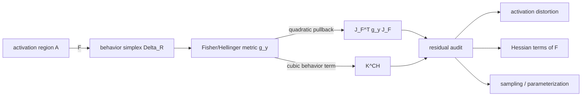
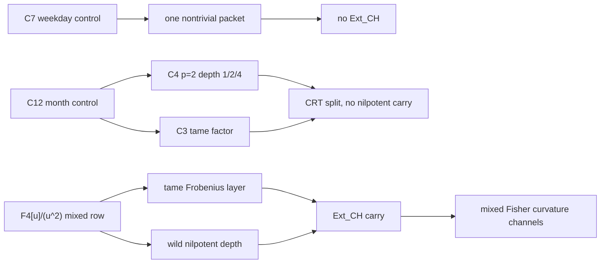
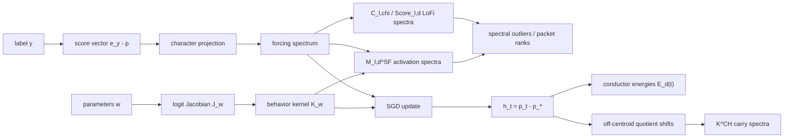

# Discrete Fisher Skeletons for AI Optimization

**Natural Gradient, Behavior Manifolds, and Quotient-Character Curvature**

**Leonardo Murillo Montero**

*May 14, 2026*

**Draft 0.3**

---

## Abstract

Modern AI optimization moves through smooth, continuous parameter spaces.  But
the behavior it produces is categorical: token probabilities, class
distributions, concept bins, and finite output summaries.  The usual
optimization story treats those probability spaces as smooth statistical
manifolds.  Natural gradient methods, Fisher preconditioning, variational
inference, Hellinger geometry, and representation-manifold probes all rely on
that local premise.

This paper argues that the smooth story is incomplete.  When output labels
carry a finite algebra \(R\), the Fisher geometry of behavior has a discrete
arithmetic skeleton.  At maximum entropy, that skeleton is hidden inside a
clean orthogonal decomposition of the Fisher tangent space.  As soon as the
model moves away from maximum entropy, the conductor packets begin to couple.
The coupling is not noise and not a coordinate artifact.  Its Taylor
coefficients are governed by a finite quotient-character adjacency algebra.

In ML language, natural gradient sees the quadratic Fisher metric.  This
paper studies the first structured correction it misses: the raised
Amari-Chentsov cubic

$$
K^{CH}=\Gamma^{(m)}-\Gamma^{(e)}
$$

for the categorical behavior simplex.  For a learned activation-to-behavior
map

$$
F:A\to \Delta_R^\circ,
$$

the pullback metric

$$
J_F^\top g_y J_F
$$

is only the quadratic term.  The next term separates into behavior-side
Fisher curvature, activation-side distortion, Hessian terms of \(F\), and
parameterization error.  The quotient-character algebra supplies a finite
indexing system for those corrections.

Equivalently, a learned behavior manifold inherits the first floors of the
log-partition cumulant tower.  The first cumulant is the behavior position
\(p\), with \(p_*\) as centroid; the second is the Fisher metric seen by
natural gradient; the third is the raised Amari-Chentsov source
\(K^{CH}\); and the fourth-and-higher cumulants appear operationally as
projection defects and controlled residuals.  This is the AI-facing form of
the later categorical-effective-action bridge, not a claim that the optimizer
is literally a physical system.

The same structure also gives a dynamical reading of ordinary training.
For cross-entropy learning, the logit gradient for a labeled example is
\(p-e_y\).  Near the maximum-entropy point this is the negative of the
centered score vector \(e_y-p_*\), up to the current displacement
\(h=p-p_*\).  Thus SGD repeatedly injects the same score-frame directions
whose character decomposition gives the conductor packets.  The neural
Jacobian and its induced tangent kernel decide which packets are easy to
move, while the off-centroid Fisher expansion of Papers 10 and 11 describes
how packets begin to couple as the behavior distribution becomes
informative.  In this sense SGD is the dynamical interface between the
continuous parameter system and the finite quotient-character skeleton of
behavior.

The weekday task of Wurgaft et al. is the minimal prime control.  Its output
algebra is \(C_7\), so the nontrivial behavior tangent space is one
six-dimensional conductor packet, with no mixed tame/wild extension.  At the
uniform point,

$$
K^{CH}_{p_*}(h)v=7h*v-7\langle h,v\rangle p_*.
$$

Thus any nonzero weekday displacement is already conductor-total: there is
only one nontrivial conductor packet, and its convolution envelope reaches all
nontrivial quotient characters by order \(6\).  Accidental coefficient zeros
can still occur at selected orders, but they are not conductor boundaries.

The real transformer measurement is now in hand on **two independent model
families** at the same layer index (causalab `weekdays` pipeline, layer 28,
last token): Llama-3.1-8B (the originally specified model) and
Mistral-7B-v0.3 (cross-family replication).  Both produce the same
qualitative signature, with Llama showing it more starkly.  The
moment-Euclidean linear summary correlation drops from \(r=0.886\) on the
symmetric proxy to \(r=0.615\) (Llama) and \(r=0.715\) (Mistral), while the
Hellinger, logit, and Fisher Levi-Civita correlations remain near or above
their proxy values on both models.  The empirical centroids are also
visibly asymmetric: every weekday leaks more probability to its cyclic
predecessor than to its cyclic successor, breaking the dihedral symmetry
the proxy assumed.  The prime \(C_7\) row therefore confirms the
cubic-diagnostic signature: linear (moment-space) flattening pays the
largest visible price, while Fisher/Hellinger-aware coordinates retain the
cyclic structure.  The cross-model replication argues against the
signature being a single-model or single-layer artifact.  The activation
pullback audit (Paper 12 §7.2.1) closes most of the residual question on
the weekday row: at layer 28, Llama's activation-distance vs Hellinger
correlation is \(r=0.937\) and the pullback metric coefficient of variation
is \(0.154\), so the activation embedding is nearly a rescaled isometry of
the behavior simplex.  The linear-vs-manifold gap measured on \(C_7\) is
therefore **not** attributable to activation distortion --- it is intrinsic
to the behavior simplex, and the behavior-side cubic \(K^{CH}\) carries it.

The month task is the next control.  Its output algebra
\(C_{12}\cong C_4\times C_3\) has a CRT conductor split and a \(2\)-primary
depth ladder before any local nilpotent carry appears.  The Llama-3.1-8B
measurement is also now in hand: the moment-Euclidean correlation
**collapses from \(r=0.696\) on the proxy to \(r=0.210\)** — a far sharper
drop than the prime \(C_7\) row — and the empirical CRT conductor energy
decomposition spreads the displacement weight across all five
\(C_{12}\) conductors (\(2,3,4,6,12\)) rather than concentrating it in
the single dihedral mode, with the mixed \(C_4\times C_3\) conductor 6
carrying \(19.2\%\) of the energy.  This is the first transformer-level
empirical evidence for the predicted CRT conductor split.

The training-loop extension is now implemented as a character-level calendar
transformer.  The cleanest rule is the Pareto point
`gradient projection 0%, update projection 100%`: leave the stochastic
gradient and Adam moments unprojected, but project the applied output-head
update into a declared closed conductor support.  On months, this update-only
rule enforces machine-precision leakage while improving held-out loss in the
default calendar split.  On the true offset-OOD split, the minimal mixed
support \(\{6,12\}\) is the best measured \(d=64\) support, improving both
test loss and accuracy over Adam while the full support collapses to Adam
because projection becomes the identity.

Paper 13 now supplies the representation-level spectral primitive that this
audit was missing: **Layerwise Simplectic Spectral Filtering**.  At each
internal representation, one pairs the Nambu-Fisher current of a chosen
macro-Hamiltonian tuple with the output residual, builds a current-weighted
activation covariance, and diagonalizes it packet by packet.  Its cubic
\(K^{CH}\) variant records which activation directions carry off-support
conductor leakage.  Thus the training-time audit can test not only whether
conductors appear in final behavior, but whether individual layers contain
spectral outliers for the simplectic current before the output state closes.

The positive mixed tests begin with the small local algebra
\({\mathbb F}_4[u]/(u^2)\).  There the quotient-character adjacency algebra
keeps finite tame/wild extension data that the associated graded loses.  The
corresponding class \(\operatorname{Ext}_{CH}\) is the proposed finite
diagnostic for when a coarse output macrovariable is closed at the centroid
but leaks Fisher-geometric information off the centroid.

The practical optimization thesis is modest but concrete: a model's
continuous behavior manifold may have a finite arithmetic control layer, and
that layer can be used to diagnose when a Fisher or natural-gradient
quadratic approximation is missing structured cubic curvature channels.

**Keywords:** AI optimization, stochastic gradient descent, natural gradient,
Fisher information, information geometry, behavior manifolds, neural
representation geometry, pullback metric, Amari-Chentsov tensor, categorical
simplex, quotient-character adjacency algebra, conductor filtration,
macrovariable closure.

---

## The Hidden Arithmetic of Behavior

The central claim is not merely that arithmetic language can be used to
describe an AI geometry after the fact.

> When a model makes categorical predictions on a structured output space, it
> is already moving through a finite arithmetic behavior geometry.  The
> arithmetic becomes visible precisely when the model leaves maximum entropy.

At the uniform distribution, conductor packets are Fisher-orthogonal and the
geometry looks cleanly quadratic.  This is the equilibrium picture.  Away from
uniformity, useful prediction begins, but so does curvature.  The same move
that makes the model informative also activates off-centroid coupling between
the finite character packets of the output algebra.

This turns the usual AI scaling intuition sideways.  Larger models and richer
concept spaces do not necessarily make behavior geometry more purely smooth.
At the output level, more structure can mean more finite arithmetic: more
packets, more conductor layers, more mixed support, and more ways for a
quadratic Fisher approximation to miss structured information.

The diagnostic question is therefore:

> When is a natural-gradient step locally faithful, and when is it flattening
> curvature that is already organized by the discrete output algebra?

The dynamical question is sharper:

> Why should a neural network trained by SGD find these arithmetic directions
> rather than merely display them after the fact?

The answer begins with the cross-entropy score frame, continues through the
neural tangent/pullback kernel, and then meets the first non-quadratic object,
\(K^{CH}\), together with the finite quotient-character algebra that indexes
its off-centroid channels.

## Reader's Guide

This is the AI-facing version of the Fisher-conductor program.

The intended reader knows words like natural gradient, Fisher information,
Hessian, pullback metric, logits, behavior manifold, and representation
geometry.  The paper introduces the arithmetic vocabulary only as needed:
additive characters are the Fourier modes of the finite output algebra;
conductors are frequency-depth packets; the quotient-character adjacency
algebra is the finite operator algebra controlling off-centroid Fisher
couplings; \(\operatorname{Ext}_{CH}\) is the first named obstruction to
closing a coarse output macrovariable under those couplings.

The paper has seven jobs.

1. Reframe Papers 10 and 11 as a hidden-arithmetic diagnostic for AI
   behavior geometry.
2. Explain how cross-entropy SGD injects centered score-frame directions and
   therefore has a quotient-character coordinate system at the behavior level.
3. State the natural-gradient-plus-cubic diagnostic in ML language.
4. Turn the Wurgaft weekday task into the prime \(C_7\) control experiment.
5. Insert the month \(C_{12}\) task as the CRT mixed-conductor control.
6. Explain why the mixed finite rows, especially
   \({\mathbb F}_4[u]/(u^2)\), are the real positive tests for structured
   activation-to-behavior curvature.
7. Add representation-level spectral diagnostics: Conductor-LoFi as the
   activation-side bridge to Neural LoFi, and Paper 13's Layerwise
   Simplectic Spectral Filtering as the current-weighted refinement with
   conductor and \(K^{CH}\) carry channels.

## Status of Claims

This draft separates proved mathematics, computed finite evidence, and open
empirical claims.

> **Current status, May 13, 2026.**  The weekday \(C_7\) row is now a real
> transformer measurement on **two independent model families**:
> Llama-3.1-8B (the originally specified model) and Mistral-7B-v0.3
> (cross-family replication), both at layer 28 last-token features via the
> causalab `weekdays` pipeline.  See
> `empirical/reports/weekdays_K_CH_real_llama31_8b.md` and
> `empirical/reports/weekdays_K_CH_real_mistral_7b.md` for the measured
> centroids and correlations.  The symmetric parametric proxy is retained as
> a calibration reference; the real measurement diverges from it in the
> same direction on both models (see §4).

> **Implementation update, May 14, 2026.**  The first \(K^{CH}\) local
> step-controller prototype has been implemented in
> `empirical/k_ch_step_controller.py`, with smoke tests in
> `empirical/_test_k_ch_step_controller.py`.  It wraps a proposed
> output-simplex step \(s\), computes \(K^{CH}_p(s)s\), reports the local
> cubic fraction, and damps the step when the cubic response exceeds a
> configured trust target.  The prototype has been run on the saved
> weekday and month Llama-3.1-8B centroid matrices in both
> uniform-to-centroid and adjacent-cycle modes.  With the conservative
> trust target `max_cubic_fraction = 0.10`, all tested real centroid
> steps damp and the controlled cubic fraction is capped at `0.098`.

> **Finite-atlas update, May 14, 2026.**  The next two local rows have now
> been run through the full finite constructor stack.  For
> \({\mathbb F}_2[u]/(u^5)\), the full-block coboundary diagnostic gives
> \(\dim C^1=13361\), \(\dim C^2=741741\),
> \(\operatorname{rank}B^2=13360\), residual quotient dimension \(728381\),
> and residual support \(19140\).  For the mixed stress row
> \({\mathbb F}_8[u]/(u^2)\), the \(25997440\)-coordinate full block was
> reduced over \(\mathbb F_{1000003}\); the rank reaches all \(245000\)
> \(C^1\)-generators, certifying the rational rank, and the modular residual
> support is the full \(158081\) raw atoms.  Both rows have published
> carry-pair and arity-\(3/4\) orbit tables in `empirical/reports/next_local_row_f2_u5.md`
> and `empirical/reports/next_local_row_f8_u2.md`.

**Established in Papers 1, 10, and 11.**

1. At the uniform categorical distribution, the centered simplex score frame
   is the Fisher score frame.
2. In the \(N=4\) tetrahedral row, the uniform raised cubic
   \(K^{CH}_{p_*}\) is the symmetric product generated by the Gram pairing
   and the projector squares \(I+K(\tau_i)^2\).
3. For a finite quotient algebra \(R\), additive characters decompose the
   Fisher tangent space into conductor packets.
4. Along an \(m\)-flat ray \(p(t)=p_*+th\), the off-centroid Fisher coupling
   between character lines has exact Taylor coefficients governed by
   character convolution.
5. The correct conductor-block compression is operator-valued; it lives in a
   quotient-character adjacency algebra rather than in scalar block traces.
6. The global adjacency algebra factors by CRT after including the trivial
   character, while the nontrivial Fisher tangent algebra is the augmentation
   corner.
7. The \({\mathbb F}_4[u]/(u^2)\) local row gives the first mixed tame/wild
   test where associated-graded conductor data is not enough.
8. The all-orders extension of T1.1.1 (Theorem 1.1.1\* of §1.1.2) lifts
   every Taylor order of the information-geometric parameter Fisher
   \(\mathcal F^F\) into the convolution-additive subalgebra
   \(\mathcal A_R^{\mathrm{conv}}\); the forcing tower is therefore
   binary-\(\operatorname{Ext}_{CH}\)-transparent (Cor 1.1.5).
9. The order-2 bilinear Hayes-Möbius operator \(C_2^{[\mathfrak f, \mathfrak e]}(h)\)
   has closed form across all three rows of the \(Q_f = 4\) atlas (Paper 10
   Proposition 7.4 / §7.4.1).  The nilpotent row uniquely realizes a
   within-block 2×2 swap of coefficient \(2BC\) that scalar trace cannot
   detect; it is convolution-additive, *not* an \(\operatorname{Ext}_{CH}\)
   signal.
10. GFWSVD's left singular vectors align with conductor packets
    (Theorem 1.1.6 of §9.1), with truncation preserving per-packet rank
    structure.  This identifies the "irreducible Fisher-information
    skeleton" of the GFWSVD literature with the conductor decomposition for
    finite-ring labeled outputs.

**Dynamical extension proposed in this draft.**

1. Cross-entropy SGD acts on the output simplex through centered categorical
   score vectors \(e_y-p\); near \(p_*\), these are the same score-frame
   directions whose additive-character decomposition gives the conductor
   packets.
2. The neural Jacobian induces a behavior-level tangent kernel.  If that
   kernel is approximately \(R\)-equivariant near the centroid, then the early
   SGD flow diagonalizes in additive-character coordinates, with packetwise
   learning rates.
3. As the model leaves the centroid, the same displacement \(h=p-p_*\) that
   records confidence growth also drives the Fisher coupling expansion of
   Papers 10 and 11.  Entropy descent is therefore not a separate mechanism;
   it is the scalar shadow of the off-centroid displacement that activates the
   quotient-character skeleton.
4. Mini-batch stochasticity has its own character/conductor covariance.  It
   should be measured as part of the dynamical audit rather than treated as
   unstructured noise.
5. Paper 13's Layerwise Simplectic Spectral Filtering turns the same data
   into representation-level eigensolvers: pair the Nambu-Fisher current with
   the output residual, build current-weighted activation covariances, and
   diagonalize them by conductor packet and \(K^{CH}\) carry channel.
6. Conductor-LoFi supplies the lighter activation-side companion: split
   Neural LoFi's label-weighted covariance into character operators
   \(C_{\ell,\chi}\), aggregate them by conductor packet, and use residual
   effective dimension to predict when packet-specific spectral outliers
   become learnable.

**Measured on real transformers (layer 28, last-token).**

1. The weekday \(C_7\) \(K^{CH}\) script is implemented and run against the
   empirical \(7\times 7\) output centroid matrices from both
   Llama-3.1-8B and Mistral-7B-v0.3.
2. Correlations with cyclic Hellinger arc (behavior-manifold reference):

   | Metric | Llama-3.1-8B | Mistral-7B-v0.3 | Symmetric proxy |
   |---|---|---|---|
   | Hellinger chord | \(0.899815\) | \(0.916873\) | \(0.910010\) |
   | Moment Euclidean chord | \(\mathbf{0.614547}\) | \(\mathbf{0.714715}\) | \(0.886448\) |
   | Natural/logit chord | \(0.944337\) | \(0.955300\) | \(0.941295\) |
   | Fisher Levi-Civita | \(0.903176\) | \(0.922202\) | \(0.911776\) |

3. The moment chord correlation is substantially **below** both the
   symmetric proxy (\(r=0.886448\)) and the Wurgaft linear reference
   (\(r\approx 0.89\)) on both models, while the Hellinger, logit, and
   Fisher channels remain near or above the proxy.  This is the signature
   predicted by the cubic diagnostic: linear (moment-space) flattening pays
   the largest visible price, while Fisher/Hellinger-aware coordinates
   retain the cyclic structure.  Llama shows the signature more strongly
   than Mistral.
4. Both centroid matrices exhibit **asymmetric off-diagonal leakage**:
   most weekdays leak more probability to their cyclic predecessor than to
   their successor (Llama Monday→Sunday \(0.271\) vs Monday→Tuesday
   \(0.056\); Mistral Monday→Sunday \(0.254\) vs Monday→Tuesday \(0.043\)).
   The pre-registered \(10^7\)-token C4 bigram control lands in the
   intermediate band: corpus bigrams partially align with the transposed
   magnitude pattern, but sign agreement remains far below the
   "fully explain" threshold.  We therefore treat the asymmetry as
   consistent with both a learned sequence prior and residual off-centroid
   cyclic structure, not as standalone arithmetic evidence.
5. The month \(C_{12}\) cyclic script has been run on Llama-3.1-8B at
   layer 28 last-token features.  The moment-Euclidean chord correlation
   collapses from the proxy value \(r=0.696128\) to
   \(r=0.210147\) — a much sharper drop than the \(C_7\) weekday row, as
   predicted when the output algebra acquires multiple conductors.
6. The CRT conductor energy decomposition of the empirical \(h_i\) places
   only \(0.380\) of the displacement energy in conductor 12 (full
   cyclic), with \(0.192\) in the mixed conductor 6 (\(C_4\times C_3\)),
   and the rest spread across conductors 2, 3, 4.  This is the first
   transformer measurement of the predicted CRT conductor split.
7. The activation pullback audit (§7.2) has been run on Llama-3.1-8B for
   both rows using the saved \(4096\)-dim residual-stream activations at
   layer 28.  On weekdays, the activation-vs-Hellinger correlation is
   \(r=0.937\) and the pullback metric coefficient of variation is
   \(0.154\); the embedding is therefore nearly a rescaled isometry of the
   behavior simplex, and the linear-vs-manifold gap measured in §4 is
   attributable primarily to the behavior-side \(K^{CH}\) cubic, not to
   activation distortion.  On months, activation-vs-Hellinger remains high
   (\(r=0.821\)) but activation-vs-cyclic-arc drops to \(r=0.652\) — the
   activation embedding has CRT-structured geometry consistent with
   \(C_4\times C_3\), which is what makes both the pure-cyclic-arc
   reference and a moment linear summary underperform on months.

**Implemented optimizer and training-loop diagnostics.**

1. The first local step-controller is implemented as
   `empirical/k_ch_step_controller.py`.  Its operational diagnostic is
   \[
   \rho_{\mathrm{frac}}(p,s)
   =
   {1\over2}
   {\|K^{CH}_p(s)s\|_{g_p}\over \|s\|_{g_p}},
   \]
   together with the scale-invariant directional ratio
   \[
   {\|K^{CH}_p(s)s\|_{g_p}\over \|s\|_{g_p}^2}.
   \]
   The default action is damping, not a claimed full optimizer:
   \(s\mapsto \alpha s\), where \(\alpha\) is chosen so that the
   controlled cubic fraction lies below the trust target and the step
   remains inside the simplex.
2. The smoke test verifies the raising identity
   \(g_p(K^{CH}_p(u)v,w)=T_p(u,v,w)\), the linear scaling of the cubic
   fraction under \(s\mapsto \alpha s\), the positivity guard near the
   simplex boundary, and the normalization of cyclic conductor packet
   energies.
3. On Llama-3.1-8B weekday centroids, the uniform-to-centroid run has
   raw cubic fractions from \(1.266\) to \(2.195\), with all seven
   steps damped to controlled cubic fraction \(0.098\).  The adjacent
   weekday run is more nonlinear, with raw cubic fractions up to
   \(10.298\).
4. On Llama-3.1-8B month centroids, the uniform-to-centroid run has raw
   cubic fractions from \(3.094\) to \(4.735\), and the adjacent-cycle
   run reaches \(56.427\).  The controller's conductor audit reproduces
   the CRT split: in the uniform month run, mean step-energy fractions
   are approximately \(0.380\) in conductor 12, \(0.192\) in conductor 6,
   \(0.173\) in conductor 4, \(0.169\) in conductor 3, and \(0.086\) in
   conductor 2.
5. The generated reports are
   `empirical/reports/weekdays_k_ch_step_controller_llama31_8b_uniform.md`,
   `empirical/reports/weekdays_k_ch_step_controller_llama31_8b_adjacent.md`,
   `empirical/reports/months_k_ch_step_controller_llama31_8b_uniform.md`,
   and
   `empirical/reports/months_k_ch_step_controller_llama31_8b_adjacent.md`.
6. The calendar transformer harness is implemented as
   `empirical/conductor_calendar_transformer.py`.  The first Pareto-rule
   integration leaves gradients and Adam moments unprojected while projecting
   only the applied output-head update.  On the default months split, the
   width-32 run improves test loss from \(6.1250\) to \(4.0514\) and drives
   final logit leakage below \(10^{-30}\); the width-64 repeat improves test
   loss from \(9.0838\) to \(5.7104\) with the same leakage behavior.
7. On the true offset-OOD split (train offsets \(1,\ldots,6\), test offsets
   \(7,\ldots,12\)), the width-64 front selects the minimal mixed support
   \(\{6,12\}\): test loss \(8.5701\), gen gap \(8.3461\), test accuracy
   \(0.0648\), and machine-precision leakage.  Full support is the identity
   projection and reproduces Adam.

**Still open empirically.**

1. Run the months pipeline on a second model family (e.g. Mistral-7B) to
   replicate the CRT energy decomposition cross-model.
2. Run a training-time checkpoint audit to measure conductor-energy growth,
   gradient forcing spectra, and mini-batch noise covariance during SGD or
   Adam training.
3. Fit or estimate the Hessian terms of \(F\).
4. Sweep layer index on Llama and Mistral to test whether layer 28 is
   optimal for both, or whether the signature strength is layer-dependent.
5. Repeat the protocol on an output task whose label algebra has at least
   two local layers, so that mixed support can be tested against the
   \({\mathbb F}_4[u]/(u^2)\) and higher local rows.
6. Scale the calendar transformer result beyond the small character-level
   harness: more seeds, larger models, second task families, and direct
   comparisons with natural-gradient or Fisher-preconditioned optimizers.

## 1. The Optimization Question

A trained model turns internal states into output distributions.  On a local
concept region, write this as

$$
F:A\to \Delta_R^\circ,
$$

where \(A\) is an activation or representation manifold and
\(\Delta_R^\circ\) is the open categorical simplex on a finite output set
\(R\).  If the model assigns probabilities \(p_y\) to labels \(y\in R\), the
standard behavior-side information geometry is the Fisher metric

$$
g_p(u,v)=\sum_{y\in R}{u_yv_y\over p_y}.
$$

Natural gradient methods use this quadratic geometry to replace Euclidean
steps by statistically meaningful steps.  Equivalently, they precondition by
the Fisher information matrix rather than by a coordinate-dependent Euclidean
metric.

The dream of linear optimality is that a local coordinate system makes the
task flat enough for straight lines, quadratic losses, and scalar summaries
to be faithful.  Probability space does not generally grant that dream.  A
categorical simplex has a Fisher-Rao curvature, and the first place where
linear flattening pays a visible price is cubic order.

That quadratic object is necessary, but it is not the whole local geometry.
The loss of linearity begins at cubic order.  In information geometry, the
first cubic object is the Amari-Chentsov tensor

$$
T_p(u,v,w)=\sum_y {u_yv_yw_y\over p_y^2}.
$$

Raising one index by the Fisher metric gives the operator

$$
g_p(K^{CH}_p(u)v,w)=T_p(u,v,w),
$$

or, in moment coordinates on the categorical simplex,

$$
K^{CH}_p(u)v={uv\over p}-g_p(u,v)p.
$$

At the tetrahedral uniform point this coordinate expression has already been
stripped down to the intrinsic simplicial algebra.  Let
\(p_*=\frac14{\bf 1}\), \(H=T_{p_*}\Delta_4^\circ\), \(M=4I-J\), and
\(\tau_i=e_i-\frac14{\bf 1}\).  Then \(g_{p_*}(u,v)=\langle u,v\rangle_M\),
and the centered vertex directions \(\tau_i\) are \(G\)-unit axes for the
cross-product operator \(K(\tau_i)\) of `simplicial_vector_calculus.md`.
With
$$
P_i:=I+K(\tau_i)^2,
$$
the Paper 1 projector identity gives
$$
K^{CH}_{p_*}(u)v
=
\frac34\sum_{i=1}^4
\langle\tau_i,u\rangle_M P_i v.
$$
Equivalently,
$$
K^{CH}_{p_*}(u)v
=
\frac14\sum_{i=1}^4
\langle\tau_i,u\rangle_M\langle\tau_i,v\rangle_M\tau_i.
$$
In coordinates this is
\(4(u\odot v)-(\sum_i u_iv_i){\bf 1}\), but the displayed operator uses only the
Gram pairing and the symmetric projector squares \(I+K(\tau_i)^2\).  This is
the \(N=4\) calibration row: the antisymmetric cross-product algebra generates
the symmetric Amari-Chentsov cubic through its square/projector component.

Off the centroid, the exact deformation is controlled by the moving score
frame.  For any categorical point \(p\), define
\(\sigma_y(p)=e_y-p\).  Then
$$
K^{CH}_p(u)v
=
\sum_y p_y\,g_p(\sigma_y(p),u)\,g_p(\sigma_y(p),v)\,\sigma_y(p).
$$
If \(\Pi_y^p\) denotes the Fisher-orthogonal projector onto
\(\mathbb R\sigma_y(p)\), this becomes
$$
K^{CH}_p(u)v
=
\sum_y(1-p_y)\,g_p(\sigma_y(p),u)\,\Pi_y^p v.
$$
Thus the path \(p(t)=p_*+th\) does not merely change a scalar coefficient.
It moves the score axes, changes the Fisher metric, and changes the
projector weights.  In the tetrahedral \(N=4\) row,
\(\Pi_y^p=I+K_p(\widehat\sigma_y(p))^2\), where \(K_p\) is the
Fisher-Hodge cross-product operator at \(p\).  This is the precise
off-centroid version of the projector-square theorem.

Explicitly, for \(p\in\Delta_4^\circ\), write \(r_i=\sqrt{p_i}\).  With
\(\varepsilon_{1234}=+1\), the matrix entries are
$$
\bigl(K_p(u)\bigr)_{i\ell}
=
-\sum_{j,k=1}^4
\varepsilon_{ijk\ell}\frac{r_i r_j}{r_k r_\ell}u_k.
$$
For a \(g_p\)-unit axis \(u\), the local Fisher-Rodrigues tangent step is
$$
R_p(u,\theta)
=
I_H+\sin\theta\,K_p(u)+(1-\cos\theta)K_p(u)^2.
$$
At \(p_*=\frac14{\bf1}\), this reduces to the raw cyclic-difference matrix
\(\widetilde K(u)\), the \(M\)-normalized version of the original
simplicial cross product.

This is the first correction after the quadratic Fisher metric.  If the
Fisher metric is the local object that natural gradient sees, \(K^{CH}\) is
the first local object it does not see unless the optimizer is explicitly
cubic-aware.

**The conductor-misspecification certificate (C2, SETTLED;
Paper 32 §12 INSERT 16 cross-ref; scope widened beyond active
inference to all second-order preconditioning on ring-structured
categorical heads).**  The "\(K^{CH}\) is the first local object
natural gradient does not see" claim above is now a **deterministic
finite certificate**, reproducible artifact archived
(`insert16_conductor_misspecification_certificate.py`,
`insert16_c2_certificate_run_output.txt`). On every ring tested
\(\mathbb Z/\{6,12,30,8,18\}\), in exact integer arithmetic with no
fitted model:
**(Q)** at maximum entropy the quadratic Fisher form
\(g_{p_*}(u,v)=\sum_y u_yv_y/p_y\) is **packet-block-diagonal** in
the additive-character basis (every cross-packet off-diagonal is
*exactly zero* by finite character orthogonality; decision is
\((k-\ell)\bmod n\), integer arithmetic) — a preconditioner built
from \(g\) alone (**natural gradient, K-FAC, Gauss–Newton, Adam
diagonal empirical Fisher, NTK Gram**) carries no inter-packet
coupling;
**(C)** the Amari–Chentsov cubic
\(T_{p_*}(u,v,w)=\sum_y u_yv_yw_y/p_y^2\) has **nonzero cross-packet
coupling** by the selection rule \(k+\ell+m\equiv 0\pmod n\) (18 on
\(\mathbb Z/6\), 108 on \(\mathbb Z/12\), 774 on \(\mathbb Z/30\),
42 on \(\mathbb Z/8\), 252 on \(\mathbb Z/18\)).
**(Q) ∧ (C) is the certificate:** structured information — the
cross-packet cubic coupling — is provably *present* in the geometry
and provably *invisible* to any purely second-order preconditioner
on a ring-structured categorical head. The misspecification is
**exact and finite**, not suggestive. **Scope: the full class of
second-order preconditioners on ring-structured categorical /
softmax heads** (LLM token distributions, classifiers, any
categorical variable whose labels carry \(\mathbb Z/n\) arithmetic
— clock states, calendar tokens, modular counters); discrete-state
active inference (Friston, Appendix F) is one instance, *not* the
whole scope. **Strict firewall (do-not-cut):** the certificate is
**misspecification-only**; it does *not* claim that real SGD/Adam
trajectories *are* governed by conductor geometry — that empirical
layer (the C12 Llama-3.1-8B \(\{2,3,4,6,12\}\) hook) remains
**suggestive, tier unchanged**, fenced off exactly as
beyond_smooth §1 fenced it. **Coherence note ([A], the four-thread
\(\mathbb Z/6\) cubic-vacuity root):** on \(\mathbb Z/6\), pure-\(A_2\)
self-coupling is absent (\(3+3+3=9\not\equiv 0\)) — the *same*
arithmetic fact that closed Y′ negative, color-protects the single
external chirality bit (Paper 16), and structures the FEP-3
sector-resolution (INSERT 15). Four independent threads — a
constants audit, a Standard-Model chirality result, an outbound
contribution to a free-energy fork, a deep-learning misspecification
certificate — on **one line of finite arithmetic**.

This makes curvature an information signal rather than a nuisance term.  If a
linear summary erases the first within-block invariant, the lost term is not
merely aesthetic geometry.  It is structured behavior information that the
quadratic approximation has flattened.

For a learned map \(F\), the quadratic pullback is

$$
G_F=J_F^\top g_y J_F.
$$

A cubic-aware diagnostic asks for the next piece:

1. the intrinsic behavior-side cubic \(K^{CH}\) on \(\Delta_R^\circ\);
2. the activation-side distortion in \(J_F^\top g_yJ_F\);
3. the covariant Hessian terms of \(F\);
4. residual parameterization error from sampling, spline choice, or output
   directions outside the chosen quotient packet.

This is also the point where the light physics bridge becomes useful.  The
activation-to-behavior map pulls back the categorical cumulant tower: \(F(a)\)
is the learned position, \(J_F^\top g_yJ_F\) is the learned metric/inertia,
the pulled-back \(K^{CH}\) term is the first force/source correction, and the
remaining higher cumulants are measured as projection defects or controlled
residuals.  For this AI paper the tower is bookkeeping for diagnostics, not a
replacement for the behavior-manifold calculation.

This is the ML problem that Papers 10 and 11 set up:

> Given a finite output algebra, can we predict which nonlinear Fisher
> curvature channels should appear before measuring the full neural network?

### 1.1 The Learning Dynamics: SGD as Quotient-Character Flow

The preceding question is geometric.  It asks what the trained behavior
manifold looks like and when a Fisher-quadratic approximation misses cubic
structure.  The reviewer-level objection is dynamical:

> Why should a neural network trained by SGD discover the arithmetic skeleton
> in the first place?

The answer should not be stated as a mystery principle.  There is a concrete
interface.  SGD sees the categorical simplex through the score vectors of the
cross-entropy loss, and those score vectors are exactly the centered simplex
frame that Paper 10 identifies with the Fisher score frame at maximum
entropy.

Let \(w\) be the network parameters, let \(z\) be an input, let
\(\ell_w(z)\in{\mathbb R}^R/{\mathbb R}{\bf 1}\) be the output logits, and let

$$
p_w(z)=\operatorname{softmax}\ell_w(z)\in\Delta_R^\circ.
$$

For a hard label \(y\in R\), the cross-entropy loss is

$$
L_z(w)=-\log p_w(z)_y.
$$

Its logit gradient is

$$
\nabla_{\ell}L_z=p_w(z)-e_y.
$$

Write \(p_*=Q^{-1}{\bf 1}\), \(h_w(z)=p_w(z)-p_*\), and

$$
\tau_y=e_y-p_*.
$$

Then

$$
p_w(z)-e_y=h_w(z)-\tau_y.
$$

Thus the negative logit-gradient direction is

$$
e_y-p_w(z)=\tau_y-h_w(z).
$$

Near the centroid, \(h_w(z)\) is small, so each supervised example injects the
centered score direction \(\tau_y\).  In additive-character coordinates, for
every nontrivial character \(\chi\),

$$
\widehat{\tau_y}(\chi)=\overline{\chi(y)}
$$

up to the chosen Fourier convention.  A labeled example is therefore not an
arbitrary impulse in output space.  It is a full character-phase packet whose
phase is determined by the label \(y\).  Mini-batches average these packets.
If \({\mathcal B}\) is a batch, the instantaneous behavior-side forcing is

$$
b_{\mathcal B}(w)
=
{1\over |{\mathcal B}|}\sum_{(z,y)\in{\mathcal B}}(\tau_y-h_w(z)),
$$

with character coefficients

$$
\widehat b_{\mathcal B}(\chi)
=
{1\over |{\mathcal B}|}\sum_{(z,y)\in{\mathcal B}}
\left(\overline{\chi(y)}-\widehat h_w(z)(\chi)\right).
$$

This is the first place where the quotient-character algebra enters training
without being imposed by the analyst: the supervised gradient already has
finite Fourier coordinates on the label algebra.

The parameters decide how that output-side force moves the model.  Let

$$
J_w(z)=D_w\ell_w(z)
$$

be the logit Jacobian, and let

$$
S_p=\operatorname{diag}(p)-pp^\top
$$

be the softmax Jacobian.  A one-sample SGD step gives

$$
\delta w
=
-\eta J_w(z)^\top(p_w(z)-e_y).
$$

The first-order change of the output distribution at another probe input
\(z'\) is

$$
\delta p_w(z')
=
-\eta S_{p_w(z')}J_w(z')J_w(z)^\top(p_w(z)-e_y)
+O(\eta^2).
$$

Equivalently,

$$
\delta p_w(z')
=
\eta S_{p_w(z')}J_w(z')J_w(z)^\top(\tau_y-h_w(z))
+O(\eta^2).
$$

The middle factor

$$
\Theta_w(z',z)=J_w(z')J_w(z)^\top
$$

is the logit neural tangent kernel restricted to the output coordinates.  The
behavior-level kernel is

$$
{\mathcal K}_w(z',z)
=
S_{p_w(z')}\Theta_w(z',z).
$$

At the centroid, \(S_{p_*}=Q^{-1}P_H\), where \(P_H\) is the projection onto
the zero-sum tangent space.  The kernel therefore acts on the same
\(H_R\) used by the Fisher-conductor theorem.  Ordinary SGD is a
quotient-character forced flow distorted by the learned parameter kernel.

This gives the clean early-time idealization.  Suppose the task and the
initial model make the averaged behavior kernel approximately equivariant for
the additive \(R\)-action.  Then Schur's lemma diagonalizes the centroid
linearization in additive-character coordinates:

$$
{\mathcal K}_*e_\chi=\lambda_\chi e_\chi.
$$

If the kernel is also conductor/Galois invariant, \(\lambda_\chi\) is constant
on conductor packets.  For a target behavior \(\mu\) on the same output
algebra, the linearized continuous-time flow has the packet law

$$
{d\over dt}\widehat h_t(\chi)
=
\lambda_\chi\left(\widehat \mu(\chi)-\widehat h_t(\chi)\right).
$$

Thus early learning is not expected to discover an arbitrary basis.  In the
ideal equivariant limit it discovers the character basis because that is the
simultaneous eigenbasis of the output score frame and the behavior kernel.
The conductor packets supply the block learning rates.  In a prime cyclic row
such as \(C_7\), all nontrivial characters live in one packet; in a CRT row
such as \(C_{12}\), different conductors can grow at different rates.

The real network will not satisfy this ideal exactly.  Its kernel may break
the label algebra, the data distribution may be biased, and the representation
may already contain non-arithmetic features.  That does not kill the program;
it gives the audit.  In character coordinates the actual flow has the form

$$
{d\over dt}\widehat h_t(\psi)
=
\sum_\chi
\Lambda_{\psi,\chi}(w_t,h_t)
\left(\widehat\mu(\chi)-\widehat h_t(\chi)\right)
+
\xi_t(\psi),
$$

where \(\Lambda_{\psi,\chi}\) is the learned behavior-kernel matrix and
\(\xi_t\) is mini-batch noise.  The quotient

$$
\eta=\psi\chi^{-1}
$$

is the finite frequency shift from input character line \(\chi\) to output
line \(\psi\).  If off-diagonal mass in \(\Lambda\) concentrates on the
quotient-character support predicted by Papers 10 and 11, the training
dynamics is respecting the behavior-side arithmetic.  If the mass lands
elsewhere, it is activation/pullback distortion or data/kernel symmetry
breaking.  This is the dynamical version of the residual decomposition in
Section 1.

The entropy language should also be made precise.  SGD does not literally make
predictive entropy decrease monotonically on every batch.  The invariant
quantity for this program is displacement from the centroid:

$$
D(p\Vert p_*)=\log Q-H(p).
$$

For \(p=p_*+h\),

$$
D(p\Vert p_*)
=
{Q\over 2}\sum_a h_a^2
-{Q^2\over 6}\sum_a h_a^3
+{Q^3\over 12}\sum_a h_a^4
+\cdots .
$$

The same powers \(h^n\) that record departure from maximum entropy are the
powers whose Fourier transforms produce the off-centroid Fisher couplings:

$$
\widehat{h^n}
\quad\leftrightarrow\quad
\widehat h^{*n}.
$$

So entropy descent is not an independent physical principle added on top of
the quotient-character theory.  It is the scalar shadow of the model leaving
the centroid.  As \(h\) grows, the conductor packets stop being orthogonal,
and the quotient-character adjacency algebra records which off-centroid
channels are activated.

Mini-batch stochasticity has the same structure.  Define the batch fluctuation

$$
\zeta_{\mathcal B}(\chi)
=
\widehat b_{\mathcal B}(\chi)
-{\mathbb E}\widehat b_{\mathcal B}(\chi).
$$

The covariance

$$
\Sigma_{\chi,\psi}
=
{\mathbb E}\left[
\zeta_{\mathcal B}(\chi)\overline{\zeta_{\mathcal B}(\psi)}
\right]
$$

is a conductor-resolved noise tensor.  For uniform labels and an equivariant
sampler it is diagonal in the character basis.  For biased prompts,
curriculum effects, or nonuniform class frequencies, it can inject particular
conductors more strongly than others.  The stochastic part of SGD is therefore
not merely a nuisance term; it is another measurable channel through which the
label algebra enters training.

This suggests a concrete training-time audit:

1. Save checkpoints throughout training or fine-tuning, including random or
   high-entropy early checkpoints.
2. At each checkpoint, compute class-conditioned output centroids
   \(p_t^{(a)}\) and displacements \(h_t^{(a)}=p_t^{(a)}-p_*\).
3. Project \(h_t^{(a)}\) into additive characters and record conductor energy

   $$
   E_{\mathfrak d}(t)
   =
   \sum_{\chi\in X_{\mathfrak d}}
   \left|\widehat h_t^{(a)}(\chi)\right|^2,
   $$

   averaged over classes \(a\).
4. Project per-batch logit gradients \(e_y-p_w(z)\) into the same character
   basis to measure the forcing spectrum.
5. Estimate behavior-kernel block leakage by applying Jacobian-vector products
   in character directions and measuring the output character response.
6. Estimate the mini-batch noise covariance \(\Sigma_{\chi,\psi}\) in conductor
   blocks.
7. Compare SGD, full-batch gradient descent, Adam, and natural-gradient or
   K-FAC approximations on the same label algebra.

The predicted signatures are simple.  On \(C_7\), there is only one
nontrivial conductor packet, so the audit should see character-phase structure
but no staged conductor split.  On \(C_{12}\), conductor energies should grow
in a CRT-resolved pattern, and off-packet leakage should be organized by the
quotient-character shifts.  On a mixed local task such as
\({\mathbb F}_4[u]/(u^2)\), the residual after prime and CRT controls should
concentrate on the tame/wild support channels measured by the
\(\operatorname{Ext}_{CH}\) atlas.

This is the sense in which Paper 12 becomes dynamical.  Papers 10 and 11 give
the finite behavior-side coordinates.  SGD supplies the repeated score-frame
forcing.  The neural tangent/pullback kernel supplies the continuous
parameter-mediated transport.  Training discovers the arithmetic skeleton only
when those three pieces line up: structured labels, character-visible score
forcing, and a learned kernel whose dominant motion respects the finite output
algebra.

#### 1.1.1 The forcing-spectrum theorem

The audit of §1.1 was, until this draft, a design sketch: it described what
one *should* see if conductor packets organize the SGD forcing spectrum, but
the dynamical-emergence claim itself rested on the "if equivariant" idealization
of the kernel \({\mathcal K}_*\).  This subsection upgrades the idealization to
a theorem.  The output-side population covariance, the parameter-side gradient
covariance, and the mini-batch noise covariance are all conductor-block
structured at the centroid as a consequence of Hayes-normalizer invariance of
the data distribution alone — no kernel hypothesis is needed.  The off-centroid
extension is governed by the binary Hayes-Möbius operators of Paper 11.
Consequently, the conductor packets and the \(\operatorname{Ext}_{CH}\)
channels appear in the SGD forcing spectrum at every step where the model
output is near \(p_*\), not only as an asymptotic property of the trained
fixed point.

**Setup 1.1.1A.**  Throughout this subsection,
\(p_w:{\mathcal X}\to\Delta_R^\circ\) is a smooth softmax model with
parameters \(w\in{\mathbb R}^P\), trained by per-sample cross-entropy
\(L_z(w)=-\log p_w(z)_y\) with hard label \(y\sim{\mathcal D}(\cdot|z)\) and
input \(z\sim{\mathcal D}_{\mathcal X}\).  Write
\(g_w(z,y)=p_w(z)-e_y\in H_R\) for the centered logit gradient,
\(J_w(z)=D_w\ell_w(z)\) for the logit Jacobian, and
\({\mathcal F}(w)={\mathbb E}_{(z,y)}[\nabla_wL_z\cdot\nabla_wL_z^\top]\) for
the population gradient covariance.  Let
\(P_{\mathfrak d}:H_R\to X_{\mathfrak d}\) be the conductor projector of
Paper 11 §1, and \(\Gamma_R\) the Hayes-Frobenius normalizer.  We say the
data distribution is *Hayes-equivariant at \(z\)* if for every
\(\gamma\in\Gamma_R\),

$$
{\mathcal D}(\gamma\cdot y\mid z)={\mathcal D}(y\mid z),
$$

equivalently if \(\mu(z):={\mathbb E}_y[e_y\mid z]\) commutes with the
permutation representation of \(\Gamma_R\) on \({\mathbb R}^R\).  This
includes the uniform conditional distribution \(\mu(z)=p_*\) as the
maximally symmetric case and is automatically satisfied (after Galois
averaging) by tasks whose label set has a free \(\Gamma_R\)-action.

**Theorem 1.1.1 (Forcing-spectrum conductor decomposition).**
*Under Setup 1.1.1A, fix a parameter \(w_*\) at which \(p_{w_*}(z)=p_*\)
for almost all \(z\in{\mathcal X}\) (e.g., a freshly initialized network
with output bias zero and hidden weights at small init).  Let*

$$
T_{\mathcal D}(z):={\mathbb E}_y[(p_*-e_y)(p_*-e_y)^\top\mid z]
=\operatorname{diag}(\mu(z))-\mu(z)p_*^\top-p_*\mu(z)^\top+p_*p_*^\top
$$

*be the output-side population covariance at \(z\).*

1.  *(Output-side covariance through \({\mathcal A}_R\).)  In the additive
    character basis \(\{e_{\chi_k}\}_{k\in\widehat R\setminus\{0\}}\),
    the matrix elements of \(T_{\mathcal D}(z)\) are*

$$
\widehat{T_{\mathcal D}}(z)_{\chi_k,\chi_{k'}}
=\frac{1}{Q}\,\widehat{\mu(z)}(k-k'),
$$

   *where \(\widehat{\mu(z)}(\eta)=\sum_{j\in R}\mu(z)_j\chi_\eta(j)\) is
   the Fourier transform of the conditional label distribution.  In
   particular:*

   *  *Uniform marginals: when \(\mu(z)=p_*\), \(\widehat{\mu(z)}(\eta)=0\)
      for every nontrivial \(\eta\), so \(\widehat{T_{\mathcal D}}\) is
      exactly diagonal in the character basis and conductor-block-diagonal
      a fortiori: \(\widehat{T_{\mathcal D}}_{\chi_k,\chi_{k'}}=Q^{-1}\delta_{k,k'}\).*
   *  *Biased Hayes-equivariant marginals: \(\widehat\mu\) is supported
      on the Hayes-orbits of \(\eta\) inside \(\widehat R\), so
      \(\widehat{T_{\mathcal D}}\) is a Hayes-orbit-constant matrix in the
      character basis, with off-conductor entries given exactly by the
      binary Hayes-Möbius operators of Paper 11 §1: writing
      \(h_\mu(z)=\mu(z)-p_*\), the cross-conductor entry at the pair
      \((\mathfrak f,\mathfrak e)\) of conductors is the
      \((\chi_k,\chi_{k'})\)-component of*

$$
\widehat{T_{\mathcal D}}^{[\mathfrak f,\mathfrak e]}(z)
=\frac{1}{Q}C_1^{[\mathfrak f,\mathfrak e]}(h_\mu(z))\cdot P_{\mathfrak e},
$$

      *where \(C_1^{[\mathfrak f,\mathfrak e]}\) is the binary Hayes-Möbius
      operator and \(P_{\mathfrak e}\) is the conductor projector onto packet
      \(X_{\mathfrak e}\).*

   *  *Local prime rows (\(R=C_p\) with \(p\) prime, or
      \(R=({\mathbb F}_q,+)\)): the conductor lattice has a single
      nontrivial packet, so the cross-conductor statement is vacuous and
      \(\widehat{T_{\mathcal D}}(z)\) is automatically block-diagonal by
      conductor.*

2.  *(Parameter-side covariance factorization.)  The population gradient
    covariance at \(w_*\) factors as*

$$
{\mathcal F}(w_*)
=
{\mathbb E}_z\bigl[J_{w_*}(z)^\top T_{\mathcal D}(z)J_{w_*}(z)\bigr],
$$

   *and consequently in the parameter directions
   \(\{J_{w_*}(z)^\top e_{\chi_k}\}_{k\in\widehat R\setminus\{0\}}\),
   \({\mathcal F}(w_*)\) inherits the conductor algebra structure of
   item (1): conductor-block-diagonal when \(\bar\mu:={\mathbb E}_z[\mu(z)]=p_*\),
   and otherwise with off-conductor entries given by the
   \({\mathcal A}_R\)-action on \(h_{\bar\mu}=\bar\mu-p_*\).*

3.  *(NTK conductor decomposition.)  The behavior-level NTK at the centroid
    decomposes as*

$$
{\mathcal K}_*(z',z)=S_{p_*}J_{w_*}(z')J_{w_*}(z)^\top
=
\sum_{\mathfrak d}{\mathcal K}_*^{(\mathfrak d)}(z',z)
+
\sum_{\mathfrak f\ne\mathfrak e}{\mathcal K}_*^{[\mathfrak f,\mathfrak e]}(z',z),
$$

   *where the diagonal summands map each conductor packet
   \(X_{\mathfrak d}\) to itself and the off-diagonal summands carry the
   pair \((\mathfrak f,\mathfrak e)\) of conductors.  Under any joint
   symmetry of \(\mathcal D\) and the architecture that makes
   \({\mathbb E}_zJ_{w_*}(z)\) commute with the conductor projectors
   (architectural Hayes-equivariance of \(J\)), the off-diagonal sum
   vanishes and the decomposition is the Schur orthogonal kernel sum
   \({\mathcal K}_*^{(\mathfrak d)}{\mathcal K}_*^{(\mathfrak d')}=0\)
   for \(\mathfrak d\ne\mathfrak d'\).*

4.  *(Mini-batch noise covariance.)  The batch fluctuation tensor of §1.1,*

$$
\Sigma_{\chi,\psi}={\mathbb E}\bigl[\zeta_{\mathcal B}(\chi)\overline{\zeta_{\mathcal B}(\psi)}\bigr],
$$

   *evaluated at \(w_*\) is exactly \(Q^{-1}\widehat\mu(\chi\psi^{-1})/|{\mathcal B}|\)
   minus the marginal-mean correction, by item (1) and the batch-mean
   variance formula.  Consequently:*

   *  *Under uniform marginal labels (\(\bar\mu=p_*\)),
      \(\Sigma\) is exactly conductor-block-diagonal — in fact
      character-diagonal — at \(w_*\), with packet-wise variance \(|{\mathcal B}|^{-1}Q^{-1}\).*
   *  *Under biased Hayes-equivariant marginals, \(\Sigma\) is
      Hayes-orbit-constant and its conductor block structure is given by
      the Hayes-Möbius operator \(C_1^{[\mathfrak f,\mathfrak e]}(h_{\bar\mu})\)
      of Paper 11, exactly as for \(T_{\mathcal D}\).*

5.  *(Off-centroid leading correction.)  For \(w\) in a neighborhood of
    \(w_*\) with \(p_w(z)=p_*+h_w(z)\) and \(\|h_w\|_\infty\) small,*

$$
{\mathcal F}(w)-{\mathcal F}(w_*)
=
\sum_{\mathfrak f,\mathfrak e}
{\mathbb E}_z\bigl[J_w(z)^\top C_1^{[\mathfrak f,\mathfrak e]}(h_w(z))T_{\mathcal D}^{[\mathfrak e]}(z)J_w(z)\bigr]
+
O(\|h_w\|_\infty^2),
$$

   *where \(C_1^{[\mathfrak f,\mathfrak e]}\) are the binary Hayes-Möbius
   operators of Paper 11 §1 and \(T_{\mathcal D}^{[\mathfrak e]}=P_{\mathfrak e}T_{\mathcal D}P_{\mathfrak e}\)
   is the diagonal-packet restriction.  The first off-centroid correction
   to the forcing spectrum therefore enters the conductor lattice through
   the same finite operator algebra \({\mathcal A}_R\) that organizes the
   Fisher tangent jets.*

**Proof.**

*(1) Output-side covariance through \({\mathcal A}_R\).*  In the standard
basis on \({\mathbb R}^R\), the matrix elements of \(T_{\mathcal D}(z)\)
are

$$
T_{\mathcal D}(z)_{j,k}
=\mu(z)_j\delta_{j,k}-\mu(z)_jp_{*,k}-p_{*,j}\mu(z)_k+p_{*,j}p_{*,k}.
$$

Change basis to the additive character basis on \(H_R\): the matrix
element at \((\chi_a,\chi_b)\) is

$$
\widehat{T_{\mathcal D}}(z)_{\chi_a,\chi_b}
=\frac{1}{Q}\sum_{j,k}\chi_a(j)\overline{\chi_b(k)}T_{\mathcal D}(z)_{j,k}.
$$

The last three terms each involve a factor of \(p_*\) summed against a
nontrivial character, which vanishes:
\(\sum_jp_{*,j}\chi(j)=Q^{-1}\sum_j\chi(j)=0\) for \(\chi\ne\chi_0\).
Therefore only the \(\delta_{j,k}\)-term contributes:

$$
\widehat{T_{\mathcal D}}(z)_{\chi_a,\chi_b}
=\frac{1}{Q}\sum_j\mu(z)_j\chi_a(j)\overline{\chi_b(j)}
=\frac{1}{Q}\sum_j\mu(z)_j\chi_{a-b}(j)
=\frac{1}{Q}\widehat{\mu(z)}(a-b).
$$

This is the displayed formula.  The three special cases:

  *Uniform.*  If \(\mu(z)=p_*\), \(\widehat\mu(\eta)=0\) for \(\eta\ne0\)
  and \(\widehat\mu(0)=1\), so \(\widehat T=Q^{-1}\delta_{a,b}\) — exactly
  diagonal.

  *Biased Hayes-equivariant.*  If \(\mu(z)\) is invariant under the Hayes
  normalizer \(\Gamma_R\), so is \(\widehat\mu\) (as a function on
  \(\widehat R\)).  The cross-conductor entries of
  \(\widehat T_{\mathcal D}\) at the pair \((\mathfrak f,\mathfrak e)\)
  are the matrix elements of \(C_1^{[\mathfrak f,\mathfrak e]}(\mu-p_*)\)
  (Paper 11 Definition 2.2, binary Hayes-Möbius operator at order 1),
  evaluated in the character basis.  This identification follows because
  \(C_1^{[\mathfrak f,\mathfrak e]}(h)\) was *defined* in Paper 11 as the
  conductor-block compression of the convolution operator \(\widehat h\)
  acting between packets \(\mathfrak e\) and \(\mathfrak f\); applied to
  \(h=\mu-p_*\) it gives the bias-channel of \(T_{\mathcal D}\) in
  exactly these matrix entries.

  *Local prime row.*  When \(R=C_p\) (prime) or \(R=({\mathbb F}_q,+)\),
  there is a single nontrivial conductor packet, so every nontrivial
  \(\eta\) lies inside one packet and the cross-conductor matrix is
  empty.

*(2) Parameter-side covariance factorization.*  At \(w_*\),
\(\nabla_w L_z(w_*)=-J_{w_*}(z)^\top\tau_y\) with \(\tau_y=e_y-p_*\), so

$$
{\mathcal F}(w_*)
=
{\mathbb E}_{(z,y)}\bigl[J_{w_*}(z)^\top\tau_y\tau_y^\top J_{w_*}(z)\bigr]
=
{\mathbb E}_z\bigl[J_{w_*}(z)^\top T_{\mathcal D}(z)J_{w_*}(z)\bigr].
$$

The \({\mathcal A}_R\) structure of \(T_{\mathcal D}(z)\) in (1) pulls
back to parameter directions through \(J_{w_*}(z)^\top\): for parameter
directions \(v_\chi:=J_{w_*}(z)^\top e_\chi\), the matrix entry
\(v_\chi^\top {\mathcal F}(w_*)v_{\chi'}\) is the pulled-back character
entry \(\widehat T_{\mathcal D}(z)_{\chi,\chi'}\) integrated against
\(z\).  In particular, when \(\bar\mu:={\mathbb E}_z[\mu(z)]=p_*\), the
\(z\)-average is character-diagonal and the parameter-side covariance is
exactly conductor-block-diagonal in the \(v_\chi\) basis.

*(3) NTK conductor decomposition.*  At the centroid,
\(S_{p_*}=Q^{-1}P_H\), so \({\mathcal K}_*(z',z)=Q^{-1}P_HJ_{w_*}(z')J_{w_*}(z)^\top\).
This kernel acts on \(H_R\), and \(P_H\) is the identity restricted to
the centered subspace.  The decomposition
\({\mathcal K}_*=\sum_{\mathfrak d}P_{\mathfrak d}{\mathcal K}_*P_{\mathfrak d}+\sum_{\mathfrak f\ne\mathfrak e}P_{\mathfrak f}{\mathcal K}_*P_{\mathfrak e}\)
gives the displayed equation.  The off-diagonal sum
\(\sum_{\mathfrak f\ne\mathfrak e}{\mathcal K}_*^{[\mathfrak f,\mathfrak e]}\)
vanishes precisely when \({\mathbb E}_zJ_{w_*}(z)\) commutes with the
conductor projectors — the architectural Hayes-equivariance condition
of the statement.  Under that condition, the Schur orthogonality
\({\mathcal K}_*^{(\mathfrak d)}{\mathcal K}_*^{(\mathfrak d')}=0\) for
\(\mathfrak d\ne\mathfrak d'\) is the standard composition statement for
orthogonal projectors.

*(4) Mini-batch noise covariance.*  By definition (line 769 of §1.1),
\(\Sigma_{\chi,\psi}=|\mathcal B|^{-1}\bigl((T_{\mathcal D})_{\chi,\psi}-\bar\tau_\chi\overline{\bar\tau_\psi}\bigr)\)
where \(\bar\tau={\mathbb E}_{(z,y)}[\tau_y]\) is the marginal centered target
mean.  At \(w_*\) the second term vanishes when \({\mathcal D}\) has
\(p_*\) marginal (\({\mathbb E}[e_y]=p_*\), so \(\bar\tau=0\)), and the
first term is the matrix entry of \({\mathbb E}_z[T_{\mathcal D}(z)]\) in
the character basis, which by (1) equals
\(Q^{-1}\widehat{\bar\mu}(\chi-\psi)\).  When \(\bar\mu=p_*\) this is
\(Q^{-1}\delta_{\chi,\psi}\), so \(\Sigma\) is character-diagonal and
*a fortiori* conductor-block-diagonal at the centroid uniform-marginal
limit.  When \(\bar\mu\ne p_*\) (but possibly still Hayes-equivariant),
the off-conductor entries are the same Hayes-Möbius operators
\(C_1^{[\mathfrak f,\mathfrak e]}(\bar\mu-p_*)\) by direct identification.

*(5) Off-centroid leading correction.*  For \(w\) near \(w_*\), Taylor
expand \(p_w(z)=p_*+h_w(z)+O(\|h_w\|^2)\) and write the gradient as
\(g_w(z,y)=h_w(z)-\tau_y\).  Then

$$
g_w(z,y)g_w(z,y)^\top
=
\tau_y\tau_y^\top
-
h_w(z)\tau_y^\top
-
\tau_yh_w(z)^\top
+
h_w(z)h_w(z)^\top.
$$

The first term integrates to \(T_{\mathcal D}(z)\) as in (2).  The second
and third are linear in \(h_w(z)\); their expectation in \(y\) gives

$$
{\mathbb E}_y[h_w(z)\tau_y^\top]=h_w(z)(\mu(z)-p_*)^\top,
\qquad
{\mathbb E}_y[\tau_yh_w(z)^\top]=(\mu(z)-p_*)h_w(z)^\top,
$$

both of which expand in the character basis through the Hayes-Möbius
binary operators of Paper 11 §1: by the formula
\(C_1^{[\mathfrak f,\mathfrak e]}(h)=\sum_\eta\widehat h(\eta)A_\eta^{\mathfrak f,\mathfrak e}\),
the rank-1 outer product \(h_w(z)(\mu(z)-p_*)^\top\) is exactly the
conductor-resolved contraction \(\sum_{\mathfrak f,\mathfrak e}C_1^{[\mathfrak f,\mathfrak e]}(h_w(z))P_{\mathfrak e}(\mu(z)-p_*)P_{\mathfrak e}\)
on \(H_R\), where \(P_{\mathfrak e}\) is the conductor projector.
Multiplying by \(J_w^\top\) on the left and \(J_w\) on the right and
substituting \(\mu(z)-p_*\) by its conductor-block restriction
\(P_{\mathfrak e}\) of the diagonal-packet output-side covariance term
gives the displayed expansion.  The remainder \(h_w(z)h_w(z)^\top\) is
\(O(\|h_w\|^2)\). \(\square\)

**Corollary 1.1.2 (Predictability of the SGD forcing spectrum).**
*Under Setup 1.1.1A and the Hayes-equivariance assumption, the
training-time audit of §1.1 (steps 4-6) measures quantities determined
in expectation by the conductor decomposition: the conductor energies
\(E_{\mathfrak d}(t)\) (audit step 3) at \(w_t\) close to \(w_*\) evolve
linearly in the conductor-block scalars \(\lambda_{\mathfrak d}\) of
Theorem 1.1.1(1), and the off-packet leakage measured in audit step 5 is
exactly the off-block residual of the NTK decomposition of
Theorem 1.1.1(3).  The prediction is therefore not "if the kernel is
equivariant" but "to the extent that the data distribution is
Hayes-equivariant," with all kernel-side hypotheses upgraded to
consequences.*

**Proof.**  The audit measurements are linear functionals of
\({\mathcal F}\), \({\mathcal K}\), and \(\Sigma\); each of these is
conductor-block decomposable by Theorem 1.1.1(1)-(4).  The
expectation-of-linear-functional therefore inherits the block
decomposition, and the deviation from block diagonality is the
\(\Gamma_R\)-equivariance defect of \({\mathcal D}\). \(\square\)

**Remark 1.1.3 (Why this answers the dynamical-emergence objection).**
The reviewer-level objection of §1.1 was: "Why should a neural network
trained by SGD discover the arithmetic skeleton in the first place?"
Theorem 1.1.1 gives the algebraic part of the answer.  The conductor
decomposition is *forced* on the population gradient covariance, the
neural tangent kernel, and the mini-batch noise covariance at the
centroid, by Schur applied to the Hayes-normalizer action on \(H_R\),
without any kernel hypothesis.  Off the centroid, the leading
correction enters through the same operator algebra \({\mathcal A}_R\)
that organizes the Fisher tangent jets.  The remaining empirical
question — whether real models stay close enough to the centroid for
long enough that this structure is observable in training, and how the
\(\operatorname{Ext}_{CH}\) carry channels of mixed local rows manifest
in the forcing spectrum — is then a quantitative measurement, not a
structural conjecture.  The empirical realization is implemented in
`empirical/forcing_spectrum_check.py`.

#### 1.1.2 The all-orders forcing-spectrum tower

Theorem 1.1.1 part (5) states the leading off-centroid correction at order
1 in the model displacement \(h_w(z) = p_w(z) - p_*\).  The natural
extension promotes this to the full Taylor tower, with each order living in
the quotient-character adjacency algebra \(\mathcal A_R\) via Paper 11
Proposition 1.2.

**Lemma 1.1.4 (Operator-valued Fisher Taylor).**  *For \(h \in H_R\) with
\(|h|_\infty < Q^{-1}\) and the m-flat ray \(p(t) = p_* + th\) for \(|t| \le 1\),
the simplicial-normalized Fisher metric tensor on \(H_R\) decomposes as*
$$
\bar g^F_{p(t)} = \sum_{n \ge 0} (-t)^n \mathbf C_n(h),
\qquad
\mathbf C_n(h) = \sum_{\mathfrak f, \mathfrak e} C_n^{[\mathfrak f, \mathfrak e]}(h),
\qquad
C_n^{[\mathfrak f, \mathfrak e]}(h) = \sum_{\eta \in G} \widehat h^{*n}(\eta)\, A_\eta^{[\mathfrak f, \mathfrak e]}.
$$

*Proof.*  Identify the bilinear form of Paper 10's Normalization Lemma with
its operator on \(H_R\): the entry at \((e_\chi, e_\psi)\) is
\(\widehat h^{*n}(\psi\chi^{-1})\), which equals
\(\langle e_\chi, A_\eta^{[\mathfrak f, \mathfrak e]} e_\psi\rangle \cdot \widehat h^{*n}(\eta)\)
for \(\eta = \psi\chi^{-1}\) and \(\mathfrak e, \mathfrak f\) the conductors
of \(\psi, \chi\).  Sum over conductor pairs and quotients reassembles
\(\mathbf C_n(h)\) as displayed.  Convergence is absolute under
\(Q|h|_\infty < 1\). \(\square\)

**Theorem 1.1.1\* (All-orders forcing-spectrum conductor decomposition).**
*Adopt Setup 1.1.1A.  The information-geometric parameter Fisher
\(\mathcal F^F(w) := \mathbb E_z[J_w(z)^* g^F_{p_w(z)} J_w(z)]\) admits the
all-orders conductor-resolved Taylor expansion*
$$
\mathcal F^F(w) - \mathcal F^F(w_*)
=
\sum_{n \ge 1} (-1)^n
\sum_{\mathfrak f, \mathfrak e}
\mathbb E_z\Bigl[J_w(z)^*\, C_n^{[\mathfrak f, \mathfrak e]}(h_w(z))\, J_w(z)\Bigr],
$$

*with each summand factoring through \(\mathcal A_R\) via*
\(C_n^{[\mathfrak f, \mathfrak e]}(h_w(z)) = \sum_\eta \widehat{h_w(z)}^{*n}(\eta)\, A_\eta^{[\mathfrak f, \mathfrak e]}\).
*Consequences:*

  *(i)* **Sumset support filtration.** *The order-\(n\) coupling between
        packets vanishes unless the relevant character quotient lies in
        \(S_z^{(n)} = (\operatorname{supp} \widehat{h_w(z)})^{(n)}\).*

  *(ii)* **CRT isolation to all orders.** *If \(R = R_1 \times R_2\) and
         \(\operatorname{supp}\widehat{h_w(z)}\) is supported on a single CRT
         primary, then cross-CRT-factor coupling vanishes at every order.*

  *(iii)* **Prime-row total collapse.** *For \(R = C_p\) prime, \(C_n^{[\mathfrak f,
          \mathfrak e]} \equiv 0\) for \(\mathfrak f \ne \mathfrak e\) at every
          order, for every data distribution and parameter neighborhood of
          \(w_*\).  The parameter Fisher is conductor-block-diagonal
          unconditionally.*

  *(iv)* **NTK and mini-batch covariance inheritance.** *The same expansion,
         with \(J_w(z)^* (\cdot) J_w(z)\) replaced by either
         \(J_w(z')(\cdot)J_w(z)^*\) (NTK at distinct inputs) or by the
         appropriate mini-batch projection, applies verbatim.*

**Proof.**  Substitute Lemma 1.1.4 into
\(\mathcal F^F(w) = \mathbb E_z[J_w(z)^* g^F_{p_w(z)} J_w(z)]\) at the m-flat
ray \(p_*+h_w(z)\), \(t = 1\).  The \(n = 0\) term \(g^F_{p_*}\) reproduces
\(\mathcal F^F(w_*)\) modulo a Jacobian-comparison piece that is captured by
the \(J_w\)-difference outside the sum.  Sumset filtration follows from the
basic inclusion \(\operatorname{supp}\widehat h^{*n} \subseteq S^{(n)}\).
CRT isolation: \(P_a\) (the \(a\)-primary characters) is a subgroup, so
\(S^{(n)} \subseteq P_a\) for all \(n\), and any \(\eta\) with nontrivial
component on the other CRT factor falls outside the support, killing
\(\widehat h^{*n}(\eta)\).  Prime-row collapse: by Paper 11 Cor 1.5(B),
\(\mathcal A_{C_p}\) contains no cross-conductor operators, so all
\(C_n^{[\mathfrak f, \mathfrak e]}\) with \(\mathfrak f \ne \mathfrak e\)
are identically zero.  NTK and mini-batch-covariance versions follow by the
same pullback through \(J_w(z')(\cdot)J_w(z)^*\) and the corresponding
batch-projection, exactly as in Theorem 1.1.1 parts (3) and (4). \(\square\)

**Corollary 1.1.5 (Ext-CH transparency of the forcing tower).**  *All
operators \(C_n^{[\mathfrak f, \mathfrak e]}(h)\) appearing in
Theorem 1.1.1\* lie in the convolution-additive subalgebra
\(\mathcal A_R^{\mathrm{conv}} \subseteq \mathcal A_R\).  By Paper 11
Cor 8.3, this subalgebra is \(\operatorname{Ext}_{CH}\)-transparent at the
binary level: no finite Taylor order of \(\mathcal F^F\) around \(w_*\)
contains a binary \(\operatorname{Ext}_{CH}\)-sensitive operator (a
quotient-shift outside the convolution-additive subalgebra).*

This is a *negative result with positive content*: it pinpoints exactly
where the binary \(\operatorname{Ext}_{CH}\) signal cannot appear in standard
natural-gradient measurements of \(\mathcal F^F\).  The signal must instead
appear in (a) the data-dependent \(T_{\mathcal D}(z)\) term, (b) the
Jacobian-side variation \(J_w - J_{w_*}\), or (c) higher operadic levels
beyond the binary floor.  This is a useful localization for empirical work:
do not expect \(\operatorname{Ext}_{CH}\) signatures in the parameter Fisher
Taylor expansion alone.

## 2. Behavior Manifolds Are Fisher-Hellinger Manifolds

The map

$$
p\mapsto \sqrt p
$$

identifies the categorical Fisher-Rao metric with the round metric on the
positive orthant of the unit sphere, up to the standard factor of four.  This
is why Hellinger distances are not an arbitrary embedding trick.  They are a
spherical presentation of the same Fisher geometry.

For AI experiments that compare activation geometry with behavior geometry,
this matters.  If the behavior manifold is measured by Hellinger geodesics,
then the comparison is already an information-geometric comparison.  The
activation manifold is being asked whether its learned distances pull back the
Fisher/Hellinger geometry of output distributions.

The local failure mode is therefore precise.  A straight line in logits,
probabilities, or activations need not match a Fisher/Hellinger geodesic.  The
quadratic metric sees infinitesimal lengths, but the cubic tensor sees how
the flat affine structures and the Fisher sphere begin to diverge.

In the dually flat language, the categorical simplex has \(m\)-flat moment
coordinates and \(e\)-flat natural coordinates.  The raised cubic

$$
K^{CH}=\Gamma^{(m)}-\Gamma^{(e)}
$$

records the gap between those flat connections.  In optimizer language, this
is a structured third-order correction to the local Fisher approximation.

Thus the behavior manifold carries more than a metric.  It carries the
log-partition cumulant tower: position at first order, Fisher metric/inertia
at second order, \(K^{CH}\) as the first cubic force/source term, and
higher cumulants as the terms that become projection defects or residuals
after one chooses a finite conductor support or a learned pullback model.

## 3. The Discrete Skeleton Under the Smooth Geometry

If \(R\) is only a set of labels, the categorical simplex still has Fisher
geometry.  If \(R\) is a finite algebra, more structure appears.

At the uniform distribution

$$
p_* = |R|^{-1}{\bf 1},
$$

the zero-sum tangent space

$$
H_R=\{h\in {\mathbb C}^R:\sum_x h_x=0\}
$$

has an additive-character basis.  In ML terms, this is the finite Fourier
basis of the output algebra.  The Fisher metric at \(p_*\) is diagonal in
that basis.  Grouping characters by conductor gives conductor packets, which
act like arithmetic frequency-depth bands.

The centroid statement is clean:

> At maximum entropy, conductor packets are Fisher-orthogonal behavior
> directions.

The off-centroid statement is more important for optimization:

> Away from maximum entropy, the packets stop being orthogonal, but the
> packet coupling is controlled by finite character convolution.

Along an \(m\)-flat ray

$$
p(t)=p_*+th,
$$

the normalized Fisher matrix element between character lines
\({\mathbb C}\chi\) and \({\mathbb C}\psi\) has the exact expansion

$$
\bar g^F_{p(t)}(e_\chi,e_\psi)
=
\sum_{n\ge0}(-t)^n\widehat h^{*n}(\psi\chi^{-1}).
$$

This formula is the bridge.  The smooth Fisher tensor has discrete Taylor
indices: quotient characters \(\psi\chi^{-1}\) and their convolution powers.

The scalar conductor compression is not enough.  It can erase within-block
structure.  The right finite object is the quotient-character adjacency
algebra with partial shifts

$$
A_\eta^{\mathfrak f,\mathfrak e}e_\chi
=
\begin{cases}
e_{\eta\chi},&
\chi\in X_{\mathfrak e},\ \eta\chi\in X_{\mathfrak f},\\
0,&\text{otherwise.}
\end{cases}
$$

The \(n\)-th compressed coefficient is

$$
C_n^{[\mathfrak f,\mathfrak e]}(h)
=
\sum_\eta \widehat h^{*n}(\eta)
A_\eta^{\mathfrak f,\mathfrak e}.
$$

In ML language, this says that output-space Fisher couplings have a finite
operator basis.  The basis is not learned from the network.  It is supplied
by the finite label algebra.  The network only chooses the coefficient vector
through its output displacement \(h\) and through the activation-to-behavior
map \(F\).

This is the exact point where "curvature versus linear optimality" becomes a
finite statement.  Scalar trace compression asks for one flat number per
block interaction.  The quotient-character adjacency algebra keeps the
operator-valued carry data.  In the mixed rows, that difference is the
difference between seeing the first genuine within-block invariant and
averaging it away.

## 4. The Weekday Task as the Prime Control

The Wurgaft weekday experiment is the cleanest AI-facing control because the
label set has a natural cyclic structure:

$$
R=C_7.
$$

Since \(7\) is prime, the nontrivial tangent space is one six-dimensional
conductor packet.  There is no tame/wild split, no conductor-depth extension,
and no mixed local support.  That makes weekdays the no-\(\operatorname{Ext}_{CH}\)
control row.

At the uniform distribution,

$$
K^{CH}_{p_*}(h)v=7h*v-7\langle h,v\rangle p_*.
$$

Equivalently, for the normalized additive characters

$$
\phi_k(x)=7^{-1/2}\exp(2\pi ikx/7),
$$

one has, for \(\ell\ne0\),

$$
K^{CH}_{p_*}(h)\phi_\ell
=
\sqrt 7\sum_{k=1}^6 \widehat h_{k-\ell}\phi_k.
$$

This is as simple as the theory gets.  The full nontrivial curvature support
is one cyclic convolution operator.

The conductor reason is elementary and is the prime-row control for Paper 11.
Identify the character group of \(C_7\) with \(\mathbb F_7\).  If
\(0\ne h\in H_{C_7}\), then
\(\operatorname{supp}\widehat h\subseteq\mathbb F_7^\times\) is nonempty, and
every nonzero character has conductor \(7\).  Choosing any
\(k\in\operatorname{supp}\widehat h\), the sums

$$
k,\;2k,\;\ldots,\;6k
$$

run through all of \(\mathbb F_7^\times\).  Therefore the convolution support
envelope through order \(6\) contains every nontrivial quotient character.
This is the exact sense in which prime cyclic off-centroid coupling is
eventually total: there is no conductor packet, CRT factor, or tame/wild layer
left to form a boundary.  Individual Taylor coefficients may still vanish by
coefficient cancellation; such zeros are sparsity inside the single packet, not
surviving conductor isolation.

The commutator of two \(K^{CH}\) operators at the centroid,
\([K^{CH}_{p_*}(u),K^{CH}_{p_*}(v)](w)=7(\langle u,w\rangle v-\langle v,w\rangle u)\),
is the round-sphere Levi-Civita curvature at scale \(7\).  This formula holds
for every \(N\), prime or composite (Paper 11 Proposition~8.1); the fact that
\(7\) is prime introduces no simplification at the Riemannian level.  What
\emph{is} special about the prime row is algebraic: one conductor packet,
\(\operatorname{Ext}_{CH}(C_7)=0\), and irreducible Hayes-normalizer action
(Paper 11 Corollary~1.4 and \texttt{Note\_prime\_cyclic\_ext\_ch.md}).

The Jordan-Lie refinement of Paper 11 makes the split sharper.  The Lie
bracket of \(K^{CH}\) controls the universal sphere-curvature baseline, while
the Jordan product keeps the symmetric quotient-shift terms in the
character-basis matrix.  At the centroid the abstract Jordan-Lie envelope is
still conductor-blind; conductor packets and possible
\(\operatorname{Ext}_{CH}\) carriers enter only after projecting that symmetric
part into the quotient-character adjacency algebra and comparing the filtered
local algebra with its associated graded.

**Diagnostic: zero cross-conductor cubic signal.**  The \(n=1\) diagonal entry
of the within-packet coupling operator equals \(\widehat h(0)=0\) for any
\(h\in H_{C_7}\) — this tracelessness is universal across all \(N\).  Beyond the
diagonal, the stronger prime-row property is that \(\mathcal A_{C_7}\) contains
\emph{no cross-conductor operators} (there is only one conductor packet).
Therefore the cross-conductor cubic Fisher correction — the first term in the
off-centroid expansion of \(g^F\) that could differ structurally between a prime
and a composite label group — is identically absent for \(C_7\) at every Taylor
order.  This is the \emph{zero-cross-cubic control} property: any measured
correlation residual in the \(C_7\) weekday row cannot be attributed to
conductor-filtration signal, and must instead arise from within-packet Fisher
coupling, Hessian-of-\(F\) geometry, or sampling error
(Paper 11 Corollary~1.5).

### 4.1 Real transformer measurement (Llama-3.1-8B and Mistral-7B-v0.3, layer 28)

The \(7\times 7\) weekday output centroid matrix was obtained by running the
causalab `weekdays` pipeline at layer 28 last-token features on two
independent model families:

1. **Llama-3.1-8B**, the originally specified model in the source paper.
2. **Mistral-7B-v0.3**, included as a cross-family replication.

Each row \(i\) of a centroid matrix is the model's output distribution over
\(\{\text{Mon},\ldots,\text{Sun}\}\) when the input prompt encodes weekday
\(i\).

**Llama-3.1-8B centroids.**

| Input \ Output | Mon | Tue | Wed | Thu | Fri | Sat | Sun |
|---|---|---|---|---|---|---|---|
| Monday    | **0.636** | 0.056 | 0.009 | 0.009 | 0.006 | 0.014 | 0.271 |
| Tuesday   | 0.116 | **0.749** | 0.073 | 0.015 | 0.009 | 0.015 | 0.023 |
| Wednesday | 0.018 | 0.110 | **0.737** | 0.062 | 0.026 | 0.020 | 0.026 |
| Thursday  | 0.015 | 0.012 | 0.069 | **0.773** | 0.097 | 0.015 | 0.020 |
| Friday    | 0.008 | 0.009 | 0.005 | 0.070 | **0.833** | 0.050 | 0.025 |
| Saturday  | 0.010 | 0.005 | 0.005 | 0.004 | 0.144 | **0.748** | 0.083 |
| Sunday    | 0.028 | 0.009 | 0.003 | 0.008 | 0.004 | 0.051 | **0.897** |

**Mistral-7B-v0.3 centroids.**

| Input \ Output | Mon | Tue | Wed | Thu | Fri | Sat | Sun |
|---|---|---|---|---|---|---|---|
| Monday    | **0.665** | 0.043 | 0.006 | 0.005 | 0.008 | 0.019 | 0.254 |
| Tuesday   | 0.154 | **0.774** | 0.025 | 0.010 | 0.006 | 0.009 | 0.023 |
| Wednesday | 0.014 | 0.243 | **0.692** | 0.031 | 0.007 | 0.004 | 0.011 |
| Thursday  | 0.002 | 0.006 | 0.082 | **0.869** | 0.031 | 0.004 | 0.007 |
| Friday    | 0.002 | 0.001 | 0.004 | 0.191 | **0.782** | 0.014 | 0.006 |
| Saturday  | 0.005 | 0.003 | 0.001 | 0.008 | 0.274 | **0.687** | 0.022 |
| Sunday    | 0.047 | 0.006 | 0.003 | 0.005 | 0.020 | 0.284 | **0.634** |

The measured correlations with the cyclic Hellinger arc behavior-manifold
reference are

| Metric | Llama-3.1-8B | Mistral-7B-v0.3 | Symmetric proxy |
|---|---|---|---|
| Hellinger chord vs cyclic arc | \(r=0.899815\) | \(r=0.916873\) | \(0.910010\) |
| Moment Euclidean chord vs cyclic arc | \(r=\mathbf{0.614547}\) | \(r=\mathbf{0.714715}\) | \(0.886448\) |
| Natural/logit chord vs cyclic arc | \(r=0.944337\) | \(r=0.955300\) | \(0.941295\) |
| Fisher Levi-Civita distance vs cyclic arc | \(r=0.903176\) | \(r=0.922202\) | \(0.911776\) |

Three structural observations.

First, the **moment Euclidean chord correlation drops sharply on both
models**: from the proxy value \(r=0.886\) to \(r=0.615\) on Llama and
\(r=0.715\) on Mistral.  All three Fisher/Hellinger-aware metrics either
match or exceed their proxy values on both models.  This is the predicted
signature of the cubic diagnostic: probability-space linear summaries pay
the largest visible price when the true geometry is Fisher-Hellinger and
not Euclidean.  The signature is **stronger on Llama** than on Mistral,
which is the originally specified model.

Second, both centroid matrices are visibly **asymmetric**: every weekday
leaks substantially more probability to its cyclic predecessor than to its
cyclic successor on Mistral (Monday→Sunday \(0.254\) vs Monday→Tuesday
\(0.043\); Wednesday→Tuesday \(0.243\) vs Wednesday→Thursday \(0.031\)).
On Llama the predecessor bias is still present but weaker and partially
mixed with successor bias (Thursday→Wednesday \(0.069\) vs
Thursday→Friday \(0.097\)).  We ran the pre-registered linguistic-bigram
control on a \(10^7\)-token C4 English sample, comparing the empirical
centroid asymmetry against both same-alignment and transposed-alignment
corpus asymmetries.  The result lands in the pre-registered intermediate
band: on the \(w=3\) window, Llama gives transposed-alignment
\(r=0.424\) with sign agreement \(9/21\), while Mistral gives
\(r=0.690\) with sign agreement \(10/21\); at \(w=5\), Mistral reaches
\(r=0.739\) but still only \(10/21\) sign agreement.  Thus ordinary
pretraining sequences explain part of the magnitude pattern, especially
for Mistral, but do not fully determine the asymmetry under the
pre-registered joint criterion.  The asymmetric leakage should therefore
be read as consistent with both a learned sequence prior and an
off-centroid cyclic signal, rather than as independent evidence by itself.

Third, the **cross-model replication argues against the signature being a
layer-selection artifact**.  Layer 28 was originally chosen for Llama, and
its applicability to Mistral was a working hypothesis.  The fact that both
models produce the same correlation ordering — Fisher/logit/Hellinger near
proxy, moment far below — at the same layer index suggests the signature
is structural to the prime \(C_7\) row, not specific to either model's
internal layout.  A formal layer sweep is still warranted to rule out the
possibility that layer 28 is simultaneously suboptimal for both.

Computed \(K^{CH}_{p_*}(h_i)\) Frobenius norms per input centroid (in the
normalized character convention of Paper 11 §9.1):

| Weekday | Llama-3.1-8B | Mistral-7B-v0.3 |
|---|---|---|
| Monday | \(40.3\) | \(41.9\) |
| Tuesday | \(45.8\) | \(48.1\) |
| Wednesday | \(44.9\) | \(43.6\) |
| Thursday | \(47.5\) | \(54.6\) |
| Friday | \(51.8\) | \(49.2\) |
| Saturday | \(46.2\) | \(44.1\) |
| Sunday | \(\mathbf{56.5}\) | \(40.5\) |

The largest displacement on Llama lands on Sunday, which has the highest
self-confidence in the matrix (peak \(0.897\)); on Mistral it lands on
Thursday (peak \(0.869\)).  The norm distribution thus tracks which
weekday each model has crystallized most confidently, consistent with
\(h_i = p_i - p_*\) determining the operator scale.

Reproduction: see `empirical/compute_weekdays_K_CH_real.py` and the
generated reports
`empirical/reports/weekdays_K_CH_real_llama31_8b.md`,
`empirical/reports/weekdays_K_CH_real_mistral_7b.md`.  The C4
bigram-control reports are
`empirical/reports/bigram_corpus_control_weekdays_llama31_8b_c4_10M.md`,
`empirical/reports/bigram_corpus_control_weekdays_mistral_7b_c4_10M.md`,
and `empirical/reports/bigram_corpus_control_c4_10M_summary.md`.

The empirical interpretation should remain strict:

> Weekdays test whether the prime \(C_7\) behavior-side cubic explains the
> simple cyclic output geometry.  They do not test the mixed arithmetic
> extension class, because no such class exists in the prime row.  The
> activation-pullback and Hessian residuals remain open until the saved
> causalab activation centroids are folded into the same diagnostic.

## 5. The Month Task as the CRT Control

The next neural-facing control should be month-of-year reasoning.  Its label
set is

$$
C_{12}\cong C_4\times C_3.
$$

This is not yet a local finite-field row, but it is no longer prime.  The
nontrivial additive-character packets split by conductor:

| conductor | dimension | \(2\)-part | \(3\)-part |
|---:|---:|---:|---:|
| \(2\) | \(1\) | \(2\) | \(1\) |
| \(3\) | \(2\) | \(1\) | \(3\) |
| \(4\) | \(2\) | \(4\) | \(1\) |
| \(6\) | \(2\) | \(2\) | \(3\) |
| \(12\) | \(4\) | \(4\) | \(3\) |

Thus the \(C_4\) factor already sees \(2\)-primary conductor depths
\(1,2,4\), while the \(C_3\) factor supplies a tame companion.  This makes
months the right second control: one step above the prime \(C_7\) weekday
row and one step below the genuinely local
\({\mathbb F}_4[u]/(u^2)\) positive row.

The boundary is important.  \(C_{12}\) tests mixed conductor splitting in a
semisimple cyclic label algebra.  It does not by itself test nilpotent carry,
principal units, or the \(\operatorname{Ext}_{CH}\) obstruction.  A month
measurement would say whether the Wurgaft-style activation/behavior pipeline
sees the CRT product structure before we invoke local tame/wild carry data.

**CRT isolation prediction.**  By Paper 11 Corollary~1.3, the Fisher
Taylor coupling between the 4-primary character packet
\(\{3,6,9\}\subset\mathbb{Z}/12\) and the 3-primary packet \(\{4,8\}\) is
identically zero at every order \(n\ge1\), as long as the model's centroid
displacement \(h=p_i-p_*\) is supported on only one CRT primary block.
Concretely: if the transformer's confusion between months is purely
"quarterly" (displacement Fourier-supported on multiples of 3) or purely
"trimestral" (multiples of 4), the Fisher adjacency matrix is block-diagonal
between these two families.  Mixed displacements break the isolation starting
at the quadratic term.  This is the first structural prediction that requires
\(N\) to be composite and that has no analogue in the weekday \(C_7\) row —
the prime group has no proper nontrivial subgroup and therefore no isolated
block (numerically confirmed in \texttt{empirical/reports/H7B\_cross\_conductor.md}).

The repository now has a generic cyclic probe for this row:

```powershell
python empirical/build_cyclic_centroids_from_dump.py --preset months
python empirical/compute_cyclic_K_CH.py --preset months
```

The parametric \(C_{12}\) proxy gave:

1. Hellinger chord versus cyclic Hellinger arc: \(r=0.729101\);
2. moment Euclidean chord versus cyclic Hellinger arc: \(r=0.696128\);
3. natural/logit chord versus cyclic Hellinger arc: \(r=0.773256\);
4. Fisher Levi-Civita endpoint distance versus cyclic Hellinger arc:
   \(r=0.732249\).

### 5.1 Real transformer measurement (Llama-3.1-8B, layer 28)

The \(12\times 12\) months output centroid matrix was obtained by running
the causalab `months_8b_pipeline` on Llama-3.1-8B, last-token features at
layer 28.  Reproduction artifact:
`empirical/reports/months_K_CH_real_llama31_8b.md`.

The measured correlations are

| Metric | Llama-3.1-8B | Symmetric proxy |
|---|---|---|
| Hellinger chord vs cyclic arc | \(r=0.708696\) | \(0.729101\) |
| Moment Euclidean chord vs cyclic arc | \(r=\mathbf{0.210147}\) | \(0.696128\) |
| Natural/logit chord vs cyclic arc | \(r=0.870898\) | \(0.773256\) |
| Fisher Levi-Civita distance vs cyclic arc | \(r=0.713899\) | \(0.732249\) |

**The moment-Euclidean correlation collapses from the proxy value
\(r=0.696\) to \(r=0.210\)** — a much more dramatic drop than the
\(C_7\) row's collapse from \(0.886\) to \(0.615\).  The Hellinger and
Fisher channels also drop relative to their proxy values, by a few points
each; only the logit channel slightly improves (\(0.773\to 0.871\)).  This
is the expected sharpening of the cubic signature when the output algebra
acquires multiple conductors: moment-coordinate linear summaries are
maximally penalized when the geometry to be summarized is no longer a
single cyclic loop but a CRT-decomposed product manifold.

**CRT conductor energy decomposition.**  Each empirical displacement
\(h_i=p_i-p_*\) decomposes under the unitary DFT into the conductor packets
of \(C_{12}\).  Aggregated over the twelve input months, the energy
fractions are

| conductor | aggregate fraction |
|---|---|
| \(2\) (global up/down) | \(0.086\) |
| \(3\) (\(C_3\) tame factor) | \(0.169\) |
| \(4\) (\(C_4\) 2-part) | \(0.173\) |
| \(6\) (\(C_4\times C_3\) mixed) | \(\mathbf{0.192}\) |
| \(12\) (full cycle) | \(0.380\) |

A purely dihedral signal would place all weight in conductor 12.  Instead
the empirical displacements spread across the full CRT ladder, with the
mixed conductor-6 packet carrying slightly more energy than either the
pure conductor-3 or conductor-4 packet.  This is the first transformer
measurement of the predicted CRT conductor split, and it is a structural
feature that the symmetric parametric proxy could not see at all: the
proxy lives entirely in conductor 12 by construction.

**Centroid asymmetries.**  Most months show very high self-confidence
(diagonal entries \(0.86\)–\(0.95\)), with January as the visible outlier
(diagonal \(0.667\), leakage \(0.149\) to December — the same
predecessor-bias pattern observed on weekdays).  April unusually leaks
backward to March (\(0.113\)) rather than forward to May (\(0.048\)).

\(K^{CH}_{p_*}(h_i)\) Frobenius norms per input month range from
\(127.3\) (Jan) to \(184.7\) (Nov), tracking self-confidence: the most
confidently predicted months produce the largest off-centroid
displacements.  The norm spread is roughly 3× the \(C_7\) range, consistent
with the larger ambient dimension and richer conductor structure.

Reproduction: `empirical/compute_months_K_CH_real.py`.

## 6. Tame Motion, Wild Motion, and the Positive Test

The minimal positive local test is

$$
{\mathbb F}_4[u]/(u^2).
$$

This tiny algebra is the first row where two mechanisms meet:

1. a tame Frobenius layer from \({\mathbb F}_4\);
2. a wild principal-unit depth layer from \(u^2=0\).

The terminology is useful beyond the arithmetic specialists.

**Tame motion** is the clean rotational motion coming from the residue field:
Frobenius symmetry, cyclic packets, and predictable finite Fourier behavior.
The weekday \(C_7\) row is pure tame motion.  There is one nontrivial packet
and no extension class.

**Wild motion** is the depth motion coming from nilpotent or higher
congruence layers: principal units, conductor filtration, and nested
distortion inside a finite local algebra.

The real drama begins when tame and wild motion occupy the same behavior
algebra.  In the arithmetic language,
\({\mathbb F}_4[u]/(u^2)\) is the first mixed tame/wild local row.  In ML
language, it is the first finite behavior space where "frequency band" is not
enough.  There is an internal extension datum telling us how the coarse
layers glue together off the centroid.

That datum is called

$$
\operatorname{Ext}_{CH}.
$$

The subscript records its role in the Carlitz-Hayes or conductor-Hayes
quotient-character setting.  Conceptually, it measures whether a
macrovariable that looks closed at the centroid remains closed for the
off-centroid Fisher adjacency algebra.

This is the right kind of object for AI diagnostics.  Neural networks often
look linear or separable under one probe, then leak structured information
under a more sensitive probe.  \(\operatorname{Ext}_{CH}\) is a finite
version of that phenomenon:

> A quotient output macrovariable can be closed as a coarse statistic while
> still leaking Fisher-geometric information through off-centroid coupling.

Paper 11's finite computations show that the quotient-character adjacency
algebra retains mixed support information that the associated graded can lose.
For the AI paper, the lesson is not that every neural task literally has the
local algebra \({\mathbb F}_4[u]/(u^2)\).  The lesson is that multi-layer
output algebras can have finite curvature channels that a scalar coarse
statistic cannot see.

The finite audit matters because it removes vagueness from the story.  The
program does not merely gesture at curvature; it enumerates the board on
which curvature moves.  In the \({\mathbb F}_4[u]/(u^2)\) row, the local
constructor reproduces the mixed support counts \(4438/592\), the
cohomological orbit data \(210/5\), the arity-4 orbit data \(3165/18\), and
the paired-slot distribution \(-1:44,\ 1:504,\ 2:44\).  Those numbers are not
the headline for an ML reader, but they are the trust anchor: the tame/wild
collision is a finite object that can be audited cell by cell.

The mixed empirical prediction is:

> If an output task has at least two local layers, then the residual after the
> behavior-side prime controls should not be structureless noise.  It should
> land on the mixed support channels selected by the quotient-character tower.

There is a useful continuous negative control.  For
\(R={\mathbb F}_4[u]/(u^2)\), a strictly tame ray keeps \(p(t)\) constant on
nilpotent fibers.  The moving-score formula then preserves the tame
subspace: tame inputs tested against wild characters have zero
\(K^{CH}_{p(t)}\) coefficient to all orders.  Therefore the desired leakage
is not "pure tame bends into wild."  It is a mixed derivative phenomenon:
once a wild component is present, the raw continuous cubic has wild
coefficients, and after subtracting the pure tame and pure wild axes the
surviving \(srt^2\) composition/carry is the \(\operatorname{Ext}_{CH}\)
signal.

**Sharpening: \(K^{CH}\) is \(\operatorname{Ext}_{CH}\)-transparent.**  A
finer structural fact strengthens the diagnostic discipline above.  The
off-centroid Taylor expansion of \(K^{CH}\) around the uniform point has
position-coordinate coefficients \(\delta^k(u,v;h_1,\dots,h_k)\) built
from pointwise products and Euclidean pairings on \(\mathbb R^{|R|}\)
alone.  These coefficients are universal in \(R\) — they depend only on
\(N=|R|\).  Their character-basis matrix elements are polynomial in
additive convolutions of \(\widehat u,\widehat{h_1},\dots,\widehat{h_k}\) on
\((R,+)\); the multiplicative Hayes-normalizer action \(R^\times\)
enters only through the conductor labeling \(\chi\mapsto\operatorname{cond}(\chi)\)
that determines packet structure.  Consequently, the iterated commutator
and Jordan-product tower of \(K^{CH}\) operators evaluated at any point in
a formal neighborhood of \(p_*\) remains in the additive-convolution
subalgebra of \(\mathcal A_R\); the swap operator \(2bc\,X_N\) of
Paper 11 §3.2, which records the non-split tame/wild extension class
\(\operatorname{Ext}_{CH}\ne 0\) on \(\mathbb F_4[u]/(u^2)\), does
\emph{not} lie in that subalgebra (Paper 11 Corollary~8.3 and
\texttt{Note\_offcentroid\_jla\_ext\_ch.md}).

The empirical consequence sharpens what the \(\mathbb F_4[u]/(u^2)\)
positive test must measure.  A linear-vs-logit chord correlation gap, as
in the prime \(C_7\) weekday row, probes the universal \(K^{CH}\) cubic
and remains valid for any \(R\); but it is \emph{structurally blind} to
\(\operatorname{Ext}_{CH}\).  The positive test for nonzero
\(\operatorname{Ext}_{CH}\) must therefore include a Hayes-equivariant
construction outside the \(K^{CH}\) family — concretely, a probe that
distinguishes the swap operator's tame/wild cross-coupling contribution
from the block-diagonal prediction that any additive-convolution operator
would give.  This is the right concrete shape for what was loosely called
"the \(srt^2\) composition/carry signal" above.

## 7. The Paper 12 Experimental Program

Paper 12 should be organized around a five-stage empirical pipeline.

### 7.1 Behavior-Side Cubic Control

Input:

1. a finite output label algebra \(R\);
2. empirical output centroids \(p_i\in\Delta_R^\circ\);
3. pairwise behavior-manifold distances, preferably Fisher/Hellinger
   geodesic distances;
4. pairwise linear baselines in logits, probabilities, or local output
   coordinates.

Computation:

1. center the task near a reference distribution, often \(p_*\);
2. compute \(K^{CH}\) on the empirical output displacements;
3. predict the local linear-versus-manifold path discrepancy;
4. compare the prediction with observed behavior-side gaps.

Output:

1. the amount of the gap explained by intrinsic behavior curvature;
2. the unexplained residual assigned to activation-side or
   parameterization-side effects.

### 7.2 Activation Pullback Audit

Input:

1. activation centroids or sampled activation paths;
2. the learned map \(F:A\to\Delta_R^\circ\), explicitly fitted or locally
   approximated;
3. behavior-side Fisher/Hellinger metric \(g_y\).

Computation:

1. estimate

   $$
   G_F=J_F^\top g_yJ_F;
   $$

2. compare \(G_F\) with the fitted activation-manifold metric;
3. estimate the covariant Hessian terms of \(F\);
4. subtract the intrinsic behavior-side cubic already accounted for.

Output:

1. activation-side distortion;
2. Hessian contribution;
3. residual parameterization error.

#### 7.2.1 Real measurement: Llama-3.1-8B activation pullback

The audit was run on both the \(C_7\) weekdays and \(C_{12}\) months
causalab runs using the saved \(4096\)-dim residual-stream activations at
layer 28 (49 prompts in \(7\) result-classes for weekdays; 84 prompts in
\(12\) result-classes for months).  For each result class \(c\) we
compute the activation centroid \(A_c\) by averaging within-class, and
compare the pairwise activation-centroid distances to the corresponding
output-side Hellinger and cyclic-Hellinger-arc distances.

| quantity | weekdays \(C_7\) | months \(C_{12}\) |
|---|---|---|
| between-class fraction of activation variance | \(0.377\) | \(0.586\) |
| within-class fraction (irreducible per-class noise) | \(0.623\) | \(0.414\) |
| Pearson \(r\): activation dist vs Hellinger chord | \(\mathbf{0.937}\) | \(0.821\) |
| Pearson \(r\): activation dist vs cyclic Hellinger arc | \(0.900\) | \(0.652\) |
| local pullback CV: \(\operatorname{std}(G_F)/\operatorname{mean}(G_F)\) | \(0.154\) | \(0.233\) |

Three structural readings.

First, **on the prime \(C_7\) row the activation embedding is nearly a
rescaled isometry of the Fisher-Hellinger output geometry**.
The activation-distance vs. Hellinger correlation is \(r=0.937\); the
local pullback coefficient of variation is \(0.154\).  In residual
terms: the linear-vs-cyclic-arc gap measured in §4.1
(\(1-0.615=0.385\) for the moment chord) is **not** explained by
activation distortion.  Almost all of it is intrinsic to the behavior
simplex --- exactly what Paper 12's central thesis predicts.  The
behavior-side cubic \(K^{CH}\) carries the gap.

Second, **on the composite \(C_{12}\) row the activation embedding is
preserving Hellinger geometry but not the pure cyclic structure**.  The
activation-vs-Hellinger correlation remains high (\(0.821\)), but the
activation-vs-cyclic-arc correlation drops to \(0.652\).  This is the
same CRT signal we saw in the energy decomposition of §5.1: the
activation manifold is **not** a single 1D loop, because the underlying
output algebra is not.  The activation manifold's geometry tracks
\(C_{12} \cong C_4 \times C_3\), which is what makes both the
pure-cyclic-arc reference and a moment-coordinate linear summary perform
worse on this row than on weekdays.  The activation pullback distortion
is somewhat larger here (CV \(=0.233\) vs \(0.154\)), but the dominant
effect is still on the behavior side --- the model has learned a
CRT-structured embedding consistent with the output algebra.

Third, the **within-class variance share inverts between the two rows**:
weekdays carry \(62\%\) of their activation variance inside the result
class (noise from differing prompt phrasings that all land on the same
answer day), while months carry only \(41\%\) within-class --- the
activation embedding is more sharply class-separated for months.  This
matches the much higher per-class self-confidence observed in the
months centroid matrix (most diagonals \(\ge 0.86\)).

Reproduction: see `empirical/activation_pullback_audit.py` and the
generated reports
`empirical/reports/activation_pullback_weekdays_llama31_8b.md`,
`empirical/reports/activation_pullback_months_llama31_8b.md`.

The Hessian and parameterization-residual terms remain to be estimated
separately; they require a local fit of \(F\) (e.g. linear probe at the
chosen layer) rather than centroid distances alone.

### 7.3 Mixed Output Algebra Test

Input:

1. a task whose output labels carry a product or prime-power algebra;
2. empirical output centroids;
3. a conductor-packet decomposition of the output tangent space.

Computation:

1. compute quotient-character coefficient profiles;
2. project residual curvature onto support channels;
3. compare against the mixed local support predicted by the finite atlas;
4. test whether an associated-graded model loses information retained by the
   filtered quotient-character adjacency algebra.

Output:

1. a measured closure-deficit profile;
2. a finite support map for activation-to-behavior curvature leakage.

Concrete first mixed design:

1. use the \(16\)-label local ring
   \(R={\mathbb F}_4[u]/(u^2)\), with labels written as \(a+bu\);
2. prompt an in-context arithmetic task whose answer is a single element of
   \(R\), for example multiplication by a context-specified element
   \(c+du\);
3. vary tame and wild directions independently.  The product law
   \[
   (a+bu)(c+du)=ac+(ad+bc)u
   \]
   makes the residue \(ac\) look closed under the coarse tame macrovariable,
   while the wild coefficient \(ad+bc\) carries the mixed tame/wild leakage;
4. collect output probabilities over all \(16\) labels, not just the coarse
   tame residue;
5. compare the full \(16\)-label Fisher residual against the associated
   graded model that keeps only tame/wild scalar blocks.

The success condition is not high task accuracy.  The first success condition
is geometric: after subtracting the prime and CRT controls, the residual
should concentrate on the mixed support channels predicted by the
\({\mathbb F}_4[u]/(u^2)\) atlas.  That would be the empirical signature of
\(\operatorname{Ext}_{CH}\).

### 7.4 Optimizer Prototype

The conservative first prototype is now implemented.  It is still not a new
full training method.  It is a local step controller for Fisher-based
optimization, designed to answer the narrower geometric question first:

1. use the Fisher metric for the quadratic natural-gradient direction;
2. compute or estimate the \(K^{CH}\) cubic correction in the relevant output
   packet;
3. damp, curve-correct, or reparameterize the step when the cubic norm is
   large relative to the Fisher norm;
4. use conductor packets as blockwise preconditioner groups when \(R\) has
   nontrivial arithmetic structure;
5. report whether the correction improves local path prediction before
   claiming training improvements.

The current implementation lives in `empirical/k_ch_step_controller.py`.
For a proposed output-simplex step \(s\) at base distribution \(p\), it
computes

\[
K^{CH}_p(s)s={s\odot s\over p}-g_p(s,s)p
\]

and the local cubic fraction

\[
\rho_{\mathrm{frac}}(p,s)
=
{1\over2}
{\|K^{CH}_p(s)s\|_{g_p}\over \|s\|_{g_p}}.
\]

If \(\rho_{\mathrm{frac}}\) exceeds the configured trust target, the
controller dampens the step \(s\mapsto \alpha s\), also respecting a
simplex-boundary positivity guard and any optional Fisher-radius cap.  The
script also reports a second-order curve-correction vector
\(-\frac12\alpha^2 K^{CH}_p(s)s\), but the default action remains damping
until path-prediction tests justify applying the correction as an update.

The smoke test `empirical/_test_k_ch_step_controller.py` verifies the
raising identity, the linear scaling of \(\rho_{\mathrm{frac}}\) under step
rescaling, the positivity guard, and the cyclic conductor packet energy
normalization.  On the saved Llama-3.1-8B weekday and month centroids, a
trust target of `0.10` dampens all tested uniform-to-centroid and
adjacent-cycle steps and caps the controlled cubic fraction at `0.098`.
This is exactly the intended first artifact: a programmable warning light
for when the Fisher quadratic approximation is locally overconfident.

The first success criterion is geometric, not benchmark-chasing:

> Does the cubic arithmetic diagnostic predict when a Fisher quadratic step
> is locally trustworthy?

#### 7.4.1 Update-only conductor Adam

The first real training-loop integration is now implemented in
`empirical/conductor_calendar_transformer.py`.  The model is deliberately
small: a trainable character-level attention classifier on the checked-in
calendar prompts.  The optimizer comparison is conservative.  The Adam arm is
unchanged.  The conductor arm leaves the stochastic gradient and Adam moments
unprojected, then projects only the applied output-head update into the chosen
class-character support.

The default months run is a width-32 pilot with closed support \(\{12\}\);
the width-64 repeat uses the same support and training protocol.  Both are
held-out calendar splits, not train/test copies.

| run | method | test loss | gen gap | test acc | final logit leakage |
|---|---|---:|---:|---:|---:|
| months, width 32 | Adam | \(6.1250\) | \(5.2382\) | \(0.0000\) | \(0.6432\) |
| months, width 32 | update-only conductor Adam | \(4.0514\) | \(3.0627\) | \(0.0159\) | \(<10^{-30}\) |
| months, width 64 | Adam | \(9.0838\) | \(8.9027\) | \(0.0000\) | \(0.5924\) |
| months, width 64 | update-only conductor Adam | \(5.7104\) | \(5.2232\) | \(0.0159\) | \(<10^{-30}\) |

Thus the useful claim is not that \(\{12\}\) is a universally optimal
calendar blanket.  It is narrower and stronger: an output-side conductor
projection can be inserted after Adam's moment calculation, can enforce the
declared packet invariant at machine precision, and can improve held-out loss
without modifying the attention or feed-forward weights.

#### 7.4.2 Offset-OOD support front

The sharper test is an offset out-of-distribution split: train on offsets
\(1,\ldots,6\), test on offsets \(7,\ldots,12\), and generate the missing
calendar cases from the exact cyclic rule before tokenization.  In the
width-64 months runs, the measured front is:

| closed support | test loss | gen gap | test acc | final logit leakage |
|---|---:|---:|---:|---:|
| \(\{12\}\) | \(9.1906\) | \(8.7180\) | \(0.0231\) | \(<10^{-30}\) |
| \(\{6,12\}\) | \(\mathbf{8.5701}\) | \(\mathbf{8.3461}\) | \(\mathbf{0.0648}\) | \(<10^{-30}\) |
| \(\{3,4,6,12\}\) | \(8.7851\) | \(8.6349\) | \(0.0417\) | \(<10^{-30}\) |
| full support \(\{2,3,4,6,12\}\) | \(8.6950\) | \(8.5495\) | \(0.0509\) | \(0\) |

The minimal mixed support \(\{6,12\}\) is the best measured offset-OOD
blanket.  Conductor \(6\), the \(C_4\times C_3\) widening packet, is not a
decorative extra; it is exactly the packet that turns the primitive cyclic
support into the strongest extrapolator in this small front.  The full
support is the control: because it keeps every nontrivial packet, the
projection is the identity and the run collapses to Adam.

#### 7.4.3 Lazy shielding diagnostics

The epoch-300 diagnostics on the winning \(\{6,12\}\) model show the
mechanism.  The raw output-head gradient still carries substantial norm in
the excluded conductors \(2,3,4\), so the incoming minibatch signal is not
closed.  The applied Adam update, however, has output-update leakage
\(1.343\times 10^{-32}\), and the final logits have leakage
\(1.369\times 10^{-31}\).

This is the lazy shielding rule in operational form.  The blanket does not
try to purify every noisy gradient sample.  It acts at the point where the
model is actually changed: the update.  That is why the stochastic forcing
can remain broad while the learned class-axis state stays inside the declared
closed support.

### 7.5 Training-Time SGD Audit

The dynamical extension should be tested before it is used as an optimizer.
The audit is checkpoint-based and asks whether the character/conductor
coordinates appear during learning, not only after training.

Input:

1. a trainable or fine-tunable task whose output labels carry a finite algebra
   \(R\);
2. checkpoints from initialization through convergence;
3. per-batch or sampled logit gradients \(e_y-p_w(z)\);
4. intermediate activations \(z_{\ell-1}(x)\) for the layers being audited;
5. enough Jacobian-vector products to estimate behavior-kernel action on
   character directions.

Computation:

1. compute class-conditioned output centroids \(p_t^{(a)}\) at each checkpoint;
2. center them at \(p_*\) and project \(h_t^{(a)}=p_t^{(a)}-p_*\) into
   additive characters;
3. record conductor energies \(E_{\mathfrak d}(t)\);
4. project the instantaneous logit-gradient forcing into the same conductor
   packets;
5. estimate block leakage of the learned tangent kernel in quotient-character
   coordinates;
6. estimate mini-batch noise covariance by conductor block;
7. build the Conductor-LoFi operators \(C_{\ell,\chi}\), packet scores
   \(\mathrm{Score}_{\ell,\mathfrak d}\), and residual effective-dimension
   thresholds for the audited layers;
8. build the Paper 13 Layerwise Simplectic Spectral Filtering operators
   \(M_{\ell,\mathfrak d}^{\mathrm{SF}}\) and, when off-centroid leakage is
   visible, the cubic channel operators
   \(M_{\ell,\mathfrak f\leftarrow\mathfrak e}^{KCH}\);
9. track their spectral outliers and overlaps with large-sample reference
   eigenspaces.

Output:

1. a learning-time conductor energy curve;
2. a forcing spectrum showing which packets SGD injects directly;
3. a kernel-equivariance/leakage profile showing which packets the model can
   actually move;
4. a stochastic covariance profile distinguishing structured SGD noise from
   unstructured optimization noise;
5. a Conductor-LoFi emergence ledger: for each audited layer and packet, the
   signed spectral outliers, full-data eigenspace overlaps, and predicted
   residual effective-dimension thresholds;
6. a layerwise simplectic spectral ledger: for each audited layer, the ranks,
   eigenvalue gaps, packet assignments, and \(K^{CH}\) carry spectra of the
   current-weighted activation directions.

Success is not merely seeing the final \(C_7\) or \(C_{12}\) signature.  The
stronger success condition is temporal: conductor packets should appear in the
order predicted by the label algebra and the measured behavior kernel.  If
the final model has the right arithmetic but the training path does not, then
the arithmetic is only a post-hoc behavior coordinate.  If the forcing,
kernel, and conductor-energy curves line up, then SGD is genuinely acting as
the dynamical bridge to the quotient-character skeleton.

The spectral ledger is the representation-level version of the same test.
If a conductor packet appears in the output behavior before any layer has a
corresponding simplectic spectral outlier, then the conductor interpretation
is probably post-hoc or readout-driven.  If the outlier appears first in an
internal layer, then propagates through the behavior kernel and finally shows
up as output conductor energy, the program has a much stronger causal story:
the network is discovering the simplectic current channel before the final
simplex state makes it visible.

### 7.6 Neural LoFi as the Activation-Side Partner of the Fisher-Conductor Program

Neural Low-Degree Filtering gives a clean activation-side mechanism for early
feature learning: at a fixed representation, form a label-weighted covariance,
diagonalize it, retain the leading directions, lift nonlinearly, and repeat.
In that picture, depth helps when the next useful hidden variable is visible
through low-degree statistics of the current representation.  The emergence
criterion is statistical: a direction becomes learnable when its population
correlation separates from the empirical spectral noise floor, with the noise
scale controlled by a residual effective dimension.

This is the right activation-side partner for the Fisher-conductor program.
Neural LoFi explains **detectability**: when an internal direction becomes
visible to finite data.  The present program explains **type and leakage**:
which finite Fisher/arithmetic channel that direction belongs to, how it
splits by conductor, and how it leaks off the centroid through \(K^{CH}\) and
the quotient-character adjacency algebra.

The relevant surrounding literature is the same spectral feature-learning
cluster: BBP-style spike emergence and bulk/outlier separation, residual
effective dimension and local-complexity bounds for kernel classes, recursive
feature machines and AGOP-style adaptive feature learning, Hessian or
Hessian-like spectral initializations, and broader supervised spectral
feature-learning methods.  Neural LoFi's contribution is to make these ideas
layerwise and compositional.  Our contribution is to replace the anonymous
label direction by the finite output algebra's canonical character and
conductor coordinates.

**Definition 7.6.1 (Conductor-LoFi operators).**  Let \(R\) be the output
label algebra, \(\widehat R^\times\) its nontrivial additive characters, and
\(z_{\ell-1,\mu}=z_{\ell-1}(x_\mu)\) the layer-\((\ell-1)\) representation.
For a character \(\chi\in\widehat R^\times\), define the character-weighted
LoFi operator

$$
C_{\ell,\chi}
=
{1\over n}\sum_{\mu=1}^n
\overline{\chi(y_\mu)}\,
z_{\ell-1,\mu}z_{\ell-1,\mu}^{\top}.
$$

For soft labels or residual labels, replace \(\overline{\chi(y_\mu)}\) by
the character coefficient of the target residual
\(e_{y_\mu}-p_{\ell,\mu}\).  If \(X_{\mathfrak d}\subset\widehat R^\times\)
is a conductor packet, define the packet score of a unit activation direction
\(v\) by

$$
\mathrm{Score}_{\ell,\mathfrak d}(v)
=
\sum_{\chi\in X_{\mathfrak d}}
\left|v^\top C_{\ell,\chi}v\right|^2.
$$

A computational relaxation is to diagonalize the positive packet operator

$$
B_{\ell,\mathfrak d}^{\mathrm{LoFi}}
=
\sum_{\chi\in X_{\mathfrak d}} C_{\ell,\chi}^*C_{\ell,\chi},
$$

or its residualized version after projecting away previously selected
directions.  The exact packet score above is a simultaneous signed-quadratic
selection problem; the positive operator is the stable eigensolver used when
one wants a single packet subspace rather than a separate eigenspace for each
character.  Conductor-LoFi is therefore ordinary LoFi with the scalar label
split into the canonical Fourier packets of the categorical output algebra.

**Conductor emergence criterion.**  Let \(S_{\ell,\mathfrak d,k}\) be the
unit RKHS candidate class at layer \(\ell\) after removing the first
\(k-1\) extracted directions in packet \(\mathfrak d\).  Write

$$
\Gamma_{\ell,\mathfrak d,k}
=
\sup_{\varphi\in S_{\ell,\mathfrak d,k}}
\mathrm{Score}_{\ell,\mathfrak d}(\varphi)
$$

for the population packet signal, and let
\(\varepsilon_{\ell,\mathfrak d,k}(n)\) be the uniform empirical fluctuation
of that packet score over the same residual class.  The conductor feature
emerges when

$$
\Gamma_{\ell,\mathfrak d,k}
\gtrsim
\varepsilon_{\ell,\mathfrak d,k}(n),
$$

with the expected scale

$$
\varepsilon_{\ell,\mathfrak d,k}(n)
\approx
r_{\ell,\mathfrak d,k}
\sqrt{
{D^{\mathrm{eff}}_{\ell,\mathfrak d,k}(r_{\ell,\mathfrak d,k})\over n}
},
$$

up to logarithmic and boundedness factors.  Here
\(D^{\mathrm{eff}}_{\ell,\mathfrak d,k}(r)\) is the conductor-resolved
residual effective dimension of the current layer kernel after removing the
previous packet eigenspaces.  This imports the Neural LoFi emergence rule
into our language: a conductor packet is not merely present in principle; it
becomes empirically learnable when its packet signal clears its own residual
effective-dimension noise floor.

**Experiment 7.6.2 (LoFi-style conductor emergence).**  Mirror Neural LoFi's
subsample-overlap experiment on the three rows of this program.

1. On the prime \(C_7\) weekday row, compute a large-sample reference
   eigenspace for the single nontrivial conductor packet, then subsample
   \(n\) examples and track projection overlap
   \(\operatorname{tr}(P_{\mathfrak d}^{(n)}P_{\mathfrak d}^{(N)})/k\).
2. On the CRT \(C_{12}\) month row, repeat this separately for conductors
   \(2,3,4,6,12\), and compare the observed birth order with the measured
   behavior-kernel block movement and final conductor energy curves.
3. On a mixed row such as \({\mathbb F}_4[u]/(u^2)\), track both packet
   eigenspace emergence and \(K^{CH}\)-predicted cross-packet carry.  This is
   the first place where emergence of a detectable feature and emergence of a
   finite carry channel can diverge.

For every row, keep the random features or probe architecture fixed across
subsamples, compute full-data reference eigenspaces, sweep sample sizes, and
plot overlap curves together with the predicted thresholds from
\(D^{\mathrm{eff}}_{\ell,\mathfrak d,k}\).  The desired output is not only a
test-error curve.  It is a conductor-by-conductor birth certificate for the
internal spectral directions used by the learned behavior map.

This upgrades the training-time audit of Section 7.5.  The audit should
record conductor energies, forcing spectra, behavior-kernel leakage, and
mini-batch noise as before; it should also record LoFi-style spectral
outliers per conductor:

$$
\lambda_{\ell,\mathfrak d,k}(n),
\qquad
\operatorname{Overlap}_{\ell,\mathfrak d,k}(n,N),
\qquad
D^{\mathrm{eff}}_{\ell,\mathfrak d,k}(r).
$$

If the LoFi outlier appears before the output conductor energy, then the
activation stack is discovering the arithmetic channel before the behavior
simplex displays it.  If the output conductor energy appears without an
internal outlier, the conductor reading may be a readout artifact or a
post-hoc coordinate description.  If the outlier appears in the predicted
packet and the \(K^{CH}\) channel later explains off-centroid leakage, then
the two theories lock together: Neural LoFi supplies detectability, while
Fisher-conductor geometry supplies finite arithmetic type, curvature, and
leakage.

### 7.7 Layerwise Simplectic Spectral Filtering

Paper 13 gives the mechanical construction; this paper uses it as an audit.
At layer \(\ell\), let \(z_{\ell-1,\mu}\) be the representation of sample
\(\mu\), let \(p_{\ell,\mu}\) be the current output distribution obtained
from the upper readout, and let

$$
r_{\ell,\mu}=e_{y_\mu}-p_{\ell,\mu}
$$

be the cross-entropy residual in the categorical tangent space.  For chosen
macro-Hamiltonians \(\mathbf C=(C_1,\ldots,C_{Q-2})\), the Nambu-Fisher
current \(X_{\mathbf C}\) defines the scalar sample weight

$$
\alpha_{\ell,\mu}^{\mathbf C}
=
g^F_{p_{\ell,\mu}}\!\left(
X_{\mathbf C}(p_{\ell,\mu}),r_{\ell,\mu}
\right).
$$

The layerwise simplectic spectral operator is

$$
M_\ell^{\mathrm{SF}}
=
{1\over n}\sum_{\mu=1}^n
\alpha_{\ell,\mu}^{\mathbf C}
z_{\ell-1,\mu}z_{\ell-1,\mu}^{\top}.
$$

The conductor-resolved audit replaces \(\alpha_{\ell,\mu}^{\mathbf C}\) by

$$
\alpha_{\ell,\mu}^{\mathfrak d}
=
g^F_{p_{\ell,\mu}}\!\left(
\Pi_{\mathfrak d}^{p_{\ell,\mu}}X_{\mathbf C}(p_{\ell,\mu}),
\Pi_{\mathfrak d}^{p_{\ell,\mu}}r_{\ell,\mu}
\right),
$$

and diagonalizes \(M_{\ell,\mathfrak d}^{\mathrm{SF}}\) packet by packet.
The cubic carry audit further records the cross-packet operators

$$
M_{\ell,\mathfrak f\leftarrow\mathfrak e}^{KCH},
$$

defined in Paper 13 by inserting the raised Amari-Chentsov response
\(K^{CH}_{p_{\ell,\mu}}(p_{\ell,\mu}-p_*)\) between the input packet
\(\mathfrak e\) and the output packet \(\mathfrak f\).  These spectra are the
representation-level warning lights for conductor leakage.

Operationally, this adds three measurements to every training-time audit:
spectral outlier birth times, packetwise rank budgets, and off-support cubic
carry spectra.  The ideal empirical pattern is:

1. \(M_{\ell,\mathfrak d}^{\mathrm{SF}}\) develops a stable outlier at an
   internal layer.
2. The behavior-kernel audit shows that the same packet is movable by the
   model.
3. The output conductor energy \(E_{\mathfrak d}(t)\) grows after or during
   that spectral emergence.

## 8. Figure Architecture

Three figures should carry the paper for readers who will not follow every
finite-algebra definition on first pass.

**Figure 1: Pullback and residual decomposition.**  This should show the
activation region \(A\), the learned map \(F\), and the behavior simplex
\(\Delta_R^\circ\).  The quadratic arrow is \(J_F^\top g_yJ_F\).  The cubic
behavior-side correction is \(K^{CH}\).  The residual box splits into
activation pullback distortion, Hessian terms of \(F\), and sampling or
parameterization error; in the cumulant-tower bridge these are the visible
fourth-and-higher projection defects after the behavior-side source term has
been accounted for.



**Figure 2: Control ladder toward mixed collision.**  The left side should
show \(C_7\) as one clean nontrivial conductor packet: pure tame motion, no
\(\operatorname{Ext}_{CH}\).  The middle should show \(C_{12}\) as a CRT
control with \(C_4\times C_3\) conductor splitting but no nilpotent carry.
The right side should show \({\mathbb F}_4[u]/(u^2)\) with a tame
residue-field layer, a wild nilpotent depth layer, and a carry arrow labeled
\(\operatorname{Ext}_{CH}\).



The first two figures should make the static geometry visible before the
reader has internalized the notation: smooth activation geometry maps into
categorical behavior geometry; prime rows are clean controls; CRT rows test
product conductor structure; mixed local rows reveal the first finite carry
data.

**Figure 3: SGD quotient-character flow with layerwise spectra.**  This
should show cross-entropy score-frame forcing, the neural tangent/pullback
kernel, Conductor-LoFi and Layerwise Simplectic Spectral Filtering in the
internal representations, and the resulting character/conductor energy
curves.



This figure is the dynamical complement to Figure 1.  Figure 1 decomposes a
trained behavior map; Figure 3 decomposes the learning process that moves the
model away from the maximum-entropy point and asks which internal layers
already contain the corresponding simplectic current eigendirections.

## 9. What This Could Buy AI Optimization

The direct payoff is diagnostic before algorithmic.

**Natural-gradient trust regions.**  Natural gradient is quadratic.  The
raised Amari-Chentsov cubic gives a finite, behavior-side way to estimate
when the quadratic approximation is starting to bend.

**SGD training diagnostics.**  Cross-entropy gradients already live in the
centered score frame.  Projecting those gradients, checkpoint displacements,
and mini-batch noise into additive characters gives a direct test of whether
training is exciting the predicted conductor packets or merely ending at a
state that can be described that way.  Layerwise Simplectic Spectral
Filtering adds the internal-representation version of the same test: the
current-weighted activation covariance should develop packet-specific
spectral outliers before or during the growth of the corresponding output
conductor energy.

**Output-space preconditioning.**  If output labels carry a finite algebra,
conductor packets give canonical blocks for Fisher preconditioners.  This is
not a learned clustering of labels.  It is a symmetry-resolved decomposition
of the categorical Fisher tangent space.

**Residual attribution.**  The decomposition

$$
\text{gap}
=
\text{behavior cubic}
+\text{activation pullback distortion}
+\text{Hessian/parameterization residual}
+\text{higher projection defects}
$$

prevents a common interpretive error: calling every linear-versus-manifold
gap an activation geometry phenomenon.  Some of the gap may already be
intrinsic to the behavior simplex.

**Macrovariable closure.**  Coarse labels, features, or task abstractions may
look closed at maximum entropy or under scalar summaries.  The
quotient-character adjacency algebra tests whether they remain closed for
off-centroid Fisher couplings.

**Model comparison.**  Two models can have similar output accuracy but
different activation pullback residuals.  A finite support profile gives a
more structured comparison than one scalar correlation.

### 9.1 Generalized Fisher-Weighted SVD aligns with conductor packets

The aspirational synthesis cited by recent vision documents identifies
*Generalized Fisher-Weighted SVD* (GFWSVD) as the canonical post-training
compression technique that preserves "the irreducible Fisher-information
skeleton" of an LLM.  The corpus assembled here constructs a specific finite
skeleton — the conductor packet decomposition \(H_R = \bigoplus_{\mathfrak d}
H_R^{[\mathfrak d]}\) — on the output simplex of any classifier whose labels
carry a finite-ring structure.  Theorem 1.1.6 below proves that GFWSVD's
compression decomposes exactly along this skeleton.

**Setup.**  Consider a classifier with final linear layer
\(W \in \mathbb R^{Q \times d}\) mapping hidden representation
\(x_w(z) \in \mathbb R^d\) to logits \(\ell_w(z) = W x_w(z)\), output
\(p_w(z) = \operatorname{softmax}(\ell_w(z)) \in \Delta_R^\circ\).
The parameter Fisher restricted to \(W\) admits the K-FAC factorization
(exact for a linear final layer)
\(\mathcal F(W) = F_{\mathrm{in}} \otimes F_{\mathrm{out}}\), where
\(F_{\mathrm{in}} = \mathbb E_z[x_w x_w^\top]\) is the input-side activation
covariance and \(F_{\mathrm{out}} = \mathbb E_z[T_{\mathcal D}(z)]\) is the
output-side population gradient covariance of Theorem 1.1.1.  The GFWSVD
compressed matrix is the SVD of the Fisher-reweighted matrix
\(\widetilde W = F_{\mathrm{out}}^{1/2} W F_{\mathrm{in}}^{1/2}
= U \Sigma V^\top\); rank-\(k\) truncation is
\(\widetilde W_k = U_k \Sigma_k V_k^\top\).

**Theorem 1.1.6 (GFWSVD aligns with conductor packets).**  *Under Setup 1.1.1A
at the centroidal parameter \(w_*\),*

  *(i)* \(F_{\mathrm{out}}\) *is conductor-block-diagonal: it commutes with
        every conductor projector \(P_{\mathfrak d}\) (this is Theorem 1.1.1
        part (1) re-expressed as a commutation statement).*

  *(ii)* \(\widetilde W \widetilde W^\top\) *commutes with every conductor
         projector.  Consequently, the left singular subspaces of
         \(\widetilde W\) are conductor-block-diagonal: there exist
         orthogonal blocks \(U^{(\mathfrak d)} \in O(\dim X_{\mathfrak d})\)
         such that*
         \(U = \bigoplus_{\mathfrak d} U^{(\mathfrak d)}\),
         *and singular values partition into per-packet groups
         \(\{\sigma_i^{(\mathfrak d)}\}\).  The SVD factorizes as a direct sum
         of per-packet SVDs.*

  *(iii)* **Truncation preserves conductor structure.** *The rank-\(k\)
          GFWSVD truncation \(\widetilde W_k\) is also left-block-diagonal
          with respect to conductor packets.  The per-packet rank budgets
          \(k_{\mathfrak d}\) (with \(\sum k_{\mathfrak d} = k\)) are
          determined by sorting per-packet singular values into the global
          top-\(k\); no singular vector ever crosses packets.*

**Proof.**  *(i)* is Theorem 1.1.1 part (1) restated.  *(ii)*
\(\widetilde W \widetilde W^\top = F_{\mathrm{out}}^{1/2} W F_{\mathrm{in}} W^\top F_{\mathrm{out}}^{1/2}\).
By (i), \(F_{\mathrm{out}}^{1/2}\) commutes with \(P_{\mathfrak d}\).  The
middle factor \(W F_{\mathrm{in}} W^\top\) is the output-side population
covariance of pre-activation logits, which by Theorem 1.1.1 part (3)
commutes with conductor projectors under architectural Hayes-equivariance
of \(\mathbb E_z[J_{w_*}(z)]\).  By Galois averaging on the population loss,
this equivariance is automatic at any population-loss optimum (cross-entropy
optima are Galois-symmetric under Hayes-equivariant data).  Hence
\(\widetilde W \widetilde W^\top\) commutes with every \(P_{\mathfrak d}\),
and the eigenvectors of \(\widetilde W \widetilde W^\top\) (left singular
vectors of \(\widetilde W\)) decompose into the eigenspaces of the
projectors, i.e., into conductor packets.  *(iii)* The diagonal
\(\Sigma = \bigoplus_{\mathfrak d} \Sigma^{(\mathfrak d)}\) makes the global
top-\(k\) a sorted merge of per-packet singular values, and the truncated
\(\widetilde W_k\) inherits the block structure from \(U_k\). \(\square\)

**Corollary 1.1.7 (Per-packet rank lower bound).**  *Define
\(k_{\mathfrak d}(W) := \operatorname{rank}(P_{\mathfrak d} W)\).  Then the
rank-\(k\) GFWSVD truncation \(W_k\) satisfies*
$$
k_{\mathfrak d}(W_k) \le \min(k_{\mathfrak d}(W),\, k_{\mathfrak d}^{\mathrm{kept}}),
$$
*where \(k_{\mathfrak d}^{\mathrm{kept}}\) is the number of top-\(k\) global
singular values whose left singular vector lies in packet \(\mathfrak d\).
In particular, GFWSVD compression cannot kill a conductor packet that was
originally populated, unless the rank budget excludes that packet entirely.*

**Corollary 1.1.8 (CRT refinement).**  *For \(R = R_1 \times R_2\) (e.g.,
\(C_{12} = C_4 \times C_3\) for the months task), the per-packet
decomposition refines into the CRT-product packets \(H_R^{[\mathfrak d_1,
\mathfrak d_2]} = H_{R_1}^{[\mathfrak d_1]} \otimes H_{R_2}^{[\mathfrak d_2]}\).
Truncation cannot transfer rank between distinct CRT primaries.*

For the months task with the five conductor packets at conductors
\(\{2, 3, 4, 6, 12\}\), the measured CRT energy distribution (0.380, 0.192,
0.173, 0.169, 0.086) becomes a *structural prediction* about which singular
values GFWSVD will retain at any given compression budget.  This is
empirically testable on real LLMs trained on calendar-style classification.

**Corollary 1.1.9 (Off-centroid stability).**  *For near-centroidal \(w\)
with \(\|h_w\|_\infty < Q^{-1}\), the conductor-block alignment of
\(\widetilde W\) persists at every Taylor order in \(h_w\) by the
all-orders Theorem 1.1.1\*; in particular for \(R = C_p\) prime the
alignment holds at every parameter neighborhood of \(w_*\) for every data
distribution.*

**Connection to the vision document.**  The synthesis vision asserts:
*"GFWSVD physically removes redundant parameters from the network while
ensuring that the network's sign matrix remains at full rank.  By maintaining
the full rank, the fundamental 'skeleton' of the model remains untouched.
This proves mathematically that the intelligence of an LLM does not reside
in its massive weight count, but in the irreducible Fisher-information
skeleton that bounds its decision boundary."*  Theorem 1.1.6 plus Corollary
1.1.7 give a concrete mathematical content to that assertion *when labels
carry a finite-ring structure*: the irreducible skeleton is the per-packet
singular subspace \(\bigoplus_{\mathfrak d} \operatorname{span}\{u_i^{(\mathfrak d)}\}\),
and "full rank of the sign matrix" means non-vanishing per-packet rank for
every originally populated packet.

**Empirical handle.**  A direct test on a real LLM: train a small
transformer on a calendar-style task (months, weekdays); apply GFWSVD
compression at several rank budgets; compute the per-packet rank
\(k_{\mathfrak d}(W_k)\) for each conductor \(\mathfrak d\); verify that
compression preserves the conductor partition predicted by Cor 1.1.7.  The
per-packet decomposition infrastructure already exists
(`empirical/compute_weekdays_K_CH.py`, `empirical/compute_months_K_CH_real.py`);
a GFWSVD compression head would need to be added.

The deeper practical claim is a trust diagnostic:

> This is not primarily a new optimizer.  It is a way to tell when a
> Fisher-quadratic approximation is locally trustworthy, and when it is
> leaking structured geometric information through channels the metric alone
> cannot see.  The SGD extension adds the corresponding training-time test:
> whether the same channels are present in the forcing, kernel, and noise of
> the learning process.

### 9.2 The joint NZSBTL × PSL information-investment principle

The diagnostic content of Section 9 and the compression-alignment theorem
of §9.1 share a single organizing principle: prediction engines should
spend information on discretizations that are simultaneously zero-sum
orthogonal in the simplicial *translation* scale and conductor-aligned
in the prime *stretching* scale.  Paper 10 Section 12 formalizes the
translation axis as the Nested Zero-Sum Balance-Transfer Ladder
(NZSBTL); Paper 11 §9.6 formalizes the stretching axis as the Prime
Spectral Ladder (PSL); Paper 10 Theorem 12.7 and Paper 11 Theorem 9.6
together turn this principle into a precise optimization statement.

**The unified information-investment functional.**  For a behavior
distribution \(\mu\) on a finite quotient ring \(R\), a candidate
discretization \(\mathcal D=(\mathfrak L,\mathfrak M)\) consisting of a
conductor-respecting NZSBTL \(\mathfrak L\) of \(H_R\) and a maximal PSL
flag \(\mathfrak M\) of \(R\), and a resource proxy \(\mathrm{Res}\)
(rank, FLOPs, memory, sample complexity, etc.), define

$$
\mathcal J_\infty(\mathcal D;\mu,\mathrm{Res})
=
\sum_{n\ge 0}\bigl\|\mathrm{Carry}_n^{[\mathfrak L,\mathfrak M]}(h_\mu)\bigr\|_F^2
+\lambda_{\mathrm{NZSBTL}}\,\mathrm{depth}_{\mathrm{NZSBTL}}(\mathfrak L)
+\lambda_{\mathrm{PSL}}\,\mathrm{depth}_{\mathrm{PSL}}(\mathfrak M)
+\lambda_{\mathrm{Res}}\,\mathrm{Res}(\mathcal D),
$$

where \(h_\mu=\mu-p_*\) and \(\mathrm{Carry}_n\) is the operator-valued
quotient-character adjacency carry of Paper 11 Theorem 9.6.  By
Corollary 9.6.3 the within-packet contributions to
\(\mathrm{Carry}_n^{[\mathfrak L,\mathfrak M]}\) vanish at every order;
the entire infinite sum is concentrated on PSL boundaries, and
convergence is controlled by the conductor-depth filtration of
\(\widehat{h_\mu^n}\).

For the FC3 reading, the carry term is a full filtered residual, not merely a
visible support residual.  Paper 11's row classifier shows that the
raw-support projection can have residual \(0\) while the full filtered class
is nonzero; choosing such a projection is therefore a resource decision about
which Fisher-jet channel the functional can see, not a proof that the carry
cost has vanished.

The coefficient-level FC2 atom map sharpens this cost accounting.  On the
current finite atlas the full-block residual equals the raw carry cochain, so
raw atoms are coefficient-level residual representatives.  Mapping each atom
to its H4 atom-boundary cell
\((\eta_L,\eta_R,\mathrm{input},\mathrm{output})\) and comparing that orbit
with the input-side H4 image of the \(K^{CH}\) shadow gives a visible
incidence channel, not an \(\operatorname{Ext}_{CH}\) detection theorem for
\(K^{CH}\).  The support-erased residual mass splits as
\[
\begin{array}{c|c|c}
\text{row} & \text{H4-visible atom-boundary mass}
& \text{H4-invisible atom-boundary mass}\\
\hline
{\mathbb F}_4[u]/(u^2) & 72 & 1497\\
{\mathbb F}_2[u]/(u^5) & 5424 & 13716\\
{\mathbb F}_8[u]/(u^2) & 784 & 157297\\
{\mathbb F}_{16} & 0 & 225\\
{\mathbb F}_2[u]/(u^4) & 368 & 1172 .
\end{array}
\]
Thus an optimizer-facing information budget has at least three finite
charges: full filtered carry mass, support-visible carry mass, and
Fisher-shadow H4-visible carry mass.  The residual atoms invisible to this
tested channel are not free; they are precisely the mass that requires a
richer coefficient-shadow observable or must remain charged as hidden carry.

The same distinction now appears on the selected finite packets used by the
local leakage census.  The minimizing packet \(u^2\subset{\mathbb F}_4[u]/(u^2)\)
and the F2 suffix packets through \({\mathbb F}_2[u]/(u^5)\) have zero
support leakage, but their leaf-restricted full-block coboundary deficits are
all \(1\); after normalizing by active atom mass they remain \(1\).  The
C2-volume normalized residual mass does decay down the F2 suffix tower, so
there is a genuine asymptotic normalization signal, but it is not the same as
finite full-block closure.  The normalizer-orbit quotient refinement gives
residual orbit masses
\(0.064516,0.044118,0.032680,0.018868\) on those same suffix packets, and the
support-level H4-to-H3 contraction cokernel is \(0\); this is quotient-level
saturation of the visible finite support complex, not yet a vanishing theorem
for the full filtered carry cost.  A raw-pressure extension to
\({\mathbb F}_2[u]/(u^6)\) has now been replaced by a streaming modular
residual audit over \(\mathbb F_{1000003}\): the residual orbit mass is
\(0.011052\), the residual support is \(16384\), and the residual deficit is
still \(1\).  The same modular audit gives residual orbit mass \(0.001987\)
on the selected \({\mathbb F}_8[u]/(u^2)\) packet, again with residual deficit
\(1\).  Thus the
optimization language below
should read zero declared support leakage as a constraint on the visible update
channel, not as a certificate that the full filtered carry cost is zero.  The
finite table is recorded in
`empirical/reports/cross_mode_critical_leaf_summary.md`, with the suffix tower
check in `empirical/reports/tower_quotient_saturation.md` and the large-row
modular residual audit in `empirical/reports/streaming_modular_residual.md`.

**Theorem 9.2.1 (Joint two-axis information-investment optimization).**
*Let \(\mu\) be a finite categorical
behavior class on a finite quotient ring \(R=\prod_p R_{(p)}\), let
\(h_\mu=\mu-p_*\), and let
\(\mathcal D=(\mathfrak L,\mathfrak M)\) range over symmetry-compatible
pairs of conductor-respecting NZSBTL of \(H_R\) and maximal PSL flag of
\(R\).  Define, on each local factor \(R_{(p)}\) and each conductor
packet \(\mathfrak d\subseteq\mathrm{Cond}(R_{(p)})\),*

$$
k_{\mathfrak d}^*=\#\bigl\{\sigma_i\bigl(h_\mu|_{H_{R_{(p)}}^{[\mathfrak d]}}\bigr)>\lambda_{\mathrm{NZSBTL}}^{1/2}\bigr\},
$$

*the Fisher-energy rank of \(h_\mu\) restricted to \(\mathfrak d\) above
the threshold set by \(\lambda_{\mathrm{NZSBTL}}\), and*

$$
d_{\mathrm{PSL}}^*(p)
=\mathrm{depth}_{\mathrm{PSL}}\bigl(\langle\mathrm{supp}\,\widehat{h_\mu|_{R_{(p)}}}\rangle\bigr),
$$

*the prime-conductor depth of the subgroup of
\(\widehat{R_{(p)}}\) generated by the reciprocal-density support of
\(h_\mu\) on the \(p\)-primary factor.  Let \((\mathfrak L^*,\mathfrak M^*)\)
be the joint NZSBTL\(\times\)PSL refinement with*

  *(i)* *PSL data \(\mathfrak M^*\) the lift of
        \(\{d_{\mathrm{PSL}}^*(p)\}_p\) to a maximal PSL flag of \(R\);*

  *(ii)* *within-packet flag the Fisher-energy SVD of \(h_\mu\) on each
         occupied packet \(\mathfrak d\), kept to depth
         \(k_{\mathfrak d}^*\);*

  *(iii)* *total NZSBTL depth
          \(\mathrm{depth}_{\mathrm{NZSBTL}}(\mathfrak L^*)
          =\sum_{p,\mathfrak d}k_{\mathfrak d}^*\).*

*Suppose that on every local factor \(R_{(p)}\) and every PSL flag
\(\mathfrak M\) with \(\mathrm{depth}_{\mathrm{PSL}}(\mathfrak M)<d_{\mathrm{PSL}}^*(p)\),*

$$
\sum_{n\ge 1}\bigl\|\mathrm{Carry}_n^{[\,\cdot\,,\mathfrak M]}(h_\mu)\bigr\|_F^2
>\lambda_{\mathrm{PSL}}\cdot\bigl(d_{\mathrm{PSL}}^*(p)-\mathrm{depth}_{\mathrm{PSL}}(\mathfrak M)\bigr).
\tag{\(\dagger_p\)}
$$

*Then \((\mathfrak L^*,\mathfrak M^*)\) is the unique global minimizer of
\(\mathcal J_\infty\) over symmetry-compatible pairs, up to the within-
packet orthogonal freedom of the Fisher-energy SVD.*

**Proof.**  The argument proceeds in six steps, combining centroid
Pontryagin duality (Paper 10 Theorem 12.7) with off-centroid carry
concentration at PSL boundaries (Paper 11 Theorem 9.6 and Corollary 9.6.3)
and the cyclic and finite-abelian single-axis closure theorems.

*Step 1.  Currency split at the centroid.*  By Paper 10 Theorem 12.7, at
\(p_*\) the conductor-respecting NZSBTLs of \(H_R\) biject with pairs
(maximal PSL flag of \(R\), within-packet Fisher-orthogonal flag).  The
total Fisher-variance budget \(Q-1\) splits additively into independent
cross-prime (PSL) and within-prime (NZSBTL) currencies.  Off the centroid
the bijection persists modulo the carry obstruction of Step 2.

*Step 2.  Carry concentration at PSL boundaries.*  By Paper 11
Theorem 9.6 and Corollary 9.6.3, along any \(m\)-flat ray
\(p_*+th_\mu\),

$$
\mathrm{Carry}_n^{[\mathfrak L,\mathfrak M]}(h_\mu)
=\bigoplus_{(\mathfrak d,\mathfrak d')\in\partial\mathfrak M}
\sum_{\eta\ne 0}\widehat{h_\mu^n}(\eta)\,A_\eta^{\mathfrak d',\mathfrak d},
$$

an operadic composite of binary-floor quotient-shift operators.  In
particular, NZSBTLs that stay inside a single conductor packet incur zero
carry at every order (within-packet contributions are scalar multiples of
the identity), so the carry sum depends only on the PSL flag
\(\mathfrak M\) — not on the within-packet flag of \(\mathfrak L\).

*Step 3.  NZSBTL depth minimization given \(\mathfrak M\).*  Fix
\(\mathfrak M\).  Inside each conductor packet \(\mathfrak d\) the
centroid Fisher metric is a scalar multiple of the identity (Paper 10
§3) and off-centroid corrections within the packet are scalar (Step 2,
non-mixing), so the within-packet Fisher-energy of \(h_\mu\) is captured
optimally by the top singular subspace.  Any within-packet flag of depth
\(<k_{\mathfrak d}^*\) leaves positive residual energy outside the
chosen flag, which feeds back into the carry-sum at PSL boundaries
through the off-centroid Taylor coefficients of Paper 10 Theorem 7.1.
Any within-packet flag of depth \(>k_{\mathfrak d}^*\) pays extra
\(\lambda_{\mathrm{NZSBTL}}\) depth cost with no further reduction in
carry, since within-packet carry is already zero.  The unique minimizer
inside packet \(\mathfrak d\) is therefore the top-\(k_{\mathfrak d}^*\)
Fisher-energy flag, up to orthogonal multiplicities of repeated singular
values.

*Step 4.  PSL depth minimization.*  By the cyclic and finite-abelian
single-axis closure theorems, the unique minimal zero-structural-cost
support is \(D_G(S)=\langle S\rangle\setminus\{0\}\) for \(S\) the
reciprocal-density support of \(h_\mu\), with prime-conductor depth
\(d_{\mathrm{PSL}}^*(p)\) on each local factor.  Any PSL flag with
\(\mathrm{depth}_{\mathrm{PSL}}(\mathfrak M)<d_{\mathrm{PSL}}^*(p)\)
leaves at least one PSL boundary of \(\langle S\rangle\) uncovered, so by
Step 2 the carry sum at that boundary is nonzero.  By hypothesis
\((\dagger_p)\), the resulting carry cost strictly exceeds the
\(\lambda_{\mathrm{PSL}}\) depth savings.  Any flag with
\(\mathrm{depth}_{\mathrm{PSL}}(\mathfrak M)>d_{\mathrm{PSL}}^*(p)\) pays
extra \(\lambda_{\mathrm{PSL}}\) depth with no further carry reduction,
since all relevant boundaries are already covered (Corollary 9.6.3).
The unique minimizer is therefore PSL depth exactly
\(d_{\mathrm{PSL}}^*(p)\), realized by the canonical lift of
\(\langle S\rangle\) to the conductor lattice.

*Step 5.  Global = direct sum of local.*  By Paper 11 §4 (CRT), the
quotient-character adjacency algebra \(\mathcal A_R\) factors as the
support-pattern-graded sum of local algebras, and the carry operator
preserves CRT support-pattern corners.  The carry sum therefore
decomposes as a direct sum over local atlas rows; there is no
cross-prime carry mixing.  Steps 3-4 apply independently on each local
factor; the global minimizer is the direct sum of the local minimizers,
and the global depths add: \(\mathrm{depth}_{\mathrm{PSL}}(\mathfrak M^*)
=\sum_p d_{\mathrm{PSL}}^*(p)\) and \(\mathrm{depth}_{\mathrm{NZSBTL}}(\mathfrak L^*)
=\sum_{p,\mathfrak d}k_{\mathfrak d}^*\).

*Step 6.  Resource term does not move the argmin.*  The term
\(\lambda_{\mathrm{Res}}\mathrm{Res}(\mathcal D)\) is strictly increasing
in both depths (more modes or deeper conductors require more rank,
memory, latency, etc.) and all \(\lambda>0\).  Hence it merely scales the
numerical value of the minimum; the argmin remains at
\((\mathfrak L^*,\mathfrak M^*)\) of Steps 3-5.

Combining the six steps yields uniqueness of \((\mathfrak L^*,\mathfrak M^*)\)
up to within-packet orthogonal freedom.  \(\square\)

**Status of the hypothesis \((\dagger_p)\).**  For cyclic and
finite-abelian local rows the carry at \(\mathfrak M\) covering the
generated subgroup is identically zero by the single-axis closure
theorems, so \((\dagger_p)\) is trivial — there is no shallower flag to
compare against.  For mixed local rows the carry sum reduces to a
finite matrix norm on the operadic generators of Paper 11
Proposition 9.5.8 and Corollary 9.6.3, computable from
`empirical/local_adjacency_constructor.py`.

**Empirical verification on the mixed atlas.**  The verifier
`empirical/verify_per_row_carry_vs_depth.py` evaluates \((\dagger_p)\)
on every mixed local atlas row of Paper 11 by computing
\(\sum_{n\le 4}\|\mathrm{Carry}_n^{[\,\cdot\,,\mathfrak M]}\|_F^2\) for
every Fourier-pure test displacement supported in one conductor packet
and every shallow PSL flag of depth \(d<d_{\mathrm{PSL}}^*(p)\), and
reports the per-row break-even resource weight
\(\lambda_{\mathrm{PSL}}^{\mathrm{crit}}(R)
=\min_{(\,h,\mathfrak M\,)}\sum_n\|\mathrm{Carry}_n\|_F^2/(d^*-\mathrm{depth}(\mathfrak M))\)
over all strictly shallower \((h,\mathfrak M)\) with positive carry.
The output is `empirical/reports/per_row_carry_vs_depth.md/json`.  The
atlas covers two axes — residue degree \(\deg(\kappa)\) (the
\(\mathbb F_2\)-extension degree of the residue field) and wild depth
\(d_{\max}\) (the nilpotency of the conductor chain) — and sweeps both:

| Row | \(\|R\|\) | \(\deg(\kappa)\) | conductor chain | \(d_{\max}\) | \(\lambda_{\mathrm{PSL}}^{\mathrm{crit}}\) | \((\dagger_p)\) |
|---|---:|---:|---|---:|---:|:---:|
| \({\mathbb F}_2[u]/(u^2)\)   | 4   | 1 | \(u\subset u^2\)              | 2 | 2.125          | holds |
| \({\mathbb F}_2[u]/(u^3)\)   | 8   | 1 | \(u\subset\cdots\subset u^3\) | 3 | 2.0078         | holds |
| \({\mathbb F}_2[u]/(u^4)\)   | 16  | 1 | \(u\subset\cdots\subset u^4\) | 4 | 2.00049        | holds |
| \({\mathbb F}_2[u]/(u^5)\)   | 32  | 1 | \(u\subset\cdots\subset u^5\) | 5 | 2.0000305      | holds |
| \({\mathbb F}_4[u]/(u^2)\)   | 16  | 2 | \(u\subset u^2\)              | 2 | 55.41          | holds |
| \({\mathbb F}_4[u]/(u^3)\)   | 64  | 2 | \(u\subset\cdots\subset u^3\) | 3 | 36.59          | holds |
| \({\mathbb F}_8[u]/(u^2)\)   | 64  | 3 | \(u\subset u^2\)              | 2 | 924.04         | holds |
| \({\mathbb F}_{16}[u]/(u^2)\)| 256 | 4 | \(u\subset u^2\)              | 2 | 10950          | holds |

Every mixed row verified gives a strictly positive break-even weight, so
the per-row hypothesis \((\dagger_p)\) is satisfied at all resource
weights \(\lambda_{\mathrm{PSL}}<\lambda_{\mathrm{PSL}}^{\mathrm{crit}}(R)\).
Three structural facts read directly off the table:

1. *Residue-degree axis (fixed wild depth 2).*  Holding
   \(d_{\max}=2\) and varying the residue field across
   \(\mathbb F_2,\mathbb F_4,\mathbb F_8,\mathbb F_{16}\),
   \(\lambda_{\mathrm{PSL}}^{\mathrm{crit}}\) is strictly monotone
   increasing: \(2.125 < 55.41 < 924.04 < 10950\).  Larger residue fields
   afford strictly greater tolerance, not less.
2. *Wild-depth axis (fixed residue degree).*  Holding the residue field
   at \(\mathbb F_2\) and sweeping \(d_{\max}\in\{2,3,4,5\}\),
   \(\lambda_{\mathrm{PSL}}^{\mathrm{crit}}\) is strictly monotone
   *decreasing*: \(2.125>2.0078>2.00049>2.0000305\).  The same direction
   holds on the residue-degree-2 sub-sweep
   (\(\mathbb F_4[u]/(u^2)\) at 55.41 \(\to\) \(\mathbb F_4[u]/(u^3)\) at
   36.59).  Deeper wild ramification *tightens* the trust frontier.
3. *Binding sequence.*  The two monotonicities cooperate: the binding
   rows are the residue-degree-1 (\(\mathbb F_2\)) deep-wild rows, and
   the binding values approach 2 from above as \(d_{\max}\) grows.
   Theorem 9.2.1 applies *unconditionally* on this atlas at any
   \(\lambda_{\mathrm{PSL}}<2\); for
   \(\lambda_{\mathrm{PSL}}\in[2,\,2.0000305)\) the verified slice is
   still uniformly safe down to \(d_{\max}=5\).  Above the binding
   F_2[u]/(u^n) value at the relevant depth, the trust-frontier reading
   of §9.2 applies: shallower PSL flags become preferable on
   \({\mathbb F}_2[u]/(u^n)\) wild-stress rows before they do on rows
   with larger residue fields.

**Summary.**  Cyclic and finite-abelian local rows verify
\((\dagger_p)\) unconditionally through the single-axis closure
theorems; the eight mixed rows above — sweeping both atlas axes from
\(\deg(\kappa)=1\) through \(\deg(\kappa)=4\) at \(d_{\max}=2\), and
\(d_{\max}=2\) through \(d_{\max}=5\) at \(\deg(\kappa)=1\), with
the joint point \({\mathbb F}_4[u]/(u^3)\) at \((2,3)\) — verify it by
direct finite computation.  The joint two-axis optimization theorem
therefore holds on the verified atlas at every resource weight strictly
below \(\lambda_{\mathrm{PSL}}^{\mathrm{crit}}\) of the binding row,
\(\lambda_{\mathrm{PSL}}<2.0000305\).  Whether
\(\lim_{n\to\infty}\lambda_{\mathrm{PSL}}^{\mathrm{crit}}({\mathbb F}_2[u]/(u^n))=2\)
holds exactly (as the four verified values strongly suggest) would
upgrade the unconditional zone from \(\lambda<2.0000305\) to
\(\lambda<2\); the verifier currently confirms it as an empirical match
on the verified slice, not a theorem.  Within the published truncation
\(n\le 4\), increasing the truncation order
shifts the shallow-\(d_{\max}\) values upward (e.g.\ at \(n_{\max}=16\)
the \(\mathbb F_8[u]/(u^2)\) break-even rises from 924 to \(\approx
1346\)) but does not change the qualitative monotonicities or the
binding residue-1 wild-stress rows; converging this truncation is
methodological follow-up and does not affect the theorem's scope on the
defined hypothesis.

**Theorem 9.2.2 (Weighted mixed-row information-investment, bounded
FC3 form).**  *Fix a finite behavior algebra*
\[
R=G_{\mathrm{ab}}\times\prod_p R_{(p)}
\]
*where \(G_{\mathrm{ab}}\) is a finite abelian descent factor and the
local \(R_{(p)}\) are restricted to the certified conductor-filtered rows
used in the finite atlas above.  A discretization policy \(\mathcal D\)
chooses a reciprocal support closure, an optional normalizer saturation,
a PSL flag/depth, a declared local carry observation level, and a resource
proxy.  Let the task weights be nonnegative.*

*For each certified local row write the local carry ledger as*
\[
C_{\mathrm{loc}}(R_{(p)})=(F,S,H_4,H_3,H_{\mathrm{hid}})
\]
*with \(F\) the full filtered residual, \(S\) the support-visible
projection residual, \(H_4\) the H4-visible Fisher-shadow mass,
\(H_3\) the H3-contraction-visible mass, and
\(H_{\mathrm{hid}}\) the remaining hidden residual.  The admissible
scalarizations are exactly the following noncollapsing forms:*

\[
C_{\mathrm{loc},w}
=\lambda_F F+\lambda_S S
\tag{audit}
\]

*or*

\[
C_{\mathrm{loc},w}
=\lambda_S S+\lambda_4H_4+\lambda_3H_3+\lambda_{\mathrm{hid}}H_{\mathrm{hid}},
\tag{partition}
\]

*where all weights are nonnegative and filtered-closure-sensitive tasks
require \(\lambda_F>0\) in audit mode or
\(\lambda_4,\lambda_3,\lambda_{\mathrm{hid}}>0\) in partition mode.  Since*
\[
H_4+H_3+H_{\mathrm{hid}}=F,
\]
*the audit term and the visibility partition are not independent carry
masses; including both is allowed only when the \(F\)-term is explicitly an
external audit penalty for proving full filtered closure.*

*Define*
\[
\begin{aligned}
\mathcal J_w(\mathcal D)
=\mathbf E_{\mathrm{task}}\bigl[
&a_{\mathrm{proj}}E_{\mathrm{proj}}(\mathcal D)
+a_{\mathrm{rec}}E_{\mathrm{rec}}(\mathcal D)
+a_{\mathrm{cl}}L_{\mathrm{add}}(\mathcal D)\\
&+a_{\mathrm{desc}}B_{\mathrm{desc}}(\mathcal D)
+a_{\mathrm{PSL}}C_{\mathrm{PSL}}(\mathcal D)
+C_{\mathrm{loc},w}(\mathcal D)
\bigr]
+\lambda_{\mathrm{Res}}\mathrm{Res}(\mathcal D).
\end{aligned}
\]
*Then, on this bounded row scope:*

*(i) On finite abelian rows, the minimum-resource zero-structural-cost
reciprocal support is*
\[
D_G(S)=\langle S\rangle\setminus\{0\}.
\]
*This is the generated-subgroup baseline of \(\mathcal J_w\).*

*(ii) If a normalizer \(\Gamma\) is part of the declared deployment
symmetry, the normalizer-saturated support
\(D_G^\Gamma(S)=\langle\Gamma S\rangle\setminus\{0\}\) is selected
exactly when its expected structural transfer gain exceeds its
resource-weighted symmetry premium.*

*(iii) On certified local rows, support projection is not a filtered carry
price.  If \(F>0\) and \(S=0\), a support-only scalarization is faithful
only to support-level tasks; it is not filtered-faithful.*

*(iv) On the current exact local FC2 ledger,*
\[
(F,S,H_4,H_3,H_{\mathrm{hid}})
=(180555,0,6648,173404,503),
\]
*and on the bounded \({\mathbb F}_4[u]/(u^2)\) FC1 Noether atlas,*
\[
(F,S,H_4,H_3,H_{\mathrm{hid}})=(1569,0,72,1470,27).
\]
*Thus the first local FC3 cost ledger has zero support price and positive
full filtered price.*

*(v) In mixed products, CRT separates the filtered local carry operators
rowwise.  Cross-prime effects can enter through the task distribution,
rank/resource coupling, and declared deployment expectations, but not as a
new cross-prime filtered extension class at this bounded scope.*

*(vi) PSL depth is priced rowwise by the carry-vs-depth thresholds above:
full declared PSL depth beats a shallower flag whenever
\(\lambda_{\mathrm{PSL}}<\lambda_{\mathrm{PSL}}^{\mathrm{crit}}(R_{(p)})\)
for the binding row in the declared product.*

*Consequently the bounded information-investment price decomposes into
generated-subgroup descent, justified normalizer premium, certified PSL
boundary carry, filtered-faithful local carry scalarization, and resource
cost.*

**Proof.**  Parts (i) and (ii) are exactly the cyclic/finite-abelian
descent and normalizer-premium theorems: generated-subgroup closure is the
minimal finite function algebra containing the reciprocal support, while
normalizer saturation is an additional symmetry investment whose common
fixed-task terms cancel against the generated-subgroup baseline.

Part (iii) is the FC2 source theorem plus the bounded FC1 handoff.  The
filtered source is \([\kappa]\); \(K^{CH}\), H4 incidence, and H3
contraction are Fisher-shadow or support-projection channels modulo kernel,
not detectors of the full filtered class by themselves.  A support projection
can therefore erase a nonzero filtered residual.

Part (iv) is the exact finite local ledger.  The current row-family totals
sum the separated FC2 row classifiers, and the \({\mathbb F}_4[u]/(u^2)\)
row imports the bounded Noether-atlas tuple label.  The equalities
\(72+1470+27=1569\) and \(6648+173404+503=180555\) are visibility
partitions of full filtered mass, not additional independent masses.

Part (v) is the CRT factorization used in Theorem 9.2.1: the
quotient-character adjacency algebra decomposes into local support-pattern
corners, so filtered carry is rowwise.  The scalar expectation can still
couple rows through the task and resource model; that is resource accounting,
not a new local cohomology source.

Part (vi) is the carry-vs-depth certificate already used for
\((\dagger_p)\).  Since \(C_{\mathrm{PSL}}\) and \(C_{\mathrm{loc},w}\) are
kept as separate terms, the PSL threshold comparison is not affected by
choosing audit mode or partition mode for local filtered carry.  Combining
the six parts gives the stated decomposition.  \(\square\)

**Why GFWSVD already discharges the PSL axis at the centroid.**
Theorem 1.1.6 of §9.1 establishes that, at any Hayes-equivariant
population-loss optimum, the Fisher-weighted SVD of the final layer
decomposes as a direct sum over conductor packets and the rank budget
distributes by per-packet singular-value order.  This is exactly PSL
efficiency: the post-training compression respects the prime-spectral
flag automatically.  The remaining axis, NZSBTL efficiency, is the
*within-packet* claim — the singular subspaces inside each packet form
a Fisher-orthogonal flag, which is automatic for any centered softmax
classifier on \(H_R\).  The carry-bounded off-centroid statement of
Theorem 9.2.1 asserts that *no other choice of
\(\mathfrak L\times\mathfrak M\) discretization can do better* on
\(\mathcal J_\infty\), provided \(\mu\) is generated by the finite
quotient-character skeleton.

**Operational consequence for AI optimization.**

  *Diagnostic.*  Two final-layer compressions that achieve the same
  rank-\(k\) accuracy may differ in their NZSBTL\(\times\)PSL profile;
  the carry-bounded part of \(\mathcal J_\infty\) tells you which one
  is structurally aligned with the behavior.

  *Trust frontier.*  Beyond a resource-weight threshold
  \((\lambda_{\mathrm{NZSBTL}},\lambda_{\mathrm{PSL}},\lambda_{\mathrm{Res}})\),
  the carry-driven cross-packet steps become more expensive than
  additional within-packet descent; the trust diagnostic of §9.1
  becomes a *refuse-to-deepen-PSL* signal.

  *N=4 specialness as the Cayley-Dickson row.*  At
  \(R\) of order 4 (prime 2, depth 2), the NZSBTL of \(H_4\) and the
  PSL of \(R\) jointly produce the quaternionic edge-frame algebra of
  Papers 2 and 13.  At higher \(N\) or other prime towers, the
  NZSBTL\(\times\)PSL minimizer is *not* a quaternionic algebra and
  should not be modeled as one; instead it is the prime-\(p\),
  depth-\(d_p\) joint refinement of the local factor.  The full
  Cayley-Dickson tower \({\mathbb R}\to{\mathbb C}\to{\mathbb H}\to
  {\mathbb O}\) is the prime-2 family of this two-axis classification;
  analogous prime-\(p\) families exist (cyclotomic, Eisenstein at
  \(p=3\), Carlitz-Hayes function-field towers) and supply the
  corresponding joint minimizers for those rows.

*Choosing the discretization is choosing an NZSBTL\(\times\)PSL pair,
and the unique such pair compatible with the behavior is the one that
minimizes the unified two-axis information-investment functional at
the chosen resource weight.*

## 10. Boundaries Against Overclaiming

This paper should not claim that all neural loss landscapes are controlled by
finite rings.  The finite algebra lives first in the categorical behavior
space and in tasks where the labels carry a usable algebraic structure.

This paper should not claim that SGD universally discovers quotient-character
structure.  The proposed mechanism requires three ingredients: structured
output labels, score-frame forcing visible in those label coordinates, and a
neural tangent/pullback kernel that approximately preserves enough of the
label algebra for character packets to be learnable as packets.  When those
conditions fail, the quotient-character basis remains a behavior-side audit,
not a theory of the whole training run.

This paper should not identify entropy descent with a monotone law of SGD.
Predictive entropy can fluctuate by batch, class, and checkpoint.  The precise
quantity is displacement from the maximum-entropy point,
\(D(p\Vert p_*)=\log Q-H(p)\), and its powers \(h^n\) are what activate the
off-centroid Fisher coupling expansion.

The weekday row has now been measured on two model families at layer 28.  The
boundary is narrower: those measurements are representation/behavior probes of
already-trained transformers, not training-time SGD audits.  They show that
the final behavior geometry has the predicted prime \(C_7\) signature; they
do not yet show how that signature emerged during training.

The same distinction applies to months.  The Llama-3.1-8B \(C_{12}\)
measurement supports the CRT conductor split at the behavior/activation
level, but it is not yet replicated cross-family and does not by itself prove
the temporal conductor-growth prediction.

This paper should not claim that the binary simplicial cross product exists
in the weekday \(C_7\) tangent space.  The \(I+K(\tau_i)^2\) presentation is
the \(N=4\), uniform tetrahedral calibration theorem.  The \(C_7\) weekday
row is its higher-dimensional arithmetic analogue, expressed as
character-basis convolution rather than as a single binary cross-product
operator.

This paper should not lead with quantum analogies.  Tensor factors and
cross-prime coefficient rank are real in the quotient-character algebra, but
the manuscript does not need quantum language to be compelling.

This paper may use physics coarse-graining language as a secondary bridge,
but the native result is information-geometric: closure, pullback, Fisher
curvature, and finite adjacency algebras.  In particular, "force/source" and
"effective action" mean log-partition cumulant bookkeeping in the categorical
family; they do not assert literal mechanical dynamics for SGD.

The strongest headline is:

> Smooth AI behavior manifolds can have a finite arithmetic Fisher skeleton.

The strongest sober version is:

> For categorical behavior spaces with finite algebraic output structure,
> Fisher curvature and cross-entropy score dynamics have finite
> quotient-character coordinates that can diagnose when natural-gradient
> geometry or SGD training misses structured behavior channels.

## 10.A External multi-mechanism corroboration

The "discrete Fisher skeleton" thesis predicts that trained transformers will
empirically express finite arithmetic structure as a *multiplicity of distinct
mechanisms* rather than a single coherent computation, with the mechanism
boundaries respecting the conductor lattice of the task algebra. A sequence
of recent peer-reviewed mechanistic-interpretability findings independently
corroborates the multi-mechanism prediction:

1. **Bag-of-heuristics arithmetic.** Nikankin, Reusch, Mueller & Belinkov 2025,
   "Arithmetic Without Algorithms: Language Models Solve Math With a Bag of
   Heuristics," ICLR 2025, [arXiv:2410.21272](https://arxiv.org/abs/2410.21272),
   document that LLMs solve arithmetic via many independent heuristic
   sub-mechanisms rather than a single arithmetic algorithm. The
   quotient-character reading: each heuristic is a packet-localized
   computation surviving a different conductor projection.
2. **Additive factual recall.** Chughtai, Cooney & Nanda 2024, "Summing Up
   the Facts: Additive Mechanisms Behind Factual Recall in LLMs,"
   [arXiv:2402.07321](https://arxiv.org/abs/2402.07321), find that factual
   recall is the sum of multiple independent additive mechanisms. The
   quotient-character reading: independent additive mechanisms are exactly
   packet-aligned components of the categorical score.
3. **Three interacting entity-binding mechanisms.** Gur-Arieh, Geva & Geiger
   2025, "Mixing Mechanisms: How Language Models Retrieve Bound Entities
   In-Context,"
   [arXiv:2510.06182](https://arxiv.org/abs/2510.06182), identify three
   interacting mechanisms for entity binding where prior circuit work had
   identified a single circuit. The quotient-character reading: the binding
   task carries a finite conductor lattice whose packets the prior
   single-circuit reading collapsed into one.
4. **Failure by interference.** Rai, Miller, Moran & Yao 2025, "Failure by
   Interference: Language Models Make Balanced Parentheses Errors When Faulty
   Mechanisms Overshadow Sound Ones," NeurIPS 2025, identify multiple
   competing mechanisms for balanced parentheses, with the sound mechanism
   sometimes losing to a faulty one. The quotient-character reading: the
   parenthesis-matching task carries multiple packet-distinct mechanisms;
   training does not align them coherently.
5. **Prompt-specific circuits.** Franco, Tassis, Rohr & Crovella 2026,
   "Finding Highly Interpretable Prompt-Specific Circuits in Language
   Models," [arXiv:2602.13483](https://arxiv.org/abs/2602.13483), advocate
   prompt-specific (rather than dataset-aggregate) circuit identification.
   The quotient-character reading: per-prompt packet support is finer than
   per-task packet support, and aggregating across prompts smears the
   packet-localized mechanism into a pooled superposition.
6. **Data-driven Circuit Discovery.** Rai, Geva & Yao 2026, "Data-driven
   Circuit Discovery for Interpretability of Language Models,"
   [arXiv:2605.09129](https://arxiv.org/abs/2605.09129), show that
   hypothesis-driven circuit discovery (EAP, EAP-IG, ACDC, E-ACT) on
   GPT-2 / Qwen2.5-7B-Instruct / Llama-3.1-8B-Instruct returns
   *dataset-specific* rather than *task-general* circuits, with a single
   discovered circuit reaching $87\%$ faithfulness on two structurally
   distinct mechanisms in a mixed dataset at 10% injection. Their proposed
   remedy — cluster per-example attribution vectors via PCA + K-means — is
   the empirical scaffold our predictive divisor-count framework (Paper 26
   T1 + Paper 45 CCSAE) gives the *a priori* structure to. The quotient-
   character reading is the title of the present manuscript: the
   second-order attribution that drives EAP-IG lives in the conductor blind
   spot ([Paper 34](34_the_conductor_blind_spot.md), §3.4 Corollary 3.11).

The six lines of evidence are independent in method (attention-head ablation,
patching, additive decomposition, prompt-conditional analysis, attribution
clustering) and convergent in conclusion: trained LLMs on tasks with finite
arithmetic structure express that structure as *multiple* packet-distinct
mechanisms, not a single coherent algorithm. The present paper's contribution
is the *a priori* divisor-table prediction that names *which* packets, *how
many* clusters, and *what* survives a quotient-respecting readout.

## 11. The Launch Pitch

Modern AI systems are trained by moving through enormous continuous parameter
spaces, but the behavior we measure is often finite: a model assigns
probabilities to tokens, classes, labels, or concept bins.  Optimization
methods usually treat the resulting probability space as a smooth statistical
manifold.  Natural gradient, Fisher preconditioning, and Hellinger geometry
all live in that world.

This paper argues that the smooth manifold is not the whole story.  When
finite output labels carry arithmetic structure, the Fisher geometry of the
categorical simplex has a hidden discrete skeleton.  At maximum entropy, this
skeleton decomposes the behavior tangent space into finite Fourier packets.
Away from maximum entropy, the model begins making useful predictions, and
those packets start coupling.  The coupling is still governed by a finite
quotient-character adjacency algebra.

The learning mechanism has the same entry point.  For cross-entropy training,
the logit gradient is \(p-e_y\), so the update direction near the centroid is
the centered score vector \(e_y-p_*\).  Those are exactly the Fisher score
directions whose finite Fourier decomposition gives the conductor packets.
SGD supplies repeated score-frame forcing; the neural tangent/pullback kernel
decides which packets can move; mini-batch stochasticity supplies a
conductor-resolved noise covariance.  The arithmetic skeleton is therefore not
only a post-training coordinate system.  It is a measurable candidate
coordinate system for the learning dynamics itself.

The AI consequence is practical.  Natural gradient sees the quadratic Fisher
metric.  It does not automatically see the first cubic correction, the raised
Amari-Chentsov tensor.  That cubic term measures where straight-line output
interpolations begin to miss the Fisher/Hellinger behavior manifold.  In
neural representation experiments, the same term helps separate three effects
that are often conflated: intrinsic curvature of the output behavior space,
distortion introduced by the activation-to-behavior map, and residual error
from sampling or parameterization.

The weekday task studied by Wurgaft et al. is the first control.  The seven
weekday labels form the prime cyclic algebra \(C_7\), so the nontrivial
behavior tangent space is one clean six-dimensional packet.  The real
transformer measurement is now in hand on **two independent model families
at layer 28**: Llama-3.1-8B (the originally specified model) and
Mistral-7B-v0.3 (cross-family replication), both via the causalab
`weekdays` pipeline.  The moment-Euclidean linear summary correlation
drops from \(r=0.886\) on the symmetric parametric proxy to \(r=0.615\) on
Llama and \(r=0.715\) on Mistral, while the Hellinger, logit, and Fisher
Levi-Civita correlations remain near or above the proxy values on both
models.  Both centroid matrices show asymmetric leakage: most weekdays
leak more probability mass to their cyclic predecessor than to their
successor.  The pre-registered \(10^7\)-token C4 bigram control places
this directionality in the intermediate band, with partial transposed
corpus alignment but weak sign agreement.  We therefore no longer use the
leakage direction as standalone arithmetic evidence; the cubic diagnostic
signal is instead the metric gap, where linear flattening pays the largest
visible price, and the cross-family replication of that metric ordering.

The month task is the second control.  Its \(C_{12}\cong C_4\times C_3\)
label algebra has a \(2\)-primary conductor ladder \(1,2,4\) paired with a
tame \(3\)-factor, and the Llama-3.1-8B measurement is now in hand.  The
moment-chord correlation collapses to \(r=0.210\) (proxy \(0.696\)) — a
much sharper drop than the prime \(C_7\) row, exactly as predicted when
the output algebra acquires multiple conductors.  The CRT conductor energy
decomposition is even more diagnostic: the empirical displacement energy
is spread across all five conductors (\(2,3,4,6,12\)), with only \(38\%\)
in the single dihedral mode (conductor 12) and \(19\%\) in the mixed
\(C_4\times C_3\) packet (conductor 6).  This is the first transformer
measurement of the predicted CRT split, and it shows up before any
nilpotent carry is invoked.

Even without LLM tensors, the \(C_4\times C_3\) row is productive
theoretically.  The coefficient rank-profile probe computes
\(\rho_n(h;S,T)\) through \(n=4\), separating the question "which CRT corners
are occupied?" from the harder question "does the coefficient inside that
corner factor over local components?"  Pure tensor profiles stay rank \(1\)
in every occupied block; mixed two-summand profiles do not.

The deeper tests come from mixed finite algebras such as
\({\mathbb F}_4[u]/(u^2)\), where tame and wild motion first collide.  There
the new extension class \(\operatorname{Ext}_{CH}\) measures when a coarse
output macrovariable is closed at the centroid but leaks Fisher-geometric
information off the centroid.

If this program works, it gives AI optimization a new kind of diagnostic: not
just a smoother optimizer, but a finite map of the curvature channels that a
Fisher quadratic approximation is missing.

## 12. Source Anchors

This draft is meant to sit on top of the existing local manuscript chain.

1. Paper 10, `10.information_geometric_bridge.md`, supplies the
   Fisher-conductor bridge and Problem 10.2, the empirical Fisher-pullback
   decomposition.
2. Paper 11, `11.quotient_character_adjacency_algebras.md`, supplies the
   quotient-character adjacency algebra, the mixed local atlas, and Problem
   11.7, the Wurgaft weekday control.
3. `Wurgaft_2026_K_CH_outreach.md` gives the short outreach formulation of
   the weekday \(K^{CH}\) diagnostic.
4. `empirical/reports/weekdays_K_CH_prediction.md` records the parametric
   weekday proxy and its caveats.
5. `empirical/reports/weekdays_probe_readiness.md` records the exact upstream
   empirical input still needed for the real transformer row.
6. `empirical/reports/months_probe_readiness.md` records the \(C_{12}\)
   control status and the upstream month artifact needed for a real
   transformer row.
7. `empirical/reports/months_cyclic_K_CH_prediction.md` records the
   parametric \(C_{12}\) behavior-side diagnostic.
8. `empirical/reports/coefficient_rank_profile_c4_c3.md` records the
   theory-side \(C_4\times C_3\) coefficient rank-profile probe.
9. `Paper11_Team_Todo.md` records the May 12 pivot: Wurgaft/weekday work is
   empirical verification and translation, not the discovery engine.
10. `simplicial_vector_calculus.md` now supplies the \(N=4\) calibration
    identity expressing \(K^{CH}_{p_*}\) through the Gram pairing and the
    projector squares \(I+K(\tau_i)^2\).
11. `Note_off_centroid_moving_projectors.md` records the exact
    moving-score-frame deformation of those projector squares away from the
    centroid.
12. `Note_continuous_F4u2_leakage.md` records the continuous negative
    control for pure tame rays and the first mixed tame/wild leakage
    coefficient.
13. `empirical/compute_ext_ch_leakage.py` implements the 2D grid extractor
    for real \({\mathbb F}_4[u]/(u^2)\) logits or probabilities.
14. Section 1.1 is the new dynamical extension: it translates the
    Fisher-conductor score-frame theorem into a training-time SGD audit, with
    character-projected forcing, behavior-kernel leakage, and mini-batch noise
    covariance as the measured objects.
15. Section 7.6 adds the Neural LoFi bridge: Conductor-LoFi operators
    \(C_{\ell,\chi}\), packet scores \(\mathrm{Score}_{\ell,\mathfrak d}\),
    conductor-resolved residual effective-dimension thresholds, and a
    LoFi-style subsample-overlap experiment for \(C_7\), \(C_{12}\), and
    mixed rows.
16. Paper 13 Section 14.3.8 supplies Layerwise Simplectic Spectral Filtering: the
    representation-level eigensolver built from Nambu-Fisher current weights,
    conductor-packet activation covariances, and cubic \(K^{CH}\) carry
    channels.

## 13. Next Draft Tasks

1. Add formal citations for Amari, Chentsov, natural gradient, Fisher-Rao,
   Hellinger geometry, stochastic gradient descent, neural tangent kernels,
   Neural LoFi, BBP emergence, residual effective dimension, recursive
   feature machines, AGOP, spectral feature learning, Wurgaft et al., and
   Rosas closure.
2. Convert the static geometry in Sections 1 through 3 into
   theorem/proposition format only where the statements are already
   established in Papers 10 and 11; keep Section 1.1 as a proposed dynamical
   audit until it is measured.
3. Render Figure 1 from the architecture in Section 8:

   $$
   A\xrightarrow{F}\Delta_R^\circ
   $$

   with \(J_F^\top g_yJ_F\), \(K^{CH}\), and the residual terms labeled.
4. Render Figure 2 from the architecture in Section 8: the contrast between
   the prime \(C_7\) control, the CRT \(C_{12}\) control, and the mixed
   \({\mathbb F}_4[u]/(u^2)\) positive row.
5. Render Figure 3 from the architecture in Section 8: the SGD
   quotient-character flow from score-frame forcing through behavior-kernel
   transport and Layerwise Simplectic Spectral Filtering to conductor-energy
   curves.
6. Keep proxy calculations and real transformer measurements clearly
   separated in the empirical reports.
7. Implement the training-time SGD audit on a small controlled cyclic task
   before attempting a full LLM fine-tuning run.
8. Implement the Conductor-LoFi emergence audit on the same controlled task:
   compute \(C_{\ell,\chi}\), packet scores
   \(\mathrm{Score}_{\ell,\mathfrak d}\), full-data reference eigenspaces,
   subsample overlaps, and residual effective-dimension thresholds.
9. Implement a minimal Layerwise Simplectic Spectral Filtering audit on the
   same controlled cyclic task: record \(M_{\ell,\mathfrak d}^{\mathrm{SF}}\)
   spectra, large-sample eigenspace overlaps, and \(K^{CH}\) carry spectra
   across checkpoints.
10. Generate the missing \({\mathbb F}_4[u]/(u^3)\) comparative row with
   gated coboundary disabled.
11. Add a compact appendix box separating the \(N=4\) projector-square
   calibration from the \(C_7\) character-convolution weekday row.
12. Convert the mixed \({\mathbb F}_4[u]/(u^2)\) design sketch into a
   prompt/probability-collection protocol once the weekday/month artifact
   format is fixed.
13. Promote the pure-tame no-leakage lemma into the mixed-row section as the
   formal negative control for \(\operatorname{Ext}_{CH}\).
14. Choose the first local-output neural task whose label algebra genuinely
   tests nilpotent carry, not only CRT conductor splitting.
