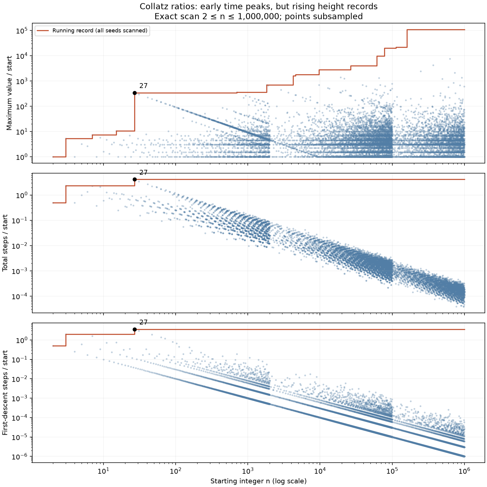
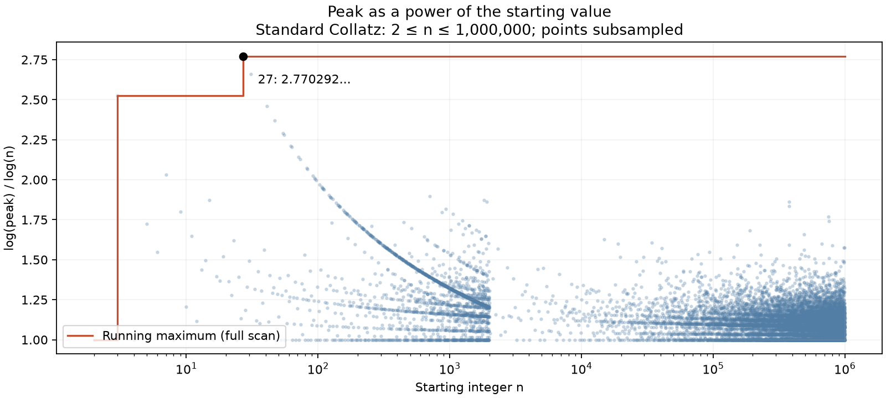

# The early peak at 27 and a distinct-path repayment bound

Status: exact finite metric census; elementary proofs of unbounded peak amplification and a sharper correction budget. No universal stopping-time bound or Collatz proof. No novelty claim for the elementary inequalities.

## 1. Fix the counting convention

For this metric comparison use the standard map: odd n goes to 3n+1 and even n goes to n/2. Count transitions, not listed terms, and stop upon first reaching 1. Let tau(n) be total steps, sigma(n) first steps to a value strictly below n, and P(n) the maximum value before reaching 1, including the starting value. The census covers every integer 2<=n<=1,000,000.

For proof statements not assuming convergence, use the supremum of the entire forward orbit for peak height, possibly infinite. A finite observed prefix already supplies a lower bound on that supremum.

| Metric | Value at 27 | Maximum in the tested range |
|---|---:|---:|
| Total steps / n | 111/27 = 4.111111... | 27 |
| First-descent steps / n | 96/27 = 3.555555... | 27 |
| Peak / n | 9232/27 = 341.925926... | 159487: 17202377752/159487 = 107860.689285... |

The first seed exceeding 27's peak/start ratio is 703, whose peak is 250504 and ratio is 356.335704.... Thus the user's memory agrees with both normalized time metrics over this range, but not with a universal peak-height claim.

The normalized time records over the range occur only at 2,3,27. This is finite evidence, not a theorem about every integer. A universal bound tau(n)<=111n/27 or sigma(n)<=32n/9, with infinite times allowed in the definition, would itself imply Collatz. It cannot be assumed to prove the conjecture.

Dividing by n strongly favors early time peaks if durations grow much more slowly than n. Shared tails also explain many local patterns: after two trajectories merge, their remaining total steps coincide, while their initial denominators differ. Neither observation establishes a global upper bound.

The plot shows subsampled points and the exact running records from the full scan. Ratios and record comparisons were computed from integers; floating point is used only for display. The census computes each seed until its first descent and joins a previously verified smaller seed, thereby establishing convergence within the finite range without an unproved termination assumption.

## 2. Peak divided by n is provably unbounded

**Proposition.** For n_r=2^r-1, r>=2, the standard Collatz orbit contains 2*3^r-2. Hence

    orbit_supremum(n_r)/n_r >= (2*3^r-2)/(2^r-1) -> infinity.

**Proof.** The first r-1 odd-only transitions have halving exponent 1 and give

    U^j(n_r)=3^j*2^{r-j}-1, 0<=j<=r-1.

For j<r-1 these values are 3 mod 4, so the asserted exponent is exact. At j=r-1 the odd value is 2*3^{r-1}-1. Its next standard odd step produces 2*3^r-2. QED.

This proof uses a finite initial segment and does not assume eventual convergence. Large peak amplification and small normalized duration can coexist; they measure different things.

## 3. Why length divided by n matters for repayment

Return to the odd-only map U. Write n_0=n and n_(j+1)=(3n_j+1)/2^{s_j}; let S_m=sum_{j<m}s_j. The exact identity is

    log(n_m/n)= -H_m+E_m,
    H_m=S_m log 2-m log 3,
    E_m=sum_{j<m} log(1+1/(3n_j)).                     (1)

Before descent all input values n_j>=n. The elementary budget E_m<m/(3n) explains why a normalized time matters: it bounds the cumulative additive correction. But using only the lower bound n_j>=n treats every visit as if it were at the minimum. Distinctness gives a stronger bound.

## 4. A packing bound for distinct paths

Assume n_0,...,n_(m-1) are distinct positive odd integers and each is at least n_0=n. The endpoint n_m may or may not descend. Every n_j for j>=1 is prime to 3: reducing 2^{s_(j-1)} n_j=3n_(j-1)+1 modulo 3 proves this.

Define b_0=n, and let b_1<b_2<... list the odd integers greater than n not divisible by 3. Define

    Q_m(n)=product_{j=0}^{m-1} (1+1/(3b_j)).

**Theorem.** Under the preceding hypotheses,

    E_m <= log Q_m(n).                               (2)

In particular, if

    2^{S_m} product_{j<m} b_j > product_{j<m}(3b_j+1), (3)

then n_m<n. This is an exact integer sufficient certificate.

**Proof.** Sort n_1,...,n_(m-1) increasingly. Its j-th member is at least b_j, since these values are distinct, odd, prime to 3, and greater than n. The function x->log(1+1/(3x)) is decreasing, so summing gives (2). Combining (1) with H_m>log Q_m(n) gives descent. Clearing denominators yields (3). QED.

There is no assumption about stochastic mixing, random parity, or typical orbits.

**Logarithmic bound.** For j>=1 the allowed points satisfy b_j>=n+3j-2, as is checked in each of the three odd residue classes modulo 6. Therefore, for m>=2,

    log Q_m(n)
       < 1/(3n) + 1/[3(n+1)]
         + (1/9) log(1+3(m-2)/(n+1)).                 (4)

To prove this, use log(1+x)<x, isolate b_0, and dominate the remaining reciprocal sum by its first term plus the integral of 1/(n+1+3t). For m=1 simply use log Q_1(n)<1/(3n).

Thus for fixed n the correction budget grows at most logarithmically in m. The coefficient 1/9 reflects the spacing of odd integers prime to 3 and the factor 1/(3n_j) in the correction. The sharper exact product Q_m, rather than the looser integral bound, is preferable for certificates.

## 5. Calibration on 27 and on 63

For n=27 the first descent occurs after 37 odd steps and 59 halvings, at endpoint 23. Numerically,

    H_37 = 0.2470289723,
    E_37 = 0.0866863222,
    log Q_37(27) = 0.1904070824,
    old upper budget 37/(3*27) = 0.4567901235.

The old linear budget is too loose to certify descent here. The distinct-path product does certify it: H_37>log Q_37(27). This is a bound computed from n,m,S and distinctness, without needing the actual intermediate sizes in the bound.

The verifier audits 17,247 prefixes from the 4,999 odd seeds 3<=n<=9999. The product certificate succeeds at the actual first descent for 4,998 of them. The exception is n=63: it descends to 61 after 34 odd steps and 54 halvings, but the sufficient product bound is too loose to certify that endpoint. This is not a Collatz exception and shows that (3) is not a necessary condition.

## 6. What this does and does not force

Before the first repeated value or first descent the distinct-path theorem applies. If an infinite positive orbit has no repeated values, take its least value as the starting point; every subsequent input is distinct and at least that minimum. A hypothetical divergent orbit must then satisfy, at every prefix,

    S_m log 2-m log 3 <= log Q_m(n)
                         <= (1/9)log m+O_n(1).       (5)

Thus exceeding a logarithmic budget is enough to rule out such an orbit. This replaces the earlier linear sufficient budget for this distinct-path setting.

The missing theorem is still a forcing statement: show that every such integer orbit has a prefix exceeding the budget. Equation (5) by itself does not contradict an orbit that keeps its surplus negative or small. Nor may distinctness be assumed across repeated circuits of a nontrivial cycle; those need separate exclusion. On one primitive cycle, its distinct inputs do allow the same packing estimate, with equality H_m=E_m rather than a contradiction.

The ratio observation is useful because it points to the accumulated reciprocal-size correction, not because an early numerical record proves a global maximum. Future concentration estimates should exploit the allowed distinct values and their actual residue restrictions, while retaining the exact halving surplus.

## 7. Reproduction and literature boundary

* `python empirical_01g/normalized_collatz_metrics.py`: one-million-seed census, JSON records, and optional matplotlib plot.
* `python empirical_01g/distinct_path_repayment_verify.py`: exact rational product identities, upper bounds, sufficient certificates, and finite checks of the Mersenne family.

Reciprocal/harmonic-mean control of the affine correction is already present in the literature; see Rozier and Terracol, Theorem 4.1, https://arxiv.org/html/2502.00948v2 . The present note supplies a self-contained distinct-value packing specialization and implementation, without a priority claim. None of the computed ratios or bounds closes the universal quantifier in Collatz.

## 8. Follow-up: the peak exponent log_n(P(n))

The user's revised metric is e(n)=log(P(n))/log(n), defined for n>1. It measures the exponent in P(n)=n^{e(n)}, rather than the multiplicative overshoot P(n)/n.

A separate complete scan through 1,000,000 confirms that 27 maximizes this metric in the tested range, with e(27)=2.7702921473225270971.... The running record seeds are 2,3,27; the runner-up is 31 with exponent 2.6588424606890158234.... Peak heights are computed exactly, the scan ranks logarithms in double precision, and the top ten are recomputed with 60-digit Decimal logarithms.

| n | P(n) | Peak exponent |
|---:|---:|---:|
| 3 | 16 | 2.523719 |
| 27 | 9232 | 2.770292 |
| 31 | 9232 | 2.658842 |
| 703 | 250504 | 1.896347 |
| 159487 | 17202377752 | 1.967351 |

This matches the remembered early peaking much better. The proven unboundedness of P(n)/n does not contradict a bounded exponent: polynomial growth with an exponent greater than one already permits an unbounded ratio. The explicit Mersenne-family lower bound in Section 2 has logarithmic exponent tending to log_2(3), about 1.585; it does not show that the exponent is unbounded.

A universal bound on the supremum of each entire orbit by n^{2.770292...}, or by any finite function of n, would exclude divergent orbits. It would not by itself exclude additional bounded cycles. Neither the sharp universal exponent bound nor universal boundedness is proved here.

Reproduce with `python empirical_01g/log_peak_exponent.py`; JSON and an optional matplotlib chart are saved beside the script.

