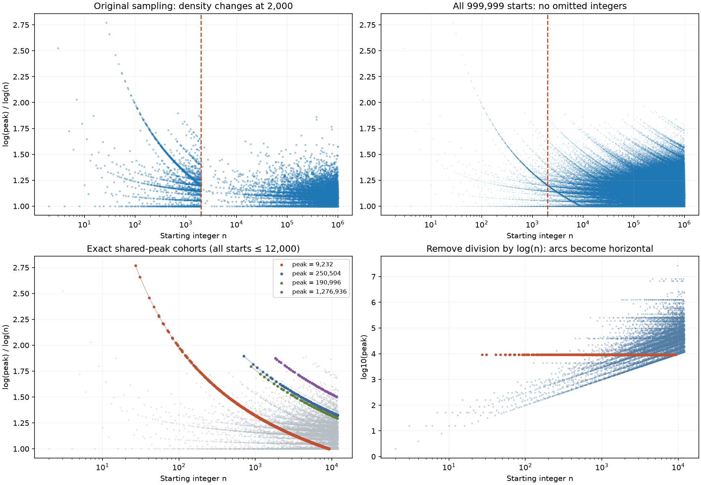

# Shared peaks, curved level sets, and a sampling artifact

Status: exact finite computation and elementary identities explain the plot. No global peak bound or Collatz proof is inferred.

## The main arc is one peak shared by many starts

Let P(n) denote the maximum of the standard Collatz orbit through its first visit to 1. The plotted ordinate is e(n)=log(P(n))/log(n), for n>1.

For a fixed peak H, all starts with P(n)=H lie exactly on

    e_H(n)=log(H)/log(n).

The conspicuous curve starting at n=27 is the level set H=9232. Exact computation gives 1,579 starts in this set, of which 408 are odd. Its least member is 27, greatest member is 9232, and greatest odd member is 3077. This census is complete for this particular peak, not merely complete through one million: P(n)>=n implies that no n>9232 can belong to it.

Every member of this level set visits 9232, and from that point all trajectories are identical. They need not visit 27. For example, 31 lies later on the orbit from 27; it shares the large peak without returning to 27. Nine of the ten largest peak exponents in the one-million-seed census belong to the 9232 level set; the exception is n=3.

Consequently these are strongly dependent observations, not nine independent instances of an exceptional growth mechanism. The smallest member of any fixed-peak set has the largest exponent in that set. This explains why 27 is its leading point. The calculation does not establish an exceptional role for the factorization 27=3^3.

## Why the curve is convex and long

On the plot's logarithmic horizontal coordinate t=log(n), the curve is e_H(t)=log(H)/t. Therefore

    e_H'(t)=-log(H)/t^2,
    e_H''(t)=2 log(H)/t^3>0.

Its upward convexity comes from the chosen normalization. All fixed-peak curves have this same form. Their relative decay rate e_H'/e_H=-1/t is independent of H, so the 9232 curve does not possess a distinct decay law. It is prominent because it begins at a very small seed, reaches a high exponent there, and contains many starts.

Plotting log(P(n)) without division by log(n) turns these arcs into horizontal bands. The diagnostic figure demonstrates this directly.

There is also an exact dyadic source of the many points. Write n=2^v u with u odd. Initial halvings give

    P(2^v u)=max(2^v u,P(u)),
    e(2^v u)=max(1, log(P(u))/(log(u)+v log 2)).

Thus each odd member of a peak group generates a chain of points on the same arc until its doubled starting value exceeds that peak. Odd inverse branches generate additional members. The horizontal floor e=1 is real: the peak includes the start.

For odd n>1, the first move gives P(n)>=3n+1. In a fixed group P(n)=H this forces n< H/3. For H=9232 the last possible odd start is 3077, and it is present. Even members continue the arc as far as H. These are genuine arithmetic boundaries, unlike the sampling cutoff.

## The apparent filter at 2000 was artificial

The original chart used this explicit plotting rule:

    retain n if n<=2000 or n%101==0.

The numeric maximum was computed over every seed, but the displayed points were subsampled. In 1000..2000 all 1001 starts were shown; in 2001..10000 only 80 of 8000 starts were shown. This abrupt roughly hundredfold reduction produced the false impression of a barrier or terminating family near 2000.

The old plot contained 11,880 points; the unsampled replacement contains all 999,999 starts from 2 through 1,000,000. The density discontinuity vanishes, while the fixed-peak arcs persist. Fixed-stride sampling can also select residue classes nonuniformly, another reason not to interpret the old point density as an arithmetic distribution.

Even with no sampling, point density increases to the right on a logarithmic horizontal axis: equal-width multiplicative intervals contain progressively more integers. Overplotting creates a dense lower region. It is not evidence of a dynamical wall. The previous red horizontal line at 2.770292 was a running record, not a proved exclusion boundary.

## What is worth investigating mathematically

For a verified peak H, define its capped predecessor set as the integers whose forward paths reach H without first exceeding H. If the orbit from H subsequently stays below H and reaches 1, this set is exactly {n:P(n)=H}. It is a finite, arithmetically constrained predecessor structure inside [1,H].

Useful quantities are its least seed, number of odd roots, dyadic chains, and occupancy across residue classes. They explain the arcs and correlated extremes. The picture alone provides no uniform control on the peaks of other trajectories. A universal relation between peak H and its least seed would be the substantive new theorem required for the peak-bound approach.

The other common peaks in the one-million-seed scan include 1276936 (3483 seeds), 6810136 (2290), and 250504 (1759). Unlike the H=9232 group, the first two counts are truncated by the scan limit and should not be called complete global counts.

Reproduce with `empirical_01g/peak_arc_diagnostic.py` using numpy and matplotlib. The adjacent JSON stores group counts and sampling diagnostics. All peak computations use integers; logarithms are used only for chart coordinates.
