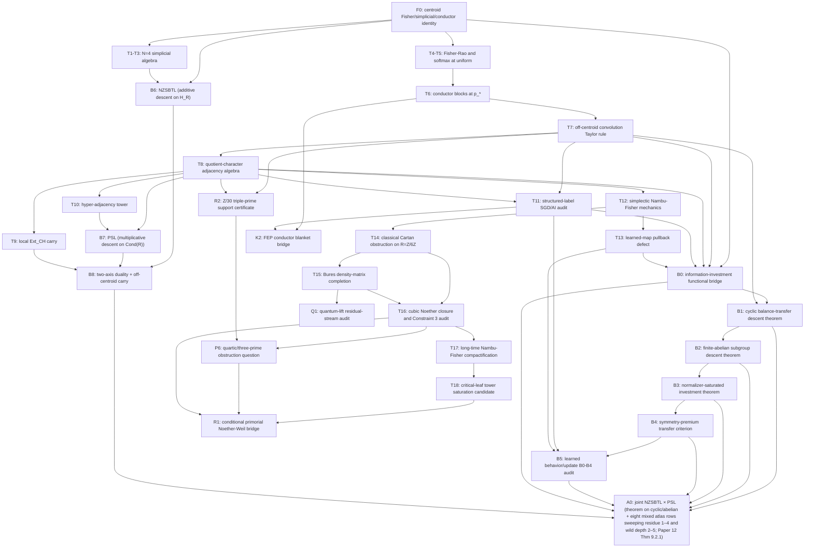

# Research Claim Graph

Created: 2026-05-14
Last updated: 2026-05-15

This is the controlling skeptical graph for the project, not a discovery log.
It records the strongest version of the current program that survives the
review notes and the newer cubic/Bures/primorial correction layer:

> Smooth categorical behavior can carry a finite arithmetic Fisher skeleton.

The engine is exact finite arithmetic and information geometry. AI, FEP,
physics, and RH-adjacent claims are downstream bridges that need their own
controls.  When another artifact conflicts with this file, treat this file as
the source of truth until the conflict is explicitly resolved here.

## Dependency Sketch

## Ladder

| ID | Rank | Claim, cautiously stated | Evidence | Parent nodes | Main source anchors | Disconfirmation question |
|---|---|---|---|---|---|---|
| A0 | Theorem on the cyclic/abelian rows and the eight-row verified mixed atlas | Within a fixed finite categorical behavior class \(\mu\) on \(R=\prod_p R_{(p)}\) and a fixed resource proxy, the joint two-axis information-investment functional \(\mathcal J_\infty\) of Paper 12 §9.2 has a unique minimizer \((\mathfrak L^*,\mathfrak M^*)\) — up to within-packet orthogonal freedom — with NZSBTL depth \(=\sum_{p,\mathfrak d}k_{\mathfrak d}^*\) and PSL depth \(=\sum_p d_{\mathrm{PSL}}^*(p)\), conditional on the per-row hypothesis \((\dagger_p)\) of Paper 12 §9.2.  Verified: cyclic and finite-abelian rows by B1/B2 (carry-zero at the generated-subgroup PSL); eight mixed local atlas rows sweeping residue degree \(\deg(\kappa)\in\{1,2,3,4\}\) and wild depth \(d_{\max}\in\{2,3,4,5\}\) (residue-1 axis only), by direct finite computation in `empirical/verify_per_row_carry_vs_depth.py` — F_2[u]/(u^2): λ_PSL_crit = 2.125; F_2[u]/(u^3): 2.0078; F_2[u]/(u^4): 2.00049; F_2[u]/(u^5): 2.0000305; F_4[u]/(u^2): 55.41; F_4[u]/(u^3): 36.59; F_8[u]/(u^2): 924.04; F_16[u]/(u^2): 10950.  CRT (Paper 11 §4) eliminates any cross-prime mixing.  Joint A0 therefore holds unconditionally on the verified atlas at every λ_PSL strictly below the binding break-even, λ_PSL < 2.0000305 (the F_2[u]/(u^5) row).  Two structural facts from the sweep: λ_PSL_crit is strictly monotone *increasing* in residue degree at fixed wild depth (so larger residue fields afford strictly greater tolerance, not less) and strictly monotone *decreasing* in wild depth at fixed residue field (the binding F_2[u]/(u^n) sequence asymptotes to 2 from above on the verified slice). | Theorem on cyclic/abelian rows and the eight verified mixed rows; proof in Paper 12 §9.2; (†_p) verified at the listed break-evens | B0, B1, B2, B6, B7, B8 | Paper 12 Theorem 9.2.1; `empirical/verify_per_row_carry_vs_depth.py`; `empirical/reports/per_row_carry_vs_depth.md`; Paper 10 §12; Paper 11 §9.6 | Does \(\inf_n \lambda_{\mathrm{PSL}}^{\mathrm{crit}}(\mathbb F_2[u]/(u^n)) = 2\) hold exactly in the n→∞ limit (a 4-point empirical match to 2 + 2^{5-4n} at truncation n_max = 4)?  Does the trust frontier remain set by residue-1 wild-stress rows once the carry-series truncation past n_max = 4 is converged (n_max = 16 raises the shallow-depth-large-residue values by 30–110% but does not invert the monotonicities or move the binding sequence)? |
| B0 | Bridge theorem candidate with FC3 split scalarization | An information-investment functional \(J(\mathcal D)\) can turn the F0 finite Fisher skeleton into an optimization criterion by combining Fisher linearization error, forbidden reciprocal energy, closure leakage, descent-balance cost, normalizer premium, PSL boundary carry, local filtered carry, pullback defect, and resource cost.  FC3-C adds admissible task-dependent weights while keeping full/support/H4/H3/remaining carry fields distinct. | Gap/program with proof targets, finite prototypes, and bounded FC3-A/B/C theorem notes | F0, T7, T8, T11, T13 | `knowledge_base/a0_f0_bridge_strategy.md`; `knowledge_base/fc3_weighted_mixed_row_theorem.md`; `empirical/reports/information_investment_functional.md`; `empirical/reports/information_investment_frontier.md` | Does \(J\) select conductor/quotient-character discretizations from data under fair baselines, or does support-only pricing appear to explain tasks where full filtered residual survives? |
| B1 | Theorem family | For cyclic \(C_N\), the B0 balance-transfer closure of reciprocal support \(S\) is the nonzero subgroup generated by \(S\), equivalently all modes whose conductors divide \(\operatorname{lcm}(\operatorname{cond}(S))\); it is the unique minimum-resource zero-structural-cost support. | Proof plus exact certificate | B0, T7 | `knowledge_base/b0_cyclic_descent_theorem.md`; `empirical/reports/cyclic_b0_descent_theorem.md` | Does the same lcm/subgroup closure principle survive finite abelian products, noncyclic CRT rows, and local nilpotent conductor ladders? |
| B2 | Theorem family | For any finite abelian character group \(G\), the B0 balance-transfer closure of reciprocal support \(S\) is \(D_G(S)=\langle S\rangle\setminus\{0\}\); conductor/order saturation is optional symmetry completion and can overbuy. | Proof plus exact certificate | B0, B1 | `knowledge_base/b0_abelian_descent_theorem.md`; `empirical/reports/abelian_b0_descent_theorem.md` | Which tasks require normalizer/conductor saturation beyond generated-subgroup investment, and can B0 learn that choice from resource-performance data? |
| B3 | Theorem family | Given a normalizer action \(\Gamma\), the symmetry-complete B0 support is \(D_G^\Gamma(S)=\langle\Gamma S\rangle\setminus\{0\}\); the gap from \(D_G(S)\) is the measurable symmetry premium. | Proof plus exact certificate | B0, B2 | `knowledge_base/b0_normalizer_investment.md`; `empirical/reports/normalizer_b0_investment.md` | When does paying the symmetry premium improve transfer, robustness, or equivariance enough to beat minimal subgroup descent under the same resource budget? |
| B4 | Policy theorem/protocol | Under a normalizer-transfer deployment distribution, B3 is preferable to B2 exactly when expected structural transfer gain exceeds the resource-weighted symmetry premium. | Exact finite audit | B3 | `knowledge_base/b0_symmetry_transfer_audit.md`; `empirical/reports/normalizer_transfer_audit.md` | Does the same premium/gain rule predict improvements in learned behavior tables and update-side optimizer projections? |
| B5 | Empirical protocol | Learned behavior tables and update-side optimizer reports can be audited by inferring behavior/update supports, computing B2 subgroup descent and B3 normalizer saturation, and scoring J-style projection, closure, balance, resource, and transfer-premium terms while keeping exact-support evidence separate.  Direct learned transfer can validate or reject B3 at a chosen resource weight. | Learned behavior/update audit; direct learned transfer pressure test; not a theorem | B4, T11, T13 | `empirical/learned_behavior_b0_b4_audit.py`; `empirical/reports/learned_behavior_b0_b4_audit.md`; `empirical/learned_normalizer_transfer_experiment.py`; `empirical/reports/learned_normalizer_transfer_f4_u2.md` | Do raw learned logits/checkpoints and direct normalizer-transfer deployments reproduce the support/premium predictions, or are current results artifacts of thresholds and declared filters? |
| B6 | Definition + Theorem | The Nested Zero-Sum Balance-Transfer Ladder (NZSBTL) of \(H_R\) is a maximal Fisher-orthogonal flag of zero-sum subhyperplanes terminating at a line; the balance-currency budget at the centroid is \(N-1\) Fisher-variance units, additive over descent steps.  Conductor-respecting NZSBTLs (each line inside a single conductor packet) are parameterized by a cross-packet ordering and a within-packet Fisher-orthogonal flag. | Proof | F0, T1, T6 | Paper 10 Definitions 12.1, 12.3; Propositions 12.2, 12.4 | Does NZSBTL extend to the non-abelian or non-quotient-ring settings (e.g. tasks whose finite output structure is a coset space), or does conductor-respecting flag-existence require the abelian conductor lattice? |
| B7 | Definition + Theorem | The Prime Spectral Ladder (PSL) of a finite quotient ring \(R=\prod_p R_{(p)}\) is the totally ordered shuffle of within-prime conductor-depth chains; total length \(d(R)=\sum_p d_p\).  Each PSL step lifts arity-by-arity to a canonical inclusion of hyper-adjacency suboperads, and across primes to the CRT support-pattern injections of Paper 11 Theorem 4.1. | Proof | T7, T8, T10 | Paper 11 Definition 9.6.1, Proposition 9.6.2 | Is the PSL the *minimal* totally ordered refinement of the conductor lattice that controls the off-centroid carry, or do non-prime-spectral refinements (e.g. character-sumset filtrations) supply additional structure? |
| B8 | Theorem | (Centroid Pontryagin duality.) At \(p_*\), conductor-respecting NZSBTLs of \(H_R\) biject with (maximal PSL flag, within-packet Fisher-orthogonal flag) pairs, with independent cross-prime and within-prime balance currencies summing to the total Fisher trace.  (Off-centroid carry obstruction.) Along an \(m\)-flat ray \(p_*+th\), the failure of consecutive NZSBTL levels to remain Fisher-orthogonal at order \(n\) is concentrated at PSL boundaries and is an operadic composite \(\sum_{\eta\ne 0}\widehat{h^n}(\eta)A_\eta^{\mathfrak d',\mathfrak d}\) of binary-floor quotient-shift operators. | Proof | B6, B7, T7, T9 | Paper 10 Theorem 12.7; Paper 11 Theorem 9.6; Corollary 9.6.3 (conductor-pure rays carry no obstruction at \(n=1\)) | Does the carry-sum converge in operator norm for all conductor-respecting NZSBTLs of every local atlas row, or are there mixed-depth rows where the formal series is not summable inside \(\mathcal A_R\)? |
| F0 | Fundamental theorem candidate | At maximum entropy, the zero-sum simplicial gauge slice, the categorical Fisher tangent space, and the additive-character conductor resolution are the same organizing object; off-centroid behavior is controlled by quotient-character Taylor couplings. | Proof | - | `paper2_draft.md`; `10.information_geometric_bridge.md`; `11.quotient_character_adjacency_algebras.md` | Is this still a useful organizer for learned nonuniform states, or only the centroid? |
| T1 | Theorem | For `N=4`, simplicial inner product, cross product `K`, and Rodrigues rotations descend through the gauge direction. | Proof | F0 | `01.simplicial_vector_algebra.md` | Can the same descent support differential operators, not just algebraic rotations? |
| T2 | Theorem | `K(u)` on `H_4` is conjugate to the Cartesian cross product and satisfies `K(u)^3 = -||u||^2 K(u)`. | Proof | T1 | `01.simplicial_vector_algebra.md` | Are normalization and orientation assumptions stated everywhere they matter? |
| T3 | Theorem | Simplicial Rodrigues rotations are orthogonal, gauge-fixing, and have a 9-multiplication zero-sum apply kernel. | Proof | T2 | `01.simplicial_vector_algebra.md`; `empirical/reports/theorem_7_1_nine_multiplication.md` | Is "9" a minimal lower bound or only an explicit structural parity algorithm? |
| T4 | Theorem | Fisher-Rao is the square-root sphere pullback; at the uniform distribution it equals the simplicial metric up to scale. | Proof | T1 | `paper2_draft.md` | Does any draft overextend this from tangent-at-uniform to global Fisher isometries? |
| T5 | Theorem | At softmax initialization, the categorical Fisher matrix is scaled simplicial Gram, and the natural gradient is mean-subtract-and-scale. | Proof | T4 | `paper2_draft.md` | How far from uniform does this remain a good approximation? |
| T6 | Theorem | At `p_*`, additive-character conductor packets are Fisher tangent spectral blocks and sufficient-statistic layers. | Proof | T4 | `10.information_geometric_bridge.md` | Which nonuniform distributions preserve exact conductor orthogonality? |
| T7 | Theorem | Along flat rays from `p_*`, off-centroid Fisher coupling has all-order support governed by character convolution. | Proof | T6 | `10.information_geometric_bridge.md` | Do boundary or convergence issues make the expansion unusable in high-confidence regimes? |
| T8 | Theorem | The correct off-centroid block compression is operator-valued and lives in a quotient-character adjacency algebra; CRT factorization appears after adjoining the trivial character. | Proof | T7 | `11.quotient_character_adjacency_algebras.md` | Can scalar conductor traces ever recover the operator data, or are they provably lossy? |
| T9 | Theorem-facing finite row | In `F4[u]/(u^2)`, the first mixed tame/wild row has a canonical binary `Ext_CH` carry representative and arity-4 mixed support lift. | Both | T8 | `11.quotient_character_adjacency_algebras.md`; `empirical/reports/f4_u2_ext_ch.md`; `empirical/reports/ext_ch_cocycle_f4_u2.md` | Could a full rational coboundary trivialize the measured carry? Current computation says no for checked rows. |
| T10 | Theorem with caveat | Hyper-adjacency cells form an operadic support tower; higher Fisher/alpha jets are generated from the binary floor.  Standalone hypercell cohomology remains optional/open; FC2 now uses the filtered adjacency extension class as the cohomology source. | Proof plus Gap | T8, T9 | `11.quotient_character_adjacency_algebras.md`; `knowledge_base/fc2_curvature_carry_solution.md` | Does an augmented hypercell complex add new coefficient-level information beyond the filtered extension class and its Fisher-jet shadows? |
| T11 | Theorem/protocol | Under structured labels and sufficient equivariance, SGD forcing, parameter Fisher, NTK/noise audits, and GFWSVD decompose by conductor packets near the centroid. | Proof, empirical protocols partial | T7, T8 | `12.discrete_fisher_skeletons_for_ai_optimization.md` | Do checkpoints from real training actually show conductor emergence, or only final-behavior structure? |
| T12 | Theorem | Nambu-Fisher/simplectic mechanics gives volume-preserving flows on the categorical simplex, and finite-jet conductor closure is a finite calculation in the adjacency algebra. | Proof | T8 | `13.simplectic_mechanics_on_the_categorical_simplex.md` | Are the macro-Hamiltonians natural objects or chosen to make closure true? |
| T13 | Theorem/protocol | Learned-map pullbacks have an explicit bracket defect made from Ext-sensitive and Hessian/Jacobian terms; conductor-closed optimization corresponds to vanishing pulled-back carry. | Proof, empirical gap | T12 | `13.simplectic_mechanics_on_the_categorical_simplex.md`; `empirical/activation_pullback_audit.py` | Can `F`, its Jacobian, and Hessian terms be estimated robustly in real models? |
| T14 | Theorem | For the minimal mixed row `R = Z/6Z = Z/2Z x Z/3Z`, the maximal continuous Fisher-volume-preserving, real-cone-preserving, CRT-compatible symmetry algebra on the classical probability simplex is the Cartan sector `u(1)^2`; the nonabelian `su(2)+su(3)` directions require leaving the real simplex. | Proof, with separate behavior-manifold evidence | T12, B8 | `14.information_geometric_mechanics_on_the_categorical_simplex.md`; `24.cubic_information_geometric_mechanics_on_the_categorical_simplex.md` | Does the proof rely on a too-strong conductor-preservation/locality hypothesis, and does any non-Cartan real positive-cone action survive after weakening the hypotheses? |
| T15 | Theorem | The Bures-Helstrom density-matrix lift on `D(C^2 tensor C^3)` restricts to Fisher geometry on diagonal states and admits the local unitary algebra `su(2)+su(3)` off diagonal; Nambu-Bures conservative dynamics reduces to von Neumann flow upstairs. | Proof; exploratory residual audit separate | T14 | `15.information_geometric_mechanics_on_the_density_matrix_manifold.md`; `18.bures_completion_of_cubic_information_geometric_mechanics.md`; `24.cubic_information_geometric_mechanics_on_the_categorical_simplex.md` | Is the Bures lift the unique or minimal completion compatible with CRT locality and Fisher diagonal recovery, or only a natural completion? |
| T16 | Theorem plus finite audit | Cubic information-geometric mechanics is governed by the raised Amari-Chentsov force `K_CH(v,v)` and a cubic Noether correspondence; admissible classical cubic charges are exhausted by Cartan generators, and jerk/fourth cumulant marks projected defect rather than a new classical conserved momentum.  The Constraint 3 trajectory audit finds no cubic-force leakage above numerical floor when squarefree `R=6` support is embedded in `R=12` and `R=18`. | Proof plus seeded trajectory audit | T14, T15 | `17.the_cubic_noether_theorem.md`; `24.cubic_information_geometric_mechanics_on_the_categorical_simplex.md`; `empirical/reports/constraint3_cubic_noether_verification.md` | Can the trajectory audit be promoted from numerical companion to structural closure lemma, and do other squarefree embeddings preserve the same cubic floor? |
| T17 | Draft theorem | Under the square-root Fisher compactification, boundary-tangent Nambu-Fisher flows are complete and regular-leaf orbits are periodic interior, periodic boundary-stratum, or heteroclinic; long-time conductor leakage is bounded by finite-jet closure defects with jerk as the leading projected leakage controller. | Draft proof / theorem sketch | T12, T16 | `19.long_time_dynamics_ergodic_classification.md`; `13.simplectic_mechanics_on_the_categorical_simplex.md` | Are the boundary-stratum construction, leakage integrand, and sharpness claim fully proved on stress rows rather than asserted from compactness and the finite-jet ledger? |
| T18 | Theorem candidate / tower problem | Critical-leaf audits identify support/K_CH-closed leaves, but exact full-block coboundary reductions still have residual deficit `1.0` on tested local leaves; the live theorem target is asymptotic quotient-level Ext/hyper-adjacency saturation, not finite support closure. | Exact finite audit plus gap | T10, K1, T17 | `knowledge_base/critical_leaf_closure_theorem_candidate.md`; `empirical/reports/cross_mode_critical_leaf_summary.md`; `empirical/reports/tower_quotient_saturation.md`; `empirical/reports/streaming_modular_residual.md` | Does the normalized full filtered residual vanish in a tower limit, or does a nonzero inverse-limit hyper-adjacency class survive on the supposed critical leaf? |
| Q1 | Empirical protocol | Residual-stream quantum-lift audits on a synthetic `Z/6Z` modular-addition probe show lower post-measurement survival for nonabelian CRT-local perturbations than for Cartan perturbations in layers 28-30 of Llama-3.1-8B-Instruct and Mistral-7B-v0.3; this supports a pre-softmax/off-diagonal geometry analogy, not an actual proved gauge action inside the model. | Exploratory empirical | T15, T11 | `empirical/reports/quantum_lift_audit_llama31_8b_instruct.md`; `empirical/reports/quantum_lift_audit_mistral_7b_v0_3.md` | Does the Cartan/nonabelian survival split remain after higher task accuracy, shuffled residual controls, random-label controls, and model/layer replication? |
| R1 | Conditional bridge | The primorial Noether-Weil/RH route is conditional on finite-place recovery, a structural Constraint 3 lemma, and the Archimedean Noether Limit; finite data currently support architecture and reject the retired FFT proxy, but do not prove RH. | Conditional conjecture/theorem program | T16, T18, P6, R2 | `22.primorial_cumulant_noether_rh.md`; `Paper23_Primorial_Noether_Weil_Identity (4).md`; `empirical/reports/constraint3_cubic_noether_verification.md` | Can the finite-place recovery gaps and Archimedean Noether Limit be proved without importing the desired Weil positivity conclusion? |
| R2 | Exact support certificate | In `R=Z/30Z`, pairwise products of primitive prime-axis conductor packets do not hit full conductor `30`, while the triple product hits every primitive full-conductor label with ordered multiplicity `6`; this is the first support-level three-prime mixing certificate for the quartic/jerk row, not an RH verification. | Exact integer computation | T7, T8 | `empirical/reports/z30_primorial_symbolic_certificate.md`; `22.primorial_cumulant_noether_rh.md` | Does coefficient-level filtered carry at `R=30` produce a genuinely new obstruction beyond support-level triple-prime mixing? |
| P6 | Problem | Decide whether fourth-cumulant / three-prime rows produce a qualitatively new obstruction beyond the cubic Cartan obstruction, or whether the same Bures-completion pattern persists at the quartic stage. | Gap with exact support control | T16, R2 | `21.quartic_force_law_n4_obstruction.md`; `22.primorial_cumulant_noether_rh.md` | Does a three-prime filtered carry survive after all pairwise CRT faces are quotiented out, and if so does it change the Noether/primorial tower rather than only its bookkeeping? |
| C1 | Corollary | In the uniform tetrahedral row, the raised Amari-Chentsov cubic equals the symmetric product generated by the `K(tau_i)^2` projector data. | Proof | T2, T4 | `01.simplicial_vector_algebra.md`; `paper2_draft.md` | Does any later text use this outside `N=4` or away from `p_*`? |
| C2 | Corollary/control | Prime cyclic rows, especially `C7`, are clean `Ext_CH = 0` controls: one nontrivial conductor packet, pure character convolution, no mixed tame/wild carry. | Both | T7, T9 | `paper2_draft.md`; `12.discrete_fisher_skeletons_for_ai_optimization.md`; weekday reports | After activation, sampling, and bigram controls, does the residual still match the behavior-side cubic? |
| C3 | Corollary | Binary `Ext_CH` should not be visible in standard parameter-Fisher Taylor terms; look for it in filtered adjacency, data forcing, Jacobian variation, or higher operadic levels. | Proof | T10, T11 | `12.discrete_fisher_skeletons_for_ai_optimization.md`; `reviews/*` | Could broken assumptions make an apparent binary `Ext_CH` signal re-enter parameter Fisher? |
| C4 | Corollary/pilot | Update-only conductor projection can enforce near machine-precision leakage in pilot optimizer/training loops. | Empirical | T11 | `empirical/reports/conductor_closed_optimizer_f4_u2.md`; `empirical/reports/conductor_calendar_transformer_months_d64_offset_ood_c6_c12.md` | Does it replicate beyond synthetic tables and small calendar transformers? |
| K1 | Theorem family | Curvature-carry duality: for every finite local conductor-filtered quotient-character row satisfying the section-extension setup, the filtered `Ext_CH` section class is the cohomological source, `K_CH` is its cubic Fisher shadow, and higher curvature/carry supports are Fisher-jet images modulo the jet kernel.  Nonzero full residual is certified on the current finite atlas, and row-level support-kernel classification has begun. | Proof plus exact computation | T9, T10 | `11.quotient_character_adjacency_algebras.md`; `knowledge_base/fc2_family_theorem.md`; `empirical/reports/fc2_family_certificate.md`; `empirical/reports/fc2_row_classification.md` | Does a certified local row produce a visible curvature shadow not in the Fisher-jet image of `[kappa]`, or does the jet kernel erase all claimed visible support? |
| K2 | Conjecture/bridge | Conductor packets can be formalized as arithmetic Markov blankets for FEP-style active inference. | Gap | T6, C4 | `references/FEP_Paper_Full_Draft.md`; `fromgrok/FEP_Paper_Full_Draft.md` | Is "conditional independence" more than Fourier orthogonality or projected-update closure? |
| K3 | Conjecture | The `N=4` edge-frame/Janus/stella-octangula picture is exceptional; higher `N` lacks the same single-axis finite-symmetry structure. | Gap | T2 | `02.edge_frame_companion.md` | Can `N=5` exhibit an equally canonical finite-symmetry edge-frame analogue? |
| P1 | Problem | Classify the full nonuniform Fisher-conductor coupling tensor and exact orthogonality loci. | Gap | T7, T8 | `10.information_geometric_bridge.md` | Are there nontrivial `p != p_*` with exact block orthogonality? |
| P2 | Problem | Empirically decompose learned behavior gaps into intrinsic cubic, activation pullback distortion, Hessian terms, and sampling/spline residual. | Gap with partial empirical evidence | C2, T13 | `10.information_geometric_bridge.md`; activation pullback reports | Does intrinsic cubic explain less than activation-side distortion? |
| P3 | Problem | Classify nonzero local rows, projection kernels, and coefficient-level Fisher-jet shadows now that FC2 uses the filtered adjacency section class rather than standalone hypercell cohomology. | Gap with first classifier | T9, T10, K1 | `11.quotient_character_adjacency_algebras.md`; `knowledge_base/fc2_row_classification_note.md`; `empirical/reports/fc2_row_classification.md`; `Paper11_Team_Todo.md` | Does any certified visible carry support fall outside the Fisher-jet image of `[kappa]`, or do support projections erase filtered classes that FC3 needs to charge? |
| P4 | Problem | Run training-time conductor audits from initialization through convergence. | Gap | T11, C4 | `12.discrete_fisher_skeletons_for_ai_optimization.md` | Do packets appear during learning, or only post hoc in final behavior? |
| P5 | Problem | Convert simplectic theory into finite atlas censuses: long-time leaves, Noether sectors, continuum carry scaling. | Gap | T12, T13 | `13.simplectic_mechanics_on_the_categorical_simplex.md` | Do computed towers stabilize, vanish, or diverge under scaling? |
| O1 | Observation | Edge-axis companion data compresses Janus polarity, bracket sign, rotor ordering, and stella-octangula choice into one orientation bit. | Proof/observation | T2 | `02.edge_frame_companion.md` | Is any "Janus" phenomenon left after fixing orientation? |
| O2 | Observation | Real weekday/month probes support Fisher-Hellinger structure and CRT splitting, but they are not yet training-time SGD evidence. | Empirical | C2, P2 | `empirical/reports/weekdays_K_CH_real_*.md`; `empirical/reports/months_K_CH_real_llama31_8b.md` | Does months replicate cross-family, and do checkpoints show emergence? |
| O3 | Boundary condition | Finite-ring algebra is first a behavior-side audit for structured labels, not a universal theory of neural loss landscapes. | Risk boundary | F0 | `12.discrete_fisher_skeletons_for_ai_optimization.md` | On unstructured labels, does the quotient-character basis predict anything nontrivial? |

## Fundamental Conjecture Program

The next ideal theorem set is recorded in
`knowledge_base/fundamental_conjecture_program.md`.  It promotes the scattered
bridge nodes K1/K2 and P2-P5 into a single private theorem-selection spine:

| ID | Role | Short form | Current graph anchors |
|---|---|---|---|
| FC0 | Master conjecture | Arithmetic Simplectic Mechanics: finite categorical behavior decomposes into conductor-closed Nambu-Fisher current plus \(K^{CH}\) and \(\operatorname{Ext}_{CH}\) residuals under explicit structure hypotheses. | F0, T8, T12, T13, A0 |
| FC1 | Macrovariable naturality | Closed at bounded finite-jet theorem scope: centroid finite-sufficient, normalizer-equivariant quadratic macrovariable jets are conductor packet energies plus packetwise orthogonal refinements; finite-sufficient Hamiltonian differentials are pullbacks through \(\Phi_{R,k}\), and exact decomposable Fisher-volume currents live in the exterior power of that finite module; off-centroid closure fails first by the first noncancelled quotient-character adjacency carry, with the FC2 section class \([\kappa]\) as filtered source and \(K^{CH}\)/higher jets as visible shadows modulo kernel.  The bounded `F4[u]/(u^2)` Noether atlas certificate is delivered with `637` seed coordinates, aggregate and moving carry-pair tuple charts, all `20` carry-pair one-split charts assessed, and tuple residual label `1569/0/72/1470/27`. | T6, T8, T12, K1; `knowledge_base/fc1_closure_certificate.md`; `knowledge_base/fc1_natural_macrovariable_theorem.md`; `knowledge_base/fc1_centroid_classification_theorem.md`; `knowledge_base/fc1_exact_differential_module_theorem.md`; `knowledge_base/fc1_off_centroid_closure_theorem.md`; `empirical/reports/fc1_noether_atlas_certificate_f4_u2.md`; `knowledge_base/fc3_handoff_from_fc1.md` |
| FC2 | Curvature-carry cohomology | Family theorem solved: the filtered adjacency extension class \([\kappa]\), not standalone hypercell cohomology, is the source; \(K^{CH}\) and higher curvature/carry supports are Fisher-jet shadows modulo the jet kernel.  Current work is row classification and visible-kernel extraction. | T8, T9, T10, K1, P3 |
| FC3 | Information-investment | FC3-A/B/C are launched at bounded split-ledger scope: generated-subgroup descent is the cyclic/finite-abelian zero-structural baseline; normalizer saturation is paid exactly when expected transfer gain exceeds resource-weighted symmetry premium; certified local rows must price full filtered carry separately from support projection and Fisher-shadow visibility; task-dependent scalar weights are admissible only when they preserve the full/support/H4/H3/remaining split.  First Noether-atlas ledger: `F4[u]/(u^2)` with `1569/0/72/1470/27`; current FC2 local projection ledger: `full/support/H4/H3/remaining = 180555/0/6648/173404/503`. | B0-B8, A0, FC1, FC2 |
| FC4 | Learned pullback | Low pullback defect should lift conductor packets through activation space and decompose carry into per-layer ledgers. | T11, T13, P2, P4 |
| FC5 | Optimizer | Conductor-closed projection and \(K^{CH}\) step control should give leakage bounds and useful loss behavior near closed leaves. | C4, T11, T13 |
| FC6 | Thermodynamic limit | Partition and arithmetic towers should converge to continuum density geometry with normalized carry-measure trichotomy. | T12, P5 |
| FC7 | Blanket bridge | Conductor packets become arithmetic blankets only after orthogonality/projection is upgraded to explicit conditional-independence or MI statements. | K2, C4 |
| FC8 | Bures completion | The real-simplex Cartan obstruction should have a minimal density-matrix completion: Fisher-on-diagonal, Bures upstairs, local unitary nonabelian symmetry, and projected jerk/leakage as the measurement-channel defect. | T14, T15, T16, Q1 |
| FC9 | Primorial Noether-Weil | The primorial/RH bridge is a conditional downstream program: finite-place recovery, Constraint 3 as structural lemma, critical-leaf tower saturation, and the Archimedean Noether Limit must all be proved before any RH-facing claim is upgraded. | R1, R2, T16, T18, P6 |

Priority order for the core program remains FC2, FC1, FC3, FC4, FC5, FC6, then
FC7; FC2 and bounded FC1 are now closed enough that FC3-A/B/C are the active
core target.  FC8 and FC9 are downstream physics/RH programs: they may use the core
graph, but they should not back-propagate stronger language into the exact
finite arithmetic, AI, or FEP nodes.

## Critical Cut Lines

These are the lines the publication strategy should not cross yet.

1. `K_CH` is not an `Ext_CH` detector by itself. Positive `Ext_CH` claims need filtered adjacency or Hayes-equivariant probes.
2. Prime cyclic rows control `Ext_CH = 0`; they do not mean zero curvature, zero holonomy, or zero Fisher cubic.
3. The C7/C12 transformer measurements are final-behavior probes, not training-time evidence.
4. FEP/Markov-blanket language is a bridge claim until conditional independence and mutual-information statements are formalized with precise random variables.
5. Support-level closure can be misleading. Full filtered closure must remain a separate field in the graph.
6. Simplectic mechanics is theorem-facing as a mathematical construction, but "physically correct finite categorical mechanics" is still a conjectural interpretation.
7. B5 learned audits do not upgrade declared update filters into exact reciprocal supports. In particular, zero leakage relative to a declared calendar filter is not the same as B2 subgroup closure.
8. Support-level B4 transfer on learned artifacts remains an estimate unless paired with a direct learned normalizer-transfer experiment.  The current direct test is only a synthetic `F4[u]/(u^2)` context-logit table.
9. A direct learned B4 test may reject B3 at a given resource weight even when B3 covers the target support. Representation coverage is not the same as paid-off information investment.
10. NZSBTL/PSL duality is *exact* at the centroid (B8 first part).  Off the centroid, the two descents commute only modulo the operator-valued carry of B8 second part, and only at PSL boundaries; within-packet steps remain commutative at every order.  Claims of "additive-multiplicative equivalence" away from the centroid must specify the carry-vs-resource frontier explicitly.
11. The \(N=4\) Cayley-Dickson coincidence is the prime-2/depth-2 row of the joint NZSBTL\(\times\)PSL classification, not a universal feature of simplicial frames.  Imaginary quaternions, the simplicial cross product, and the single-axis 2-form identification are special to \((p,k)=(2,2)\) and the Hodge match \(\dim H_4-1=2\); higher rows of the classification do not produce division algebras in general.
12. The two-axis A0 statement (B8 \(\to\) A0) is now a *theorem* on the cyclic/abelian rows (by B1/B2) and on eight computed mixed local atlas rows sweeping residue degree 1–4 (at wild depth 2) and wild depth 2–5 (at residue degree 1), with the joint point F_4[u]/(u^3) at (residue 2, depth 3): F_2[u]/(u^2), F_2[u]/(u^3), F_2[u]/(u^4), F_2[u]/(u^5), F_4[u]/(u^2), F_4[u]/(u^3), F_8[u]/(u^2), F_16[u]/(u^2).  The hypothesis \((\dagger_p)\) has been directly verified on each mixed row by `empirical/verify_per_row_carry_vs_depth.py` with strictly positive break-even resource weights (2.125, 2.0078, 2.00049, 2.0000305, 55.41, 36.59, 924.04, 10950 respectively).  Joint A0 holds unconditionally on the verified atlas at every λ_PSL strictly below 2.0000305 (the binding F_2[u]/(u^5) row).  Residue degree pushes the break-even strictly *up* at fixed wild depth; wild depth pulls it strictly *down* at fixed residue field; the trust frontier is therefore set by residue-1 wild-stress rows, not by large-residue rows.
13. The Bures/density-matrix completion is a theorem about an information-geometric lift of the finite `R=Z/6Z` skeleton.  It is not a derivation of a complete quantum field theory, chirality, generations, Yukawa couplings, anomaly cancellation, spacetime, gravity, or renormalization-group flow.
14. The quantum-lift residual-stream audits are exploratory model diagnostics.  They can support a pre-softmax/off-diagonal analogy, but they do not prove an actual `SU(2) x SU(3)` gauge action inside Llama or Mistral.
15. The Constraint 3 cubic Noether audit replaces the retired `Z/12Z` versus `Z/18Z` FFT proxy.  Do not cite the retired proxy as evidence.  The live claim is the trajectory-level result: no cubic-force leakage above the `Z/6Z` numerical floor in the tested embeddings.
16. The primorial Noether-Weil/RH program is conditional.  Z/30 support mixing, critical-leaf audits, and the Constraint 3 trajectory audit do not prove RH; they only feed named finite-place and Archimedean proof obligations.
17. The months `C12` aggregate conductor split is close to the per-character-uniform null.  Use the cautious reading: stable all-nontrivial energy with modest high-conductor tilt, not standalone proof of CRT-specific routing.
18. `paper16_draft (1).pdf` is quarantined as an unsafe conceptual draft.  It overstates the physical three-body conclusion and is not a graph-supported public claim unless rewritten as a bounded Bures-lift analogy.
19. FC1 macrovariable naturality concerns relative finite-sufficient macrovariable jets and exact decomposable Nambu-Fisher currents.  It does not classify every smooth Fisher-volume-preserving current, every invariant polynomial inside a packet, or every nonuniform closed-current residual.

## Neighborhood Anchors

| Neighborhood | Internal nodes | External/literature anchors to track | Current status |
|---|---|---|---|
| Simplicial coordinates and gauge | T1-T3, O1 | frame theory, barycentric/quadray coordinates, Hodge star, Rodrigues, Eckmann/Massey cross-product classification, DEC/FEEC | Strong, but novelty must be phrased as coordinate presentation. |
| Information geometry | T4-T7, C1 | Fisher-Rao, Chentsov, Amari dual connections, Aitchison geometry, Hellinger sphere | Strong at uniform and along stated flat rays; nonuniform classification open. |
| Finite arithmetic | T8-T10, K1, P3 | finite Fourier/additive characters, conductor lattice, CRT, Carlitz-Hayes normalizers, local filtered algebras | Engine of the program; exact computation strong, proof extraction still needed for some rows. |
| AI behavior geometry | T11, C2, C4, P2, P4, O2 | Wurgaft-style behavior manifolds, NTK/Fisher, GFWSVD, natural gradient, transformer activation probes | Promising evidence; keep controls visible. |
| FEP and self-organization | K2 | Friston FEP, Markov blankets, active inference, mutual information, informational closure/Rosas | Conceptual bridge; not yet bedrock. |
| Simplectic mechanics | T12, T13, P5 | Nambu mechanics, symplectic/multisymplectic geometry, volume-preserving currents, Noether | Mathematical framework present; bounded FC1 Noether atlas delivered; long-time dynamics and physical interpretation remain open. |
| Cubic/Bures completion | T14-T17, Q1 | Cartan subalgebras, Bures-Helstrom/quantum Fisher geometry, density matrices, von Neumann flow, Noether | The obstruction-completion theorem spine is written; transformer lift audit is exploratory; no QFT claims. |
| Primorial/RH bridge | R1, R2, P6, T18 | Weil explicit formula, primorial towers, cumulants, critical-line positivity, finite-place recovery | Conditional downstream program; finite support and trajectory audits are useful but not RH proof. |

## Contradiction And Vacuum Queue

1. **Conditional independence vacuum:** define the variables for "internal", "external", and "blanket" modes. Determine when Fourier orthogonality implies statistical conditional independence.
2. **Mutual information vacuum:** prove or narrow the claim that closed energy fraction equals normalized mutual information. If only true under Gaussian/orthogonal-energy assumptions, say so.
3. **Ext_CH empirical vacuum:** run real-output or real-gradient `Ext_CH` leakage probes. Existing scripts are not evidence until reports exist.
4. **Training-time vacuum:** checkpoint audit of conductor-energy growth, forcing spectra, and mini-batch noise covariance.
5. **Data provenance risk:** reconcile older notes that say weekday data was missing with newer local safetensor reports. Track local/external/public provenance separately.
6. **Publication phrasing risk:** avoid "paradigm shift", "ironclad", and universal optimizer language. Use scoped theorem/protocol language.
7. **Quantum-lift replication vacuum:** residual-stream Cartan/nonabelian audits need higher-accuracy tasks, random-label controls, shuffled residual controls, and model/layer replication.
8. **Primorial analytic vacuum:** R1 cannot upgrade until the finite-place recovery gaps, the structural Constraint 3 lemma, and the Archimedean Noether Limit are proved.
9. **Artifact hygiene risk:** discovery notes, team todos, duplicate paper drafts, and quarantined PDFs should not be treated as current claims unless their content has been extracted into this graph or `evidence_ledger.md`.
